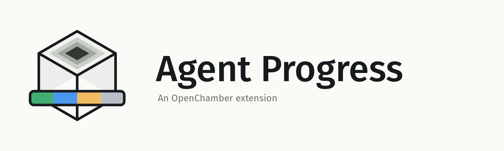
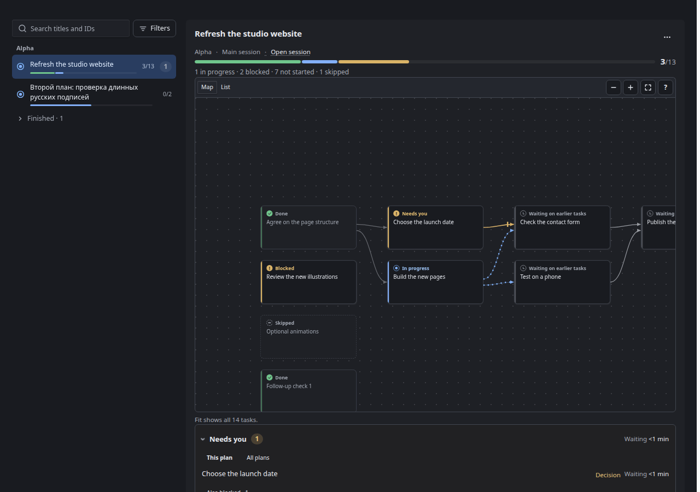
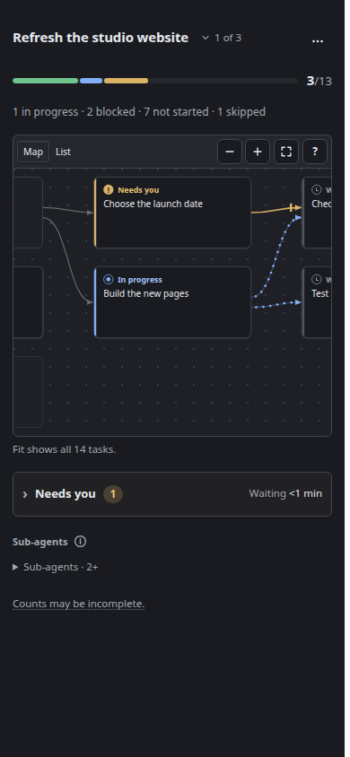
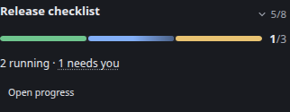
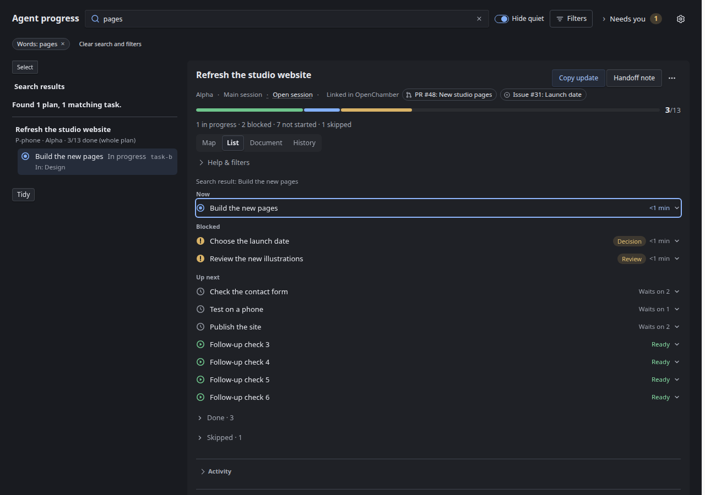

<h1>
  <picture>
    <source media="(prefers-color-scheme: dark)" srcset="docs/images/brand/agent-progress-header-dark.svg">
    
  </picture>
</h1>

**See the plan. Follow the work. Know what was actually reported.**

Agent Progress is an [OpenChamber](https://github.com/openchamber/openchamber) extension that turns your agents' plans into a calm, live progress view. One glance tells you what's done, what's running, what's blocked and what needs you. When you want more, the detail is one click away.

<p align="center">
  
</p>

## Why you'll like it

- **At a glance, then in depth.** A map or task list sits below the plan's progress bar, followed by *Needs you* and *Sub-agents*. Expand a task for its reason, next step, prerequisites and who's on it.
- **See who reported an update.** In a plan's **List**, open **Activity** below the tasks. Page back to earlier updates to see who reported them and which task IDs they named.
- **See how the work connects.** Plans with recorded prerequisites open on an interactive dependency map, with pan, zoom, keyboard navigation and a clear *Ready* / *Unlocks next* view. Blue beads travel along the arrows from a task reported working to the tasks waiting on it, and an arrow from a blocked task ends in a stop bar.
- **Know when it's your turn.** *Needs you* shows decisions and reviews the main session asks you to handle, with **Open session**, **Copy reply** and **Hide**.
- **Watch your sub-agents.** Running sub-agents get one line each, and everything else stays tucked away until you ask.
- **Open the right session's progress.** Choose **Open Agent Progress** in a session's menu, even while another chat is visible. The panel stays on the clicked session. Choose **Show current session** to follow the visible chat again; see the [host reopening limitation](docs/ui.md#native-session-entry-and-optional-host-context).
- **One More menu.** Copy a progress update or handoff note, open the plan document, change language or find Setup and Troubleshooting.
- **Make room for current plans.** The rail and board hide active plans that haven’t reported in seven days by default. Change that in rail **More** or board **Filters**. No reports does not mean the work has stopped or finished.
- **Close a plan you no longer need.** Choose **More → Finish as cancelled** and confirm. History and unfinished tasks stay available; the action does not stop running agents.
- **Honest and private.** Progress comes from what agents deliberately report, never from guesses. Everything stays in a local store on your machine.
- **Built for everyone.** Full keyboard support, tested with the Orca screen reader, and friendly to forced colours and zoom.

## Three places to follow along

<table>
  <tr>
    <th width="50%">Right rail</th>
    <th width="50%">Work Status</th>
  </tr>
  <tr>
    <td align="center"></td>
    <td align="center"></td>
  </tr>
  <tr>
    <td>The current session's plan, right beside your chat.</td>
    <td>A compact summary of the plan that matters most right now.</td>
  </tr>
  <tr>
    <th colspan="2">Fullscreen board</th>
  </tr>
  <tr>
    <td colspan="2" align="center"></td>
  </tr>
  <tr>
    <td colspan="2">Every plan across projects, worktrees and sessions, with search, filters, history and the dependency map.</td>
  </tr>
</table>

## Get started

1. In **OpenChamber → Settings → Extensions**, install from this Git URL:

   ```text
   https://github.com/Phototonic/openchamber-progress.git
   ```

2. Review the **Add a plugin to OpenCode** disclosure and choose **Allow and enable**. The plugin runs with your account's full access inside OpenCode.
3. Open **Agent progress → More → Setup**, review what changes on your computer, then confirm. Setup creates a private progress folder, connects it to OpenCode, turns on recording and checks that it works. No global plugin installation is needed. Agents with `agent_progress_report` receive guidance without special prompts or agent names; reporting still depends on the agent following that guidance.

No build step or dependency install is needed. Prefer a download? Each version is also published as a ZIP on [GitHub Releases](https://github.com/Phototonic/openchamber-progress/releases).

**Verifying a download (Linux):** Download both ZIPs, `entries-<version>.sha256` and `sha256.txt` into an empty folder. In that folder, run `sha256sum -c --ignore-missing sha256.txt`. The inventory also lists files inside the ZIPs; `--ignore-missing` skips those before extraction. To check extracted files, unpack each ZIP into its matching `agent-progress-extension-<version>` or `agent-progress-companion-<version>` folder, then run `sha256sum -c entries-<version>.sha256` from the download folder, replacing `<version>` with the release number.

**Updating:** Git installs use **Settings → Extensions → Check for updates → Update**. The URL above follows the remote default branch (`main` here); append `#main` to select it explicitly, or a published tag such as `#v1.1.1` to stay on that tag. A fixed tag does not follow later releases. `dev` is source only and not installable. Existing `#dev` installations keep their files when an update lacks built entries; replace them with a default-branch or tagged installation. Offers depend on a higher package version, not just a new commit: same-version changes produce no offer. Folder and ZIP installs need manual replacement, not Git update checks. See [update and approval details](docs/setup.md#updates-observations-and-integrity).

**Requires:** OpenChamber 2.7.1 or later. Linux OpenCode 2.2.7 and historical Linux/native Windows 2.1.4 checks have different scopes; they do not certify every managed host/platform. See [tested configurations](docs/compatibility.md).

## Good to know

- **Three interface languages.** Use **More → Language** to follow OpenChamber or choose English, Russian or Simplified Chinese. Progress summaries follow the choice; plan and task text is never translated.
- **Calm, qualified counts.** A `+` means a number may be low; **Some counts may be incomplete** explains it once, with **Load more** when available. Technical limits stay in **Troubleshooting → Advanced details** and the support summary.
- **Phone views.** Open the rail or fullscreen board on a phone, with larger touch controls and a tap/pan/pinch dependency map. Physical-phone acceptance is deferred to the live release; current checks use browser emulation.
- **Windows setup and upgrades.** New setup and migration run in short, resumable steps with visible progress rather than one long request. Windows no longer starts PowerShell for permission checks, which had blocked OpenCode while the companion loaded. See [setup and recovery limits](docs/setup.md#install-review-confirm).

- **Child reports are deliberate.** Assigned children with reporting permission receive their task brief only after verified binding, on a naturally occurring context. A first-turn-only child may finish without reporting. A bare final handoff records a claim only; an explicit combined handoff can atomically report assigned task changes too. Neither means the coordinator accepted the work. Optional host agent/resource labels are context, not task authority; Workflows navigation is not offered on the current SDK.

- **Capture follows managed delivery.** Watched-file delivery retires capture after extension disable/removal; caller-owned configuration requires an explicit OpenCode restart. Mode may be unknown. Terminal, external/remote, isolated-space and VS Code runtimes are outside this managed path. A legacy plugin or explicit **Add to global config** entry can outlive the extension and needs deliberate separate removal. History is retained; a held-permission session may need interruption.
- **Your data stays local.** Plans live in a private SQLite store on your machine. It can contain plan text and project paths, so treat it, and any screenshots, as private.
- **Updates follow the host.** OpenChamber checks the selected Git source; Agent Progress no longer makes a separate version-metadata request or shows its own update notice. Companion bytes ship with the extension under host approval/update rules. Loaded-byte differences warn, not block reporting: this is explicitly weaker than the old private hash-attested payloads, not publisher authentication. See Setup for approval, load observations, migration and recovery caveats.

The [setup guide](docs/setup.md) covers each of these in full.

## Learn more

- [Setup, updates, diagnostics and removal](docs/setup.md)
- [The progress views in detail](docs/ui.md)
- [Reporting and API contracts](docs/contracts.md)
- [Tested compatibility](docs/compatibility.md)
- [Contributing, development and releases](CONTRIBUTING.md)
- [Changelog](CHANGELOG.md)
- [Logo assets and usage](docs/images/brand/README.md)

## License

[MIT](LICENSE). Bundled dependencies keep their own terms; see the [third-party notices](THIRD_PARTY_NOTICES.md).
