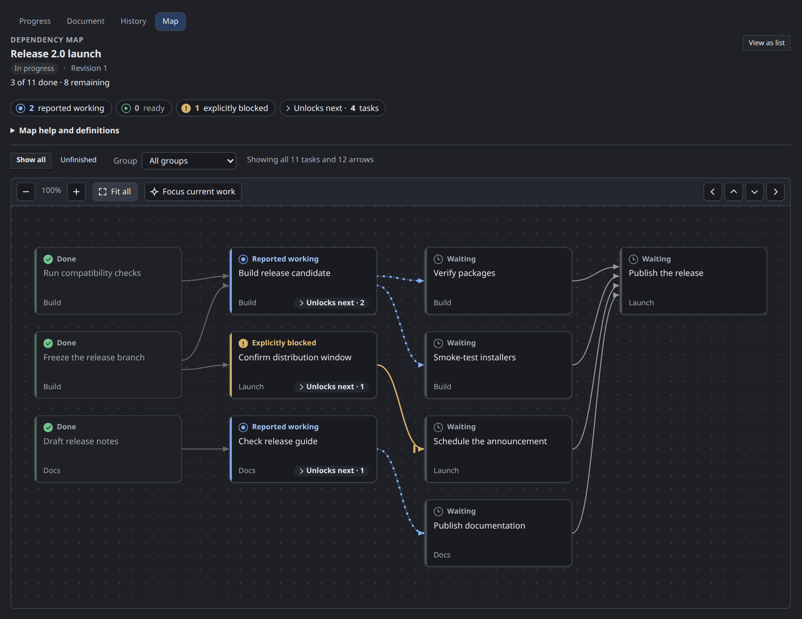
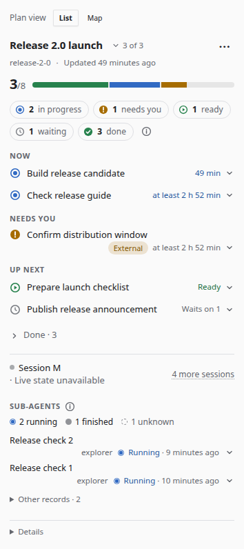
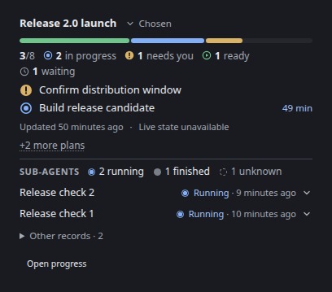
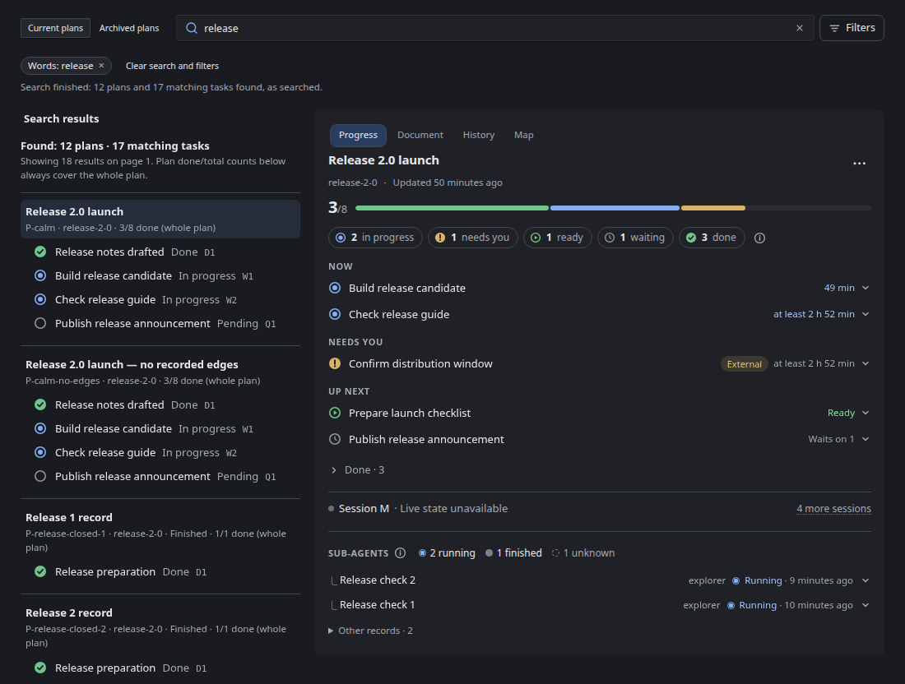

<h1>
  <picture>
    <source media="(prefers-color-scheme: dark)" srcset="docs/images/brand/agent-progress-header-dark.svg">
    
  </picture>
</h1>

**See the plan. Follow the work. Know what was actually reported.**

Agent Progress is an [OpenChamber](https://github.com/openchamber/openchamber) extension that turns your agents' plans into a calm, live progress view. One glance tells you what's done, what's running, what's blocked and what needs you. When you want more, the detail is one click away.

<p align="center">
  
</p>

## Why you'll like it

- **At a glance, then in depth.** A single grouped list, *Now*, *Needs you*, *Up next*, with finished work folded away. Expand any task for its reason, next step, prerequisites and who's on it.
- **See how the work connects.** Plans with recorded prerequisites open on an interactive dependency map, with pan, zoom, keyboard navigation and a clear *Ready* / *Unlocks next* view. Blue beads travel along the arrows from a task reported working to the tasks waiting on it, and an arrow from a blocked task ends in a stop bar.
- **Know when it's your turn.** Blockers that need a person rise to the top, with the reason and how long they've been waiting.
- **Watch your sub-agents.** Running sub-agents get one line each, and everything else stays tucked away until you ask.
- **Hand off in one click.** Copy a ready-made progress update or handoff summary from any plan.
- **Honest and private.** Progress comes from what agents deliberately report, never from guesses. Everything stays in a local store on your machine.
- **Built for everyone.** Full keyboard support, tested with the Orca screen reader, and friendly to forced colours and zoom.

## Three places to follow along

<table>
  <tr>
    <th width="50%">Right rail</th>
    <th width="50%">Work Status</th>
  </tr>
  <tr>
    <td align="center"></td>
    <td align="center"></td>
  </tr>
  <tr>
    <td>The current session's plan, right beside your chat.</td>
    <td>A compact summary of the plan that matters most right now.</td>
  </tr>
  <tr>
    <th colspan="2">Fullscreen board</th>
  </tr>
  <tr>
    <td colspan="2" align="center"></td>
  </tr>
  <tr>
    <td colspan="2">Every plan across projects, worktrees and sessions, with search, filters, history and the dependency map.</td>
  </tr>
</table>

## Get started

1. In **OpenChamber → Settings → Extensions**, install from this Git URL:

   ```text
   https://github.com/Phototonic/openchamber-progress.git
   ```

2. Review the **Add a plugin to OpenCode** disclosure and choose **Allow and enable**. The plugin runs with your account's full access inside OpenCode.
3. Open **Agent progress → Setup**, review the resolved source and private store, then explicitly confirm configuration. No global plugin installation is needed. The next eligible managed session/context can activate reporting; agents with `agent_progress_report` receive guidance without special prompts or agent names. Reporting is best-effort model participation.

No build step or dependency install is needed. Prefer a download? Each version is also published as a ZIP on [GitHub Releases](https://github.com/Phototonic/openchamber-progress/releases).

**Requires:** OpenChamber 2.7.1 or later. Linux OpenCode 2.2.7 and historical Linux/native Windows 2.1.4 checks have different scopes; they do not certify every managed host/platform. See [tested configurations](docs/compatibility.md).

## Good to know

- **Capture follows managed delivery.** Watched-file delivery retires capture after extension disable/removal; caller-owned configuration requires an explicit OpenCode restart. Mode may be unknown. Terminal, external/remote, isolated-space and VS Code runtimes are outside this managed path. A legacy plugin or explicit **Add to global config** entry can outlive the extension and needs deliberate separate removal. History is retained; a held-permission session may need interruption.
- **Your data stays local.** Plans live in a private SQLite store on your machine. It can contain plan text and project paths, so treat it, and any screenshots, as private.
- **One small network check.** The views check GitHub's public metadata for the latest official version. This is informational only; nothing installs itself.
- **Updates follow the host.** Companion bytes ship with the extension under host approval/update rules. Loaded-byte differences warn, not block reporting: this is explicitly weaker than the old private hash-attested payloads, not publisher authentication. See Setup for migration, interrupted-removal/manual recovery and configuration-lock caveats.

The [setup guide](docs/setup.md) covers each of these in full.

## Learn more

- [Setup, updates, diagnostics and removal](docs/setup.md)
- [The progress views in detail](docs/ui.md)
- [Reporting and API contracts](docs/contracts.md)
- [Tested compatibility](docs/compatibility.md)
- [Contributing, development and releases](CONTRIBUTING.md)
- [Changelog](CHANGELOG.md)
- [Logo assets and usage](docs/images/brand/README.md)

## License

[MIT](LICENSE). Bundled dependencies keep their own terms; see the [third-party notices](THIRD_PARTY_NOTICES.md).
