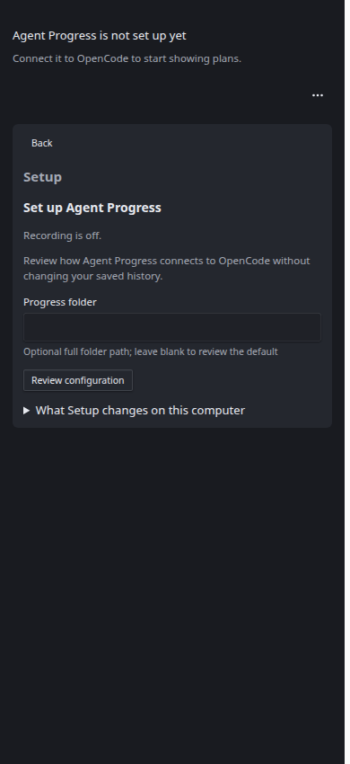

# Extension-managed capture setup

## Install, review, confirm

Use **OpenChamber 2.7.1 or later**. Install Agent Progress through **Settings →
Extensions**, using the repository Git URL or a release ZIP. No consumer build,
dependency installation or permanent global plugin is needed. Git installs execute
the committed JavaScript. The extension contributes `build/companion`, including
the existing report tool, inline skill and native guidance.

Approval includes **Add a plugin to OpenCode** and **Allow and enable**. Plugin
code runs inside OpenCode with the account's full access, like the extension's
service. Declining approval or a host policy refusal is not bypassed. Installation
approval alone does not authorize selecting existing progress data.

Open **Agent progress → Setup**. Optionally choose a dedicated private progress
store, inspect it, and review the resolved config/data scope and exact store.
Explicit acknowledgement and confirmation are required. Config/data roots must
already exist, be canonical, belong to the current account and pass platform
checks. They are not inferred from a project, PID, browser or account label.
Unsupported `OPENCODE_DB` or `OPENCODE_CONFIG_DIR` scope overrides are refused.
The service's scope observation is not proof of the runtime's effective scope;
the companion independently validates it.

The private store is a directory, not a SQLite filename or the OpenCode data
directory itself. A custom store remains an explicit choice; existing unrelated
sources remain readable but do not grant reporting authority. A matching retained
source is reused only when unambiguous. Corrupt, future-schema, foreign or unsafe
state is refused without reset, permission repair, takeover or deletion.

The sole managed descriptor is
`<OpenCode data root>/agent-progress-managed/progress-binding.json`, beside a fixed
product ownership marker. Both processes derive the data root from absolute,
canonical `XDG_DATA_HOME` plus `opencode`, or HOME/homedir plus
`.local/share/opencode` **only when XDG data is absent**. An invalid explicit XDG
value is an error, not permission to fall back. `XDG_STATE_HOME`,
`AGENT_PROGRESS_BINDING`, package siblings and project folders are not production
managed discovery selectors. No root scanning or automatic legacy adoption occurs.

Opening Setup, inspecting status or loading an unconfigured companion creates no
binding directory, marker, descriptor or store. Confirmed configuration creates
product state (0700 directories and 0600 files on Linux and macOS; ordinary
per-user folders with the profile's default inherited permissions on Windows). Mutable state never lives in the extension code folder.
After configuration, the next eligible native context/report boundary can activate
a previously dormant companion; no global install or automatic restart is needed.

Fresh setup now runs in short, resumable steps on every supported platform.
Choose the default or a custom private store, inspect the folders and frozen plan,
acknowledge the review, then confirm. Inspection and cancellation write nothing.
New storage is prepared, its folder/database created separately, the companion
expectation published, the source registered and the binding selected. The new
database starts with capture off; only the later reviewed enable step turns it on.
Reconnecting valid retained storage reuses its identities, history and capture
setting, with no enable/disable step. A matching verified source is reused;
otherwise the review discloses a new source registered only after expectation.
Reconnecting a retained matching source may replace a different expectation for the
same Store/source/install identity with the explicitly reviewed package. Its
expectation step freezes and compares the prior bytes before atomic replacement.
Foreign or invalid metadata still refuses. Once that step completes, changed
expectation bytes or package consent refuse rather than being silently refreshed.

The card shows real steps and on/off/unknown capture, not a percentage. Pause or
Stop waits for the active request and retains work, without undoing it. Reopening
requires explicit continuation. Before storage exists, capture is unknown, not off.
Fresh setup presents these internal steps in at most four groups: create a private
progress folder, connect it to OpenCode, turn on recording, and check that it works.
The frozen plan alone determines membership and order. An existing folder is named
as existing; groups without internal steps are omitted (retained storage has no
turn-on group). A group completes only after its last internal step is durably
complete. Pausing or failing inside a group leaves that group paused or failed,
not complete. Migration keeps its separate internal sequence with plain labels.

The fresh review shows its purpose, grouped steps and one unchecked consent line:
the progress service runs with your account's access. Canonical paths, proposed
identities, package and delivery facts, recording consequences and internal steps
are in one disclosure that can be opened before confirmation. Consent remains
bound to the same reviewed facts whether or not the disclosure was opened; changed
facts still refuse stale consent. Running fresh setup shows a plain recording line;
pause, failure, close/reopen and completion with recording off or unknown keep a
conspicuous warning and the applicable recovery action. Retained recording stays
unchanged. This is presentation only: step requests, journal, deadlines, budgets
and platform checks are unchanged.

Fresh Setup uses **recording** and **progress folder**. Before its first review,
installation/load facts and the account-access, delivery and lifecycle explanations
are in one keyboard-operable **What Setup changes on this computer** disclosure;
recording state stays visible outside it. Review still shows the same bound facts
and visible consent line, whether or not the disclosure was opened.
**More → Setup** opens it without leaving the current session;
**Back** returns to the plan and the More button. Language follows **More →
Language**, including before setup is complete; changing it never confirms a
Setup action. Troubleshooting's Advanced details and copied support summary
retain the diagnostic vocabulary needed for support.



Each request has a 17-second work deadline and an 18-second response deadline
below the host's 20-second limit, and no step starts a process. Health remains
cheap while workers run. A timeout is not rollback and never permits deleting
metadata or changing permissions to force a retry.

The service's five-second HTTP `requestTimeout`/`headersTimeout` bounds receiving
request bytes, not executing a fully received Setup request. It produces HTTP 408,
not a JSON `storage` failure. A deadline refusal (`managed-step-deadline`) never
becomes evidence of absent state or permission to write.

## Reach and disable/removal

| Delivery | Effect and limits |
| --- | --- |
| OpenChamber-owned watched managed config file | After the host removes the contribution and disposes it, later reporting stops. Re-enable can resume using validated retained state; normally no restart is needed. This is not an instantaneous UI-click deadline. |
| Caller-owned `OPENCODE_CONFIG` / content fallback | Changing the extension toggle requires an **explicit OpenCode restart** to change the runtime contribution. The toggle alone is not a live-stop guarantee. |
| External local/remote server, terminal OpenCode, isolated spaces, VS Code | Not delivered or captured by this extension-managed path. Shared directories do not extend its reach. |
| Legacy plugin or explicit host **Add to global config** entry | Independent of the extension and can outlive its disable/removal. Deliberately remove that separate entry; the extension never silently edits user configuration. Do not add one for normal setup. |

The service currently reports delivery mode as unknown, so Setup and reporting
health explain these alternatives rather than claiming to know the live mode.
Closing a progress view does not disable capture. Disable/removal retains the
store, binding, expected metadata and history. Reinstallation validates retained
state; it does not reset it. An in-flight report held at read permission cannot
append a late report/capture after retirement, but its session may still need
explicit interruption. **Graceful session cancellation or bounded session
completion is not guaranteed.** Never automatically restart a real instance.

## Legacy migration and recovery

### Setup coordination port

The bounded setup worker derives loopback TCP coordination ports from the
canonical discovery data root and Store root, rather than reserving one port for
all profiles/users. Each key hashes to a port in **25000–28999**, below the default
Linux, macOS and Windows ephemeral client-port ranges. The stable derivation is
25000 plus the first four SHA-256 digest bytes as unsigned big-endian modulo 4000.
Skip forward (wrapping within the range) over 25565, 26000, 27015–27030 (including
27017–27019), 27036–27037, 28015–28017 and 28960 to avoid common service/game ports.
Writers to the same discovery target or shared
Store serialize; unrelated targets can proceed independently. No progress data is
exposed on these ports. Hash collisions or an unrelated listener fail closed as
`managed-step-port-busy`: **The coordination port for this setup target is busy.
Let other setup activity finish, then retry. If it stays busy, check whether
another program or a custom client-port range uses the coordination port.**
The service never identifies/stops another listener,
switches ports to evade contention, or removes a lock to force progress.
The managed step HTTP route uses this worker boundary. Read-only inspection
continues discovery across separate worker
requests without creating product files or changing capture. An unfinished review
expires on service restart or package/environment change and requires fresh
inspection. Its confirmed prepare path retains a durable operation receipt for
an exact retry after restart; bounded status reports unknown capture rather than
replaying an old capture observation. The private worker also implements separate
effect requests and durable pause, abandon and resume. These controls retain
unfinished work; they do not undo removal or change capture. An interrupted capture
decision that cannot be proven requires a fresh review, and that review authorizes
only one new capture intent. Retrying a settled enable never overrides a later
manual disable. No worker continues automatically after restart.

Authenticated health and Setup delivery advertise independent
`managedMigrationSteps: 1` and `managedFreshSteps: 1` capabilities. The existing
`/v1/setup/managed-step` route uses wire 1 for migration and wire 2 for fresh setup.
An absent fresh capability shows update-together guidance, with no old-route
fallback. The old migrate
URL always returns 409 `managed-action-required` with no migration work. On Windows the old inspect/configure URLs always refuse with that
exact 409 object before body parsing, workers or product writes.
On Linux/macOS these compatibility routes do the same no-write refusal when
legacy discovery or any migration journal applies (configuration of ambiguous
legacy plus managed selection without a journal returns `managed-migration-conflict`,
while inspection still returns `managed-action-required`). Legacy/journal inspect
refusal uses local presence hints before full validation, with no writes; its acceptance budget
is eight seconds on the undelayed runner. The
old inspect/configure routes remain supported only on Linux/macOS for no-legacy,
no-journal fresh setup under the existing nonce-bound review and writer fence;
migration must never fall back to them. A presence hint authorizes only refusal:
it neither validates nor reads the journal/legacy contents. An absent or unreadable
hint still runs the full fresh path and filesystem checks, including canonical
presence checks, before offering a review or writing. Invalid metadata without a
migration hint retains its precise ownership/path refusal; step inspection
diagnoses metadata behind a migration hint.
Ordinary Setup reads are bounded and read-only; absent operation progress is
omitted, not null. Concurrent identical Setup reads share one in-flight status run
and its budget, never a completed result; a read during a mutation still refuses.
Ordinary capture enable/disable shares the writer fence.
When `managedMigrationSteps: 1` is advertised, Setup uses authenticated, bodyless
POST `/v1/capture/disable` and `/v1/capture/enable` for both fresh and migrated
managed installations. The existing target/consequence review, acknowledgement
and explicit confirmation gate the UI request; these routes do **not** accept or
validate a nonce-bound review token. They freshly validate the currently selected
binding, Store/source, schema and permissions under the writer fence. Enable
refuses unfinished or conflicting migration; disable does not require legacy
ownership. No legacy files or migration receipts are changed. Setup rereads the
actual capture bit afterwards; a failed reply is not rollback or automatic retry.
Precise refusals, including `managed-step-port-busy`, remain visible. Older
services without the capability retain their nonce-bound inspect/control flow.
Portable HTTP tests and launch counts are not native Windows latency certification.

### Confirmed step migration

Setup supports one confirmed **Switch to extension-managed capture** journey,
executed as separate bounded requests for a fully validated canonical legacy installation.
A folder name alone is not ownership. Inspection validates its complete ownership
manifest, releases, descriptor and actual Store/source identity. Modified or
foreign files are a conflict, not permission to delete them. A different selected
store/source refuses before disabling or changing either selection.

Busy, corrupt, unsupported-schema or platform inspection failures instead show
**inspection unavailable**, with the fixed underlying diagnostic. Resolve that
failure and retry inspection; unavailable does not mean ownership conflicts or
authorize manual deletion. During either conflict or unavailability, **Turn off
capture** remains available if the selected managed Store/source verifies. Its
review and explicit confirmation change only that Store's capture flag; no
legacy ownership/removal check is needed, no legacy files change, and an
unselected legacy Store is not controlled. Enable and migration stay fail-closed.

The reviewed confirmation explains the narrower managed reach, retained history,
global discovery removal and possible reload. Immediately before mutation,
ownership and identity are checked again. Migration records its pending target,
disables capture, uses the existing verified `remove-capture` operation,
durably writes the same-target
managed selection and expected metadata, then enables only after those steps
succeed. Store/source IDs, reports, receipts, captures, cleanup fences, run
records, installation history and retained legacy payloads survive. Successful
filesystem removal is not proof of managed activation.

An uncertain/failed reply must be inspected before retry. Setup can show a pending,
capture-off state and offer a fresh explicit same-target review/confirmation.
The private format-2 journal retains intent before each effect and a receipt after
completion. Explicit same-target resume can reconcile interrupted discovery-file
removal from that evidence; absence alone is not permission to delete or skip a
file. Changed ownership/bytes, unsupported journals and ambiguous staging refuse.
An accepted resume can remain pending with an unsettled worker observation: Setup
offers Continue and submits the next advance to reconcile the retained intent.
It does not claim that the earlier effect completed; the engine can still refuse
if fresh evidence cannot establish safe continuation.
Do not repair/delete remaining files, restore a global loader or enable capture
to force progress. Pause/abandon stops following requests; it is not rollback.
Closing, hiding or restarting never continues the migration automatically. A
hide/show round trip permanently retires that local attempt, including any held
reply; reopening reads status and requires an explicit Continue or Resume.
At an unchanged journal sequence, a refreshed status observation can replace
unknown capture and Resume with the actual capture bit and a required review.

Step errors retain fixed platform codes such as `path-unverified`
and `symlink-escape`, alongside the actual requested step or journal/lock
stage. No raw exception, path, account identity, token, command or database content
is included. A non-null error means failure even if the disposition says
`replayed`: that is a failed receipt, not a successful retry. Budget/deadline/busy
refusals use 503, stale/unsupported/ownership conflicts 409. A worker crash or
timeout is treated as effect uncertainty, never rollback; the writer slot stays
held until the worker exits. A pending migration record is published before capture is disabled:
failure to publish that first record leaves legacy capture unchanged. A crash after
publication but before disable can therefore show pending with legacy capture still
on; pending alone is not proof of capture-off. A fresh explicit retry revalidates.
For a fully validated pending target, Setup reads the actual capture bit even
before a managed selector exists. This read-only observation does not configure
the service, admit progress reads or grant recovery authority. If validation or
the read fails, capture remains unknown rather than being inferred from the phase.

A crash while holding the private configuration lock leaves **busy** state. There
is no time-based stale-lock takeover or automatic lock deletion. Stop only the
known configuration operation, establish that no owner is active, and arrange
separately authorized manual recovery of the exact lock after verifying the
private selection. Do not treat busy as absent configuration or select a new store.

Managed-directory bootstrap also retains narrow **manual-recovery crash windows**
from versions 1.2.0 and 1.3.0. A crash after directory creation but before the
ownership marker, or between linking a published file and removing its staging
link, can leave invalid private metadata. Such an unmarked directory, hard-link
anomaly or foreign content is refused, never adopted, repaired or
deleted automatically. A valid marked same-target directory with no migration
journal can be reused after fresh validation and confirmation; it is not the same
as an unmarked directory. The step protocol's `prepare` stage uses this
existing bootstrap, not a new claim file or crash-proof directory publication.

The step engine's lifecycle helper can reconcile an interrupted
`record-removal`: it removes only the verified empty discovery directory and then
records one operation-specific history event. It revalidates between those two
effects. An exact retained event permits a read-only retry; a missing directory
alone does not prove completion. Replaced history, duplicate events or partial
history lines refuse without repair. After resume, evaluating the retained intent
as running is read-only evidence checking; executing an effect still requires a
freshly validated, durably published running intent.

The format-1 upgrade helper likewise requires explicit same-target consent from
the step driver. It preserves the original binding and legacy identity.
Only a freshly verified removal receipt plus absent discovery allows the shorter
plan; the old phase alone does not. Upgrade itself changes only the private
journal, not capture, selectors or history. Once upgraded, retain format 2 on
rollback: an older service must refuse it rather than discard or down-convert it.

Fresh operations retain format-3 journals at the same private location. A folder
created without its completion checkpoint, an incomplete database, orphan sidecars
or ambiguous publication links remain refused and retained; privacy/emptiness alone
never permits adoption or repair. A committed database can reconcile only against
its exact creation intent, frozen identity, supported schema and initial off state.
Creation reconciliation also requires absent sidecars, even when the database
exists; this does not forbid normal WAL sidecars after its creation checkpoint.
If Store observation fails on an unfinished format-3 operation with no database
creation checkpoint (including retained storage), ordinary status reports unavailable for manual diagnosis,
without a Resume action. Checkpointed and complete operations instead retain their
pending or complete progress with unknown capture and the read diagnostic attached.
The finished Setup card explains when the progress folder’s status could not be read
and offers a fresh status check.
Status retains the fresh-setup presentation family even when no usable progress can
be shown. Any partial folder is retained, never deleted, reused or repaired to force
continuation. A damaged expectation is a state conflict
(`managed-migration-conflict`), not a storage outage.
Fresh refusal banners and diagnostics use localized setup wording, not migration
copy. Fixed last-action stage and bounded error codes appear alongside plain-language
guidance, not instead of it. The kept-partial-folder note appears once, only when
unfinished fresh progress includes a completed store-folder or database creation;
a stage name, invalid bootstrap marker or presentation hint alone cannot claim a
store folder exists. The ordinary Turn on capture action is not offered during
unfinished fresh setup; continue or resume that operation instead. It remains
available after verified completion with capture off.
Rollback must retain format 3, stores, bindings, expectations and history. Older
journal readers refuse format 3, including complete records; use a fresh-capable
build for recovery, never down-convert or restore a global loader.
Creation-only sole-source and initial capture-off checks apply while fresh work is
unfinished, not after terminal completion. A completed store may serve other
sources; Setup still verifies its selected source, Store identity, schema, private
objects and actual capture setting.

If bootstrap is refused, stop submitting setup actions, retain the files and
record only the fixed diagnostic stage/code for support. Establish that no
configuration or migration worker is active, then arrange separately authorized
manual inspection and recovery of the specific partial metadata. Do not clear the
managed directory, staging files or locks, loosen permissions, reset the Store,
or restore a global loader to force progress. Preserve Store data, payloads and
history; do not post local paths or metadata contents in a public report.

Already-running legacy processes may retain code after discovery removal. Stop or
reload those processes explicitly if global execution must end before capture
resumes. The host may also need an explicit affected-location reload to retire a
cached legacy duplicate-ID winner. No runtime is restarted automatically.

The standalone companion archive and `build/setup/main.js` are **legacy/recovery
support**, not a new global-install journey. An existing owned install's
`remove.js disable` / `remove.js remove-capture` can disable/remove its verified
discovery files even after extension absence; history and payloads are retained.
These utilities preserve their original ownership checks. They do not remove a
manually added host global-config entry or grant authority over modified files.
Updating a pre-managed default-only loader refuses with
`legacy-update-requires-managed-migration` before selecting or staging a release.
The previous selected release keeps working. Use Setup's **Switch to
extension-managed capture** rather than updating that loader to managed-only code.

## Updates, observations and integrity

Host extension updates now choose companion bytes under the host's approval/update
rules. There is no independently selected normal-path companion version or
per-companion-update confirmation. Use **Settings → Extensions → Check for updates**
(the icon is labelled **Check installed extensions for updates**), then the
extension's **Update** action when **Update available** appears. Checking alone
does not install. On tested web 2.7.1, reopening Settings reuses a cached successful
check; an explicit check fetches again. The one-hour cache boundary was verified
with the host's module-clock input, not an hour-long browser wait.

The ordinary unchanged-permission Git update needed no new approval and retained
grants, scopes, installation storage, device language, private binding and history.
Synthetic host account/settings records and the paused flag were retained too;
this is not real integration/OAuth retention certification. Paused-state retention
was additionally checked through an explicit updater-module call, not a UI offer.
When an update requests an added capability, the host opens its approval dialog.
**Not now does not roll back the package**: in the tested host the new files/version
were already installed, while the new capability remained ungranted and its use
was refused. **Review permissions → Allow and enable** grants it later.

Agent Progress no longer fetches version metadata or displays an official-main
notice. For at least one release, authenticated `GET /v1/extension-update` remains
as a fixed, network-free unknown/unavailable compatibility reply. Its one-hour
backoff is not a promised future check. An old notice cached in an open frame can
remain until a successful compatibility read or a frame remount. Current guests
never call that route; host Git traffic is separate.

Package versions are independent of protocol/schema 2. A development checkout can
share a version label with a release; labels alone do not prove identical bytes.

In the isolated web 2.7.1 Git journey, replacement stopped the old service process;
subsequent access started a new one with retained progress. The continuously open
board got a new package execution context; rail and Work Status were checked on
subsequent access with matching counts. This is not proof that every session or
all three frames reload simultaneously.

Reporting health separates configured delivery, last loaded-companion observation,
capture control, selected recorded revision and viewer freshness. Load is not a
heartbeat, effective tool inventory, a report receipt or completion. Restricted
sessions can lack the report tool despite an earlier matching load. Its bounded
explicit check does not probe conversations, restart OpenCode or call a model.
Previewable support text excludes paths, IDs, fingerprints, timestamps and content.

The service records expected package/version/binding fingerprints in owned private
store metadata; the companion records its successful activation observation.
Unknown/not observed, matching, and differing loaded bytes are distinct. A
same-version difference **warns only** and does not stop otherwise authorized
reporting/guidance. Binding, ownership, schema, control and permissions still fail
closed. An unavailable expected observation is unknown, never matching or authority
to recreate a missing store.

Check Setup/Reporting health after replacement rather than assuming every Git
update needs a restart. In a fresh caller-owned `OPENCODE_CONFIG` test, the service's
loaded-fingerprint observation went matching → different → matching after the next
report turn without a restart. That is not independent proof of which cached
importer executed. The explicit restart caveat for adding/removing/toggling the
contribution in caller-owned configuration remains distinct (see Reach above).
Unknown or differing observations do not establish universal activation; no
automatic restart or graceful session cancellation is promised.

**This is explicitly weaker than the former private hash-attested immutable
payloads.** These observations measure bytes read around activation, not publisher
authenticity or proof of exactly what a cached importer executed. A restart/update
may establish a new baseline. Coordinated same-account changes can agree. Folder
installs reference host-controlled source; ZIP permissions follow the host/umask,
and shared writable groups can permit cross-user modification. The extension does
not chmod host-installed code or promise private payload permissions. Inspected
Git updates use two renames, and ZIP replacement also has an absent-path interval:
neither is a gap-free atomic exchange. Ownership-manifest release selection and
hash-attested payload descriptions apply only to retained legacy installations.

## Data, failure and rollback

Plans and captured documents live in the dedicated private SQLite store and can
contain sensitive text and paths. Treat stores, backups and screenshots as private.
Disable/removal does not purge or securely erase anything. Explicit archive/restore
and confirmed permanent plan deletion are separate progress-view actions; original
plan files remain untouched. First cleanup creates a private recovery snapshot.
Deletion does not erase backups, journals or free pages. Preserve cleanup guards,
tombstones and run records through rollback; never reset schema or automatically
restore a snapshot to undo cleanup.

Unsupported base schema/run storage stays untouched; health/setup remain reachable
with fixed diagnostics. Restore valid ownership/access or use a compatible build;
restarting cannot make a future format compatible. Reads revalidate and can recover
when access is restored, without automatic reset or permission repair.

Authenticated `/health` is a cheap liveness snapshot, not a new storage or legacy
inspection. A newly started managed service reports `starting`, `ready:false` and
`sqlite:false` until a real Setup/data operation validates it. Later snapshots are
`unconfigured`, `ready` or `refused`, reflecting the last admission only. A ready
snapshot never authorizes a data access: each such operation still revalidates.
The views explicitly read Setup then health once on `starting`/`refused`, so a
restored store can recover without a restart. Health alone does not retry checks.
Only a starting-phase Setup 503 `managed-step-unsettled` falls through to that
single health reread (including an echo of the same transient code); other errors
and refused health diagnostics remain failures, and unavailable data stays unread.
Background composer actions use that same admission path and check capabilities
on the ready reply. Refused security/binding states are failures, not “setup needed”.
There is no timer, worker or background admission; synchronous Setup/data checks
can still delay other requests while that explicit operation runs.

Code rollback retains private selection/history but older services may not discover
the new descriptor. Migration does not reinstall global capture on rollback.
Prefer forward recovery with a compatible managed build. Deliberate legacy recovery
requires separately authorized verified retained targets, not store downgrade or
automatic global restoration.

## Proactive guidance after loading

Verified binding/source, enabled capture and effective `agent_progress_report`
availability gate recurring native guidance. No named agent, planner, manual skill
load or global prompt edit is required. Reporting remains best-effort model
participation; guidance never infers progress or completion. Structured/non-Markdown
plans require no source file. Conditional plan-file and dispatch/tracker hints read
no document bodies and do not themselves report, capture or grant restricted tools.

## Git distribution validation and main promotion

The Git URL is `https://github.com/Phototonic/openchamber-progress.git`; selected refs
determine committed bytes:

- No fragment follows the remote default branch (`main` for this distribution).
- `https://github.com/Phototonic/openchamber-progress.git#main` selects main explicitly.
- A published tag, for example `https://github.com/Phototonic/openchamber-progress.git#v1.1.1`,
  stays at that tag; it does not follow later release tags.

`dev` is source only and is not an installable ref. A host refuses a package
without built entries, preserving an existing installation's files/state.
An older `#dev` installation can still see a higher-version offer, but that
update is refused: replace it with a default-branch or fixed-tag installation.

Branches are not immutable commit pins. OpenChamber compares the selected ref's
package version, not commit IDs or changed bytes. A new same-version commit does
not produce an Update offer. Folder/ZIP installs have no Git update discovery:
replace them manually with accepted built files (developers rebuild their source
first). Local folder watching is not remote self-updating. Git-equivalent retention
and approval behavior is not certified for manual folder/ZIP replacement.

`private:true` prevents npm publication, not Git access.
Git, folder and ZIP packages carry the declared companion folder plus service,
setup, background and all three guests. No consumer compilation/dependency fetch.
Standalone release assets remain compatible legacy/recovery transports.

Develop on `dev`, target `dev`, and commit no generated outputs. Build locally with
`bun run build:all` before standalone tests/drivers. With maintainer approval,
`bun run promote main dev promote/<version>` creates a local two-parent commit
whose tree is accepted `dev` plus the nine reproducible outputs. It never pushes,
tags, publishes or moves either input branch. A failure creates no promotion
branch; fix the cause and retry. Bring any main-only source change to `dev` in a
separate source-only PR first, never by merging `main`.
Run host gates on a checkout of that promotion commit, then propose that branch
to `main`; do not merge `dev` directly or merge the release back into `dev`.
Rehearsals use only disposable clones with their remote removed.
No routine version bump or automatic release is implied.
Follow [CONTRIBUTING](https://github.com/Phototonic/openchamber-progress/blob/main/CONTRIBUTING.md)
for full-history disposable CI, nine-entry parity, SDK validation and release policy.
Never clear existing archives to make CI run. Actual host folder/ZIP/Git and native
runtime gates remain separate from portable checks.

```sh
# From the promotion checkout, not source-only dev:
node --experimental-strip-types scripts/project-git-package.ts <candidate-Git-tree-projection>
AGENT_PROGRESS_HOST_MODULE=<isolated-host-install.js> \
  node --experimental-strip-types scripts/verify-git-package.ts <candidate-Git-tree-projection>
```

Use only disposable source projections, unmodified isolated installers and synthetic
profiles. No live profile/auth, real-instance restart or paid model is a test input.

## V1 installable artifacts

Historical V1 standalone/global installation evidence describes its tested bytes,
not managed-delivery certification. Current package versions come from included
`package.json`; published tags/assets are on GitHub Releases. Native platform and
host evidence, including unavailable checks, is recorded in the compatibility
guide. Historical companion-update confirmations are not the managed update path.

## Native Windows

Native filesystem protection uses existing JavaScript and ordinary Node
filesystem calls only. No process is started for any permission check, no ACL is
queried, applied or repaired, and no native helper, compiler or module is part of
the runtime. State lives under the user's profile and relies on its default
per-user permissions, like other per-user applications. This was a maintainer
decision ([#172](https://github.com/Phototonic/openchamber-progress/issues/172)):
starting Windows PowerShell synchronously for each check (one to two seconds each)
blocked the OpenCode event loop inside the companion for tens of seconds.

**On Windows, Agent Progress no longer checks folder permissions.** It does not
check who owns a folder, who can write to it, or who can replace it or its parents.
A store or custom root in a folder that other accounts can write to (a shared
profile, `ProgramData`, a shared drive) is accepted, and so is state under a
parent that another account can replace. Protection is whatever the folder
already has: with the default profile location that is the user's own profile
permissions. A custom store folder outside the profile simply has the
permissions it already carries. Existing roots that carry a private ACL from an
earlier version keep working and are never modified. Linux and macOS keep their
uid and mode checks.

Windows keeps the checks that need only filesystem calls: drive-qualified path
syntax, canonical path, refusal of hard-linked owned state files, content-ownership
markers, hashes and schema validation. In the path chain only **symbolic links and
junctions** are refused. Other reparse points, such as volume mount points or
cloud-storage placeholders, are not detected: they are resolved through their real
path. Directories are created with default inheritance, and an existing directory
is accepted as it is.

Managed service construction and health do no legacy payload/Store preflight.
Every request and every mutation boundary repeats its path and object checks; no
result survives a request. The host's liveness deadline is separate from the
setup deadlines. OpenChamber 2.7.1 also limits both the guest bridge and service
proxy to **20 seconds** per request (`packages/sdk/src/contract.ts:499`,
`host.ts:607-618`, and `packages/web/server/lib/guests/service.js:725,832,855-856`
at tag `v2.7.1`). Migration and fresh setup run as separate inspection pages and
confirmed steps. The 17-second work and 18-second response deadlines sit below the
host limit; the undelayed runner gates each request at eight seconds. The native
suite also exercises pause/reopen/resume, and an independent observer asserts
that the service starts no process. Failed-worker and late-worker cases are
portable-only. Native results remain
pending CI; these are acceptance budgets, not a latency guarantee for every
machine.

Workers retain their fence until exit; timeout is not rollback. The portable
fixtures spy on every child-process entry point of a projected Windows path; they
do not exercise native NTFS behaviour. See
[the step protocol](../setup/managed-steps.md#request-budgets-and-stage-split)
for deadline and settlement rules.

Use one account and local NTFS storage. Owned hard-linked state files are
refused. Journals/side files remain in the store folder. No elevation is
attempted.

Drive-qualified paths support either separator, spaces, Unicode and trailing
directory separators through actual identity checks, not blind lowercasing.
Traversal, junction/reparse escapes, UNC/network roots, device namespaces,
alternate data streams and reserved aliases are refused. Long paths and other
filesystems are not certified; APPDATA is not assumed to be OpenCode config.

Capture checks requested/canonical permissions, opened-file identity and bounded
bytes, then file/ancestor identity and mutation metadata. Source documents are
ordinary authorized reads. Failure retains prior text and valid structured reports.
Trusted same-account processes are assumed; this is not Linux final-opened-path
proof against coordinated hostile filesystem races. Windows flushes writable file
descriptors but lacks POSIX directory fsync/power-loss namespace guarantees.
Historical private payload selection remains legacy-specific, not a claim about
host-managed executable folders. Historical Windows 11 x64/NTFS, OpenCode 2.1.4 /
OpenChamber 2.5.2 evidence does **not** certify Windows managed-host delivery.
