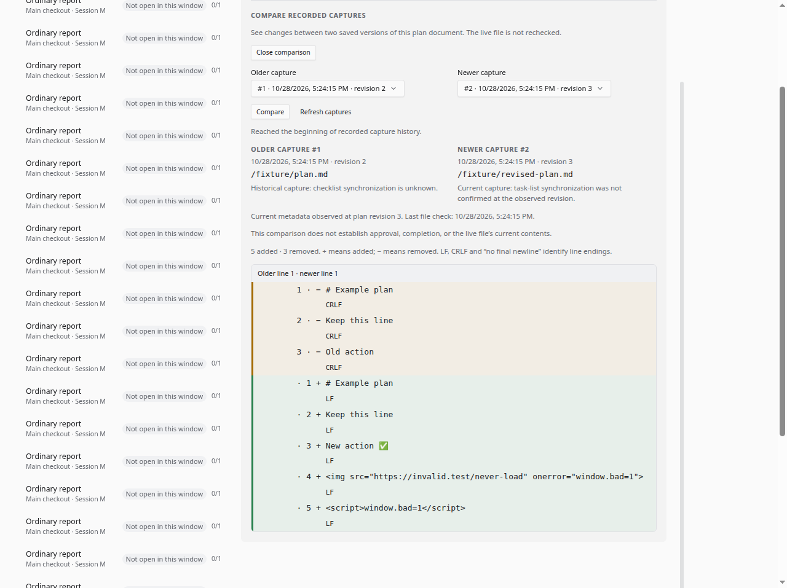
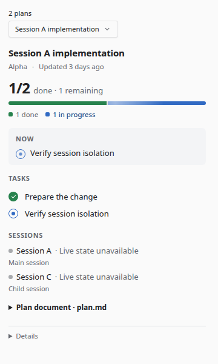
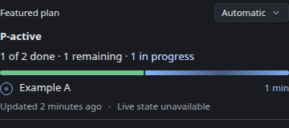
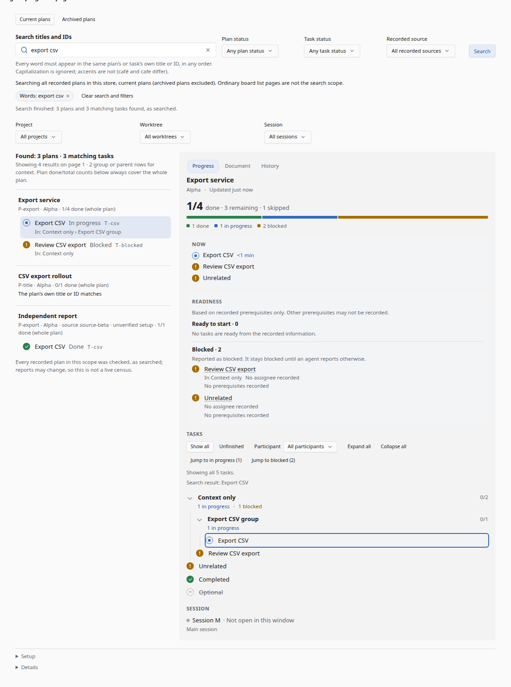
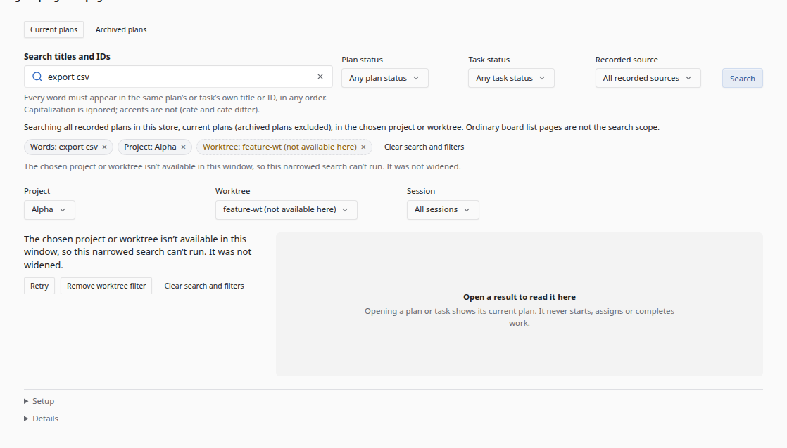
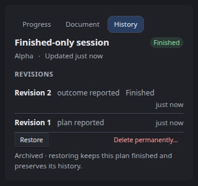
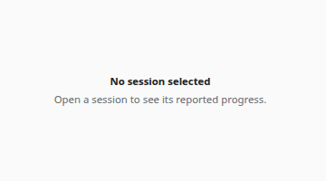

# Progress views

## Reporting health

The board offers Reporting health even when its normal read fails. Opening it or selecting Refresh observations performs a bounded read-only check. Installation, matching loaded-companion observation, capture, selected recorded revision and viewer freshness are explained separately. A matching load does not establish every running instance or restricted child session has the tool. Select a plan to check its recorded revision; unknown states remain explicit.

The support summary is previewed in a labelled selectable text area. Copy is explicit, reports success only after clipboard acceptance, and offers manual copying on failure. It contains fixed observation enums and a numeric version, with private context excluded. No upload, persistent cache, synthetic plan, repair or automatic restart occurs. Account/store/source, selection/filter/archive/search, capture and failed-viewer changes retire the observation; otherwise it remains labelled as the last explicit check.

## Compare recorded document captures

The board's Document tab offers **Compare recorded captures** after the existing
document. Opening it explicitly discovers recorded versions and defaults to the
newest two available capture IDs. Two labelled SDK selectors choose the older
and newer capture; **Compare** reads the selected pair. Choosing the same ID
shows equal text; a reversed pair is refused with a plain explanation. Existing
document reading remains separate. The rail and Work Status never request a
comparison. An absent `documentCaptureComparison:1` capability explains that the
feature is unavailable without calling unsupported routes.



Synthetic fixture, including literal markup used to check text-only rendering.

Discovery reads at most ten bounded windows per explicit action. Empty windows
do not establish no history; **Look for older captures** continues it. The option
page retains at most 50 entries plus the two selected records. Advancing replaces
the page while keeping selected IDs. Refresh discovers new versions without
silently changing that pair. Zero/one-capture messages require exhausted,
successful discovery; failed windows retain prior choices with Retry and never
claim complete coverage. New reports offer refresh while the pair stays pinned.

`capture-comparison.ts` owns one frame-local visit. Identity includes integration
account, service/store/source binding, selected source/plan, board/search scope
and cleanup generation. Leaving Document, selection/context changes, hidden
frames, cleanup and disposal retire reads; no stale callback can continue
discovery or restore removed bytes. A 404 clears retained comparison data and
selections. Archive remains inspectable, but archive/restore restarts the visit.
Normal list/search freshness observes remote deletion; filtered-list absence is
not deletion. A search-opened plan uses complete validated detail metadata even
outside the ordinary 500-plan list. There is no comparison polling or browser
persistence, and no writes to reports, review points or the source document.

The board retires requests synchronously through `beforeUiChange` when effective
selection, tab, archive, filter or search scope changes, before the next paint.
Background repaint deferral applies only to expanded popups with `aria-haspopup`;
an open comparison disclosure never freezes newer-report or deletion updates.

`capture-comparison-view.ts` renders literal text through textContent. Unified
hunks show old/new line numbers, +/− prefixes, three context lines and explicit
omitted-context counts. Changed lines distinguish LF, CRLF and no final newline.
Long lines wrap; selectors and capture metadata stack at narrow widths. Text uses
the host foreground token; border/tint colors supplement the textual prefixes.
No captured HTML, remote assets, markdown rendering or source editing is enabled.

Capture timestamps and paths identify each version. Current checklist metadata
is labelled with its observed plan revision and last file-check time; historical
synchronization stays unknown. Denied/missing/other later file checks can retain
readable earlier captures, explicitly labelled as retained. An equal comparison
does not prove the live file unchanged. Limit states explain why no partial diff
is shown; comparison never establishes approval or completion. See the
[wire limits](contracts.md#recorded-document-comparison-additive-revision-1).

Focused validation: `tests/backend/document-captures.test.ts` exercises real
storage/service reads and pure diff bounds; `tests/browser/capture-comparison.test.ts`
exercises adapters/controller against a real disposable HTTP service.
`node --experimental-strip-types tests/browser/capture-comparison-qa.ts <artifact-directory> --built-service`
drives current guest bundles with real keyboard/pointer input in isolated
Chromium, synthetic SDK events and disposable built services. It records bounded
results, request metadata and synthetic screenshots. This is rendered browser
evidence, not native-host or screen-reader certification.

Three guest frames read production contract v2 (`shared/progress.ts`,
`docs/contracts.md`) through `host.serviceRequest`. Rail/page also expose its optional,
explicit finished-plan cleanup actions; Work Status remains read-only. Full-page History
alone adds a "Since you last reviewed" change digest (see Change digests); the board alone
adds plan/task search (see Board search).
- Built from `@openchamber/sdk/ui` and host theme tokens; TypeScript source, classic IIFE bundles.
- This file is the authority for the UI surfaces' structure and behaviour; the wire contract lives in `docs/contracts.md` and `shared/progress.ts`.

## Build and checks

```sh
export PATH=$HOME/.nvm/versions/node/v24.19.0/bin:$PATH
node_modules/.bin/tsc -p ui/tsconfig.json --noEmit
node --experimental-strip-types --test tests/browser/*.test.ts
bun run bundle:guest ui/panel/main.ts ui/panel/main.js   # same for status, page
```

Entries `ui/{panel,status,page}/index.html` load `main.js`, the generated installable artifact. There are no runtime dependencies, remote assets or CDN loads. The panel ID stays `agent-progress-probe` (`ui/shared/config.ts`), so Work Status can open the rail with `openSurface('plugin:agent-progress-probe')`.

## Layers (`ui/shared`)

| Module | Role |
| --- | --- |
| `adapter.ts` | **Only** module that knows the wire format. Validates and maps v2 replies: `/health`, `/v1/plans`, `/v1/plan` (with optional `timing`), `/v1/document`, `/v1/history`, `/v1/change-digest`, `/v1/search`, `/v1/search-state`, `/v1/setup`, `/v1/extension-update`. Builds query and setup bodies. Protocol/schema ≠ 2 fails as incompatible. |
| `model.ts` | View model and pure semantics. Plan summaries use server `counts`; detail subtrees use the shared `countItems` (same rule). Hierarchy, current work, participants, document-state copy, and the task-view projection (row membership, branch aggregates, jump order; see Task view). |
| `readiness.ts` | Pure task-readiness projection of an active plan's complete detail (see Task readiness). Never changes status, counts or assignments. |
| `summary.ts` | Pure deterministic Markdown for progress updates, handoffs and explicitly historical summary-only snapshots (see Previewable summaries). Uses complete matching detail and the shared readiness projection. |
| `source.ts` | Paged reads through the host proxy (rules under v2 mapping below). Classifies fixed error codes into plain states. |
| `live.ts` | SDK workspace enrichment: projects plus bounded worktree discovery and selected session streams. Shared project membership, coverage, live-state labels, navigation gating (`canOpen`), and `restart()` after a context change. |
| `scope.ts` | Server list scope per surface, owned-first ordering, page project/worktree grouping, coverage gap. |
| `setup.ts` | Setup UI, phases, plain-language SetupError and diagnostic text. |
| `official.ts` | Official-main version notice (rail and page) and the compact Work Status line. |
| `cleanup.ts` / `cleanup-view.ts` | Bound cleanup targets, eligibility and plain error copy; rail/page actions and inline delete confirmation. The shared controller owns mutations and cache retirement. |
| `app.ts` / `refresh.ts` | Frame lifecycle, caches and repaint rules (under Controller below). |
| `change-digest.ts` / `change-digest-checkpoint.ts` / `change-digest-view.ts` | Page-History digest: one pinned visit per frame and explicit review (controller), device-scoped review checkpoints (no other storage scope), and the section's DOM plus pure text rules (see Change digests). |
| `search.ts` / `search-view.ts` | Board search: the DOM-free controller (criteria, frozen location membership, bounded windows and pages, freshness, retirement) and its form, chips, counts, coverage and grouped results (see Board search). |
| `components.ts`, `style.ts`, `format.ts` | DOM pieces, CSS from host tokens only (including reported-progress motion), locale-aware time. |

## v2 mapping (frozen contract → UI)

- **List.**
  - Each `data[]` row is a `PlanSummary`.
  - The plan key is `${sourceId}/${id}`; the owner is `sessionId`; `finished` displays as "Finished".
  - List rows and summaries use server `counts` / `working` only.
- **Rail and Work Status.**
  - Read `/v1/plans?session=<ctx session>` only for an explicit selected session. Null/draft/missing session is **No session selected**, even if directory metadata exists: health only, no plan list or part requests and no fabricated store read.
  - A successful empty session read is **No plan reported for this session**. Pending and failed reads stay distinct from that authoritative empty result.
  - The server's filter includes participants (links, assignments, attributed contributions), so a contributing child sees the plan it works on, with a "contributes to a plan from …" note. A fork with no recorded membership does not inherit ancestor plans.
- **Page.**
  - Reads all plans (`limit=50`, cursor pages up to 10).
  - The session filter goes to the server (`session=`); project/worktree narrowing is local, from the recorded `directory` plus live SDK labels.
  - This is the history board, independent of host-selected session. Host A/B/null updates do not narrow current/archived lists or reset its explicit filters. The host may destroy the frame during navigation; reopening starts the page's ordinary defaults, not an implicit host-session filter.
- **Detail** (`/v1/plan`) loads on demand for the shown plan only.
  - Items and contributions page with one cursor: each nested `nextCursor` is passed back verbatim, and reading stops when both are null.
  - If `plan.revision` changes between pages, the read restarts (bounded).
  - Every page must match the first page's store, source binding and requested plan; a mixed page is a refused read (unreadable reply), never joined into one detail, even at the same revision. A failed continuation or page-cap exhaustion is an error, not a partial detail.
  - A present `dependencies` value must be an array of nonempty strings; anything else refuses the reply instead of reading as "none recorded". An omitted list stays valid.
  - Contributions use `itemIds[]` and never change counts. Relays show "Reported by <reporter> for <child>".
- **Optional cleanup.** `health.planCleanup === 1` enables actions; absent/unknown hides them and the page explains that cleanup is unavailable. Optional plan `cleanup` is validated separately from progress revisions. Normal/archived list modes never share a scope-cache key; an older service is not asked an unsupported archive query and never establishes an empty archive.
- **Document** (`/v1/document`) loads on demand, when the disclosure opens or the Document tab is shown.
  - Continuation pages pin the first reply's `captureId`.
  - States (`denied`, `missing`, `moved`, `oversized`, `non-text`, `unavailable`, `changed-during-read`) get plain copy.
  - A retained earlier capture stays readable, labelled "last successful capture, not the current file".
  - `checklistSynchronized` adds "task list was confirmed against this capture".
  - `currentFile` is always described as not rechecked; age never implies out-of-sync.
  - Continuation pages pin the first page's capture ID, so the text is always one capture. If any page answers `historical-capture` (a newer capture landed mid-read), the body says "A newer capture was recorded while this loaded. This is the earlier capture." The next refresh loads the new capture.
- **History** (`/v1/history`, page tab): oldest-first pages, labelled plan reported / tasks revised / outcome reported / progress update. The page's History tab adds one pinned `/v1/change-digest` read above it (Change digests); legacy history pages are never fed into it.
- **Health.**
  - `ready:false` is a setup state, never an empty success.
  - `503 {error}` maps to plain states: `corrupt` → damaged, `schema` → incompatible, `busy` → busy, others → service not responding.
- **Navigation.** "Open session" appears only when the plan's `sourceId` equals the verified `sourceBinding.sourceId` **and** the session is in this host's current SDK snapshot. Other plans stay readable with "From another OpenCode setup" and no target.
- **Source identity.** A plan whose recorded source has `verified:false` shows "Unverified OpenCode setup" in its header and an "Unverified setup" (warning) badge in the page list. Details lists every recorded source with its verified flag.
- **Windows directory spelling.** Checkout/worktree membership, directory-scope cache keys and compact location labels compare drive-qualified Windows slash/backslash spellings consistently, including drive-letter case. Folder-name case stays unchanged; similar path prefixes do not establish checkout ownership, and POSIX backslashes remain ordinary name characters. Recorded paths are displayed as received.
- **Cache identity.** Frame generation + `storeId` + `sourceBinding`. A change resets UI state and the detail, document and history caches.

## Surfaces

**Right rail (`ui/panel`).** Shows the scoped plans; a picker appears when there are several, and plans are never merged.
- The chosen plan is **persisted per session** in host storage (`rail-plan:<sessionId>`), so it survives panel remounts and reloads.
- Reading order:
  1. plan title, location, "Updated …"
  2. large done/total and segmented bar (done / in progress / blocked)
  3. "Now" callout
  4. Readiness (active plans only; see Task readiness)
  5. Task view controls and the task hierarchy (groups collapsible, with their own counts; see Task view)
  6. sessions with live state and verified "Open session" (session titles and live state only for plans of the verified bound source; see Session labels)
  7. collapsed plan document
  8. collapsed Details
- Unconfigured service: the setup flow in compact form. After install, a reload notice.



**Work Status (`ui/status`).** Compact, scoped only to the section's explicit selected session.
- **Automatic** features the most recently reported active plan with explicitly working task IDs (stable plan-key tie-break). Without one, it keeps the existing scoped ordering: owned-first, then active/recent within each ownership group, including the existing finished/cancelled fallback. Live Running/Idle labels never determine selection or completion.
- With multiple scoped plans, **Featured plan** offers Automatic and every available plan. A manual choice, including a pending or finished plan, stays through refreshes, newer reports and directory moves of the same session. Removed choices revert to Automatic. Choices are frame-local, retained for up to eight recent session contexts, and cleared when the store/source binding or integration account changes; reopening the frame starts Automatic. No asynchronous preference restore or server writes.
- The status-only SDK selector shares one row with its label: a right-aligned 24px-high control, bounded to 65% of the row and shrinkable at narrow guest widths. Its value truncates with the full title on hover; popup labels wrap for keyboard/touch discovery. SDK naming and keyboard behavior remain intact, with an inset host-token focus outline. Other surfaces keep their existing select sizing.
- Shows: counts and bar; first working (else blocked) task from the primary plan's detail; age and live state; up to two other plans.
- Detail loading and the first live project subscription follow the featured plan, including a selection beyond the first three list entries; the two-session-stream/32-total-subscription limits remain unchanged.
- "Open progress" calls `openSurface` to open the rail, whose selection remains independent. The compact picker does not synchronize other panes. Unconfigured shows "Set up", which opens the rail's setup flow.
- `setHeight` follows content. The frame never writes a badge.



**Fullscreen page (`ui/page`).**
- Project → worktree → session filters; a grouped keyboard listbox (live/lifecycle/"Other setup" badge, done/total).
- Detail tabs: Progress / Document / History. The Progress tab is the same shared plan detail as the rail, including Readiness. History shows "Since you last reviewed" above Revisions. A coverage note covers missing live state, other-source plans and the subscription cap.
- Above the filters: the search form (see Board search). While a search is shown, its grouped results replace the plan list; the detail pane and tabs are unchanged.
- Footer zone: collapsed **Setup**, then collapsed **Details**.

## Change digests (full-page History only)

A concise account of completed tasks, reported blockers and scope changes between the revision a person last **marked reviewed** and a pinned target, from the frozen `/v1/change-digest` read (`docs/contracts.md`). Only the board's History tab shows it, above Revisions; the rail and Work Status stay unchanged and never read a digest or review point (a confirmed delete there only removes that plan's markers). Nothing here changes tasks, revisions, documents or service rows.
- **Explicit review (owner decision).** Only a real keyboard/pointer activation (trusted click/Enter/Space) of **Mark reviewed** on a loaded, visible digest acknowledges, and only its **displayed** target. Mounting, polls, repaints, hidden frames, focus return, dwell, list/detail/history reads and script clicks never do. Before writing, one bounded live read (the first `/v1/plan` page only, no cursors) rechecks store/binding/plan, cleanup state/generation and lifecycle; a moved plan asks for Refresh, a deleted one (404) retires the digest. A newer progress revision does not move the target: the older displayed revision is saved and the rest stays for the next digest. A higher acknowledgement from another window is never rewound ("Already reviewed through revision N"). Pending disables repeats; no automatic retry; repeating the same acknowledgement is safe. Initial and partial digests can be marked; partial ones say that earlier uncompared changes won't be recovered.
- **Shared review point (device-storage exception).** The checkpoint is a preference in SDK **device** storage (`{scope:'device'}`), used only after the host advertises `features.deviceStorage`; never instance storage or any fallback. The host partitions device storage by browser profile, runtime, extension and installation. It provides no authenticated-user isolation: people sharing that namespace and integration account value share review points across sessions, board filters, frames and windows. This is the one exception to frame-local reading state: task filters, focus and disclosures remain unstored. Review points are not synchronized across devices; URL aliases are not guaranteed to share them.
- **Integration account and existing points.** SDK `connection.account` describes integration-link state, not a signed-in host user. Its value is retained in the review-point identity as a preference partition, not a security boundary. A changed value selects a different set of markers; an empty or missing value uses the same explicit `null` sentinel. Returning to a previous value makes its saved points available again. The version-1 format is unchanged, so existing points remain readable without migration. Keys are `rv1.<sha256 of the versioned tuple (integration account or absent sentinel, store, binding source + verified, source, plan)>.<revision>` (≤ 86 characters); values are `{v, id, revision}` only, never titles or digest text. Readers enumerate keys once (bounded by the SDK's 2,000) and validate only the highest of their context; an older writer's key cannot overwrite a newer one; after a successful write only lower revisions of the same context are compacted.
- **Storage failures.** Unsupported feature, denied access, quota, unreadable/malformed highest record or persistent disagreement (one bounded reread) is **checkpoint unavailable**, never an initial view, and disables Mark reviewed; a failed write keeps the previous point and stays retryable.
- **Pinned visit.** Entering History reads the checkpoint, then one digest for the listed revision (a checkpoint ahead of a lagging list gets one live read first; still ahead is unavailable, never a reversed interval). Unchanged polls and repaints do no digest work; a newer revision shows "Newer changes are available" and **Refresh digest**, never replacing text under the reader. Refresh is one coalesced checkpoint + digest sequence. Visible/focus return rereads only the checkpoint and marks a newer acknowledgement ("Reviewed through revision N in another window or tab") with Refresh. At most the active visit is cached.
- **Invalidation.** Visits are keyed by integration account, store, binding, source/plan and cleanup state/generation; leaving History, another selection, integration account/store/binding change, hidden frames (an in-flight sequence restarts on return; a review not yet written to storage is cancelled and needs a fresh Mark reviewed) and disposal retire every pending reply and control, so a held reply cannot paint or enable a detached Mark reviewed. Archive/restore start a new visit under the new cleanup generation with the **same** review point (archived plans stay inspectable and reviewable). Reopen/finish keeps the plan's identity and review point but requires Refresh before reviewing. A confirmed delete (rail or page) removes that plan's markers best effort; a 404 from a digest or review read does too. A filtered or truncated list absence is not deletion. A write already dispatched can finish only its captured marker; offline profiles may keep inert numbers (invalidation, not secure erasure).
- **States.** Loading; **Initial view — no saved reviewed revision in this profile** (current counts only, no historical claims); comparison; complete-empty ("No new revisions since you reviewed revision N" or "No summarized task changes in revisions A–B"); partial ("Only revisions X–B could be compared (reason); …", the totals still compare both endpoints); baseline unavailable (no totals, proven suffix only); target unavailable (no review); checkpoint unavailable; older service without `planChangeDigests:1` (unavailable, zero digest requests); read failure, conflict (Refresh) and missing plan. Unknown history is never shown as zero.
- **Content.** Endpoint counts `D/T done (P%) → D/T done (P%)` (zero total: no percentage), with **Scope** causes (counted tasks added/removed, skipped/returned) kept apart from **Completion** causes; recorded transitions per facet, counted per change, not per task; changed tasks grouped (Removed, Blockers, Completion, Added, Skipped or returned, Revised) with every facet in text ("Reported blocked · No longer reported blocked · Completed", never colour alone, never "resolved"). Group-only and pending ↔ in-progress updates are not summarized. Omitted rows/references are disclosed; counts still include them.
- **Links.** Each task row's **Recorded changes** disclosure shows its revisions, times, facets and before/after title, status, group and prerequisites from the digest itself (the recorded side's group and prerequisites for additions and removals), including removed tasks (labelled historical, never put back into the live tree). **View current task** (tasks present at the target) waits on History for complete current detail at the listed revision, then switches to Progress and uses the canonical reveal (clears hiding filters, opens ancestors, focuses the row). If the task is gone, History stays and says so politely.
- **Accessibility.** Heading + lists + native disclosures/buttons; unavailable actions stay focusable (`aria-disabled`) so focus survives state changes; visible focus outlines. One persistent polite live region outside the repainted root speaks each explicit outcome once (refresh, review, navigation), never per poll or repaint. No digest animation or transition; at 360 px and 200% reflow everything wraps without horizontal overflow.

## Board search

Find reported plans and tasks by title or stable ID across the whole recorded store, not only the board's loaded list, from the frozen `planTaskSearch:1` reads (`docs/contracts.md`). Only the full-page board has it; the rail and Work Status have no search controls and send no search requests. Without `planTaskSearch:1` the board shows "Search is unavailable with this service version." and otherwise stays as before (never zero results). Search never claims, starts, assigns or completes tasks, opens sessions or writes reports.



- **Form.** A visible label "Search titles and IDs" on a kit search field, Plan status, Task status and (with several recorded sources) Recorded source selects, and **Search**. Typing only changes a frame-local draft: no request, no repaint. Search or Enter in the field submits; Enter during IME composition only commits text. No keyboard shortcut is added and no document-level key is handled, so Ctrl/Cmd+F, Ctrl/Cmd+K and host shortcuts stay with the host. Texts over 256 characters or 16 words are refused with a plain message, never truncated. Without words, a plan status, a task status or a source, Search does not run: board filters alone are ordinary browsing ("Enter words to search, or choose a plan or task status."). Empty words plus a task status finds every task with that status. Help text: every word must appear in the same plan's or task's own title or ID, in any order; capitalization is ignored; accents are not. While the form differs from the shown results, "Not searched yet: these results are for the previous search" stays visible until the next Search.
- **Explicit scope.** A scope line names what is searched: all recorded plans in this store or one recorded source; current plans (archived excluded) or archived plans only; the chosen project/worktree; the chosen session (owner, linked or recorded contributor). It is visible with zero, failed or unavailable results. The host-selected session never narrows search; host A/B/null keeps it. Archived plans are searched only in the existing Archived plans mode; switching Current/Archived ends the search and resets filters as before.
- **Chips and Clear all.** Each submitted constraint (words, source, plan status, task status, project, worktree, session) is a removable chip button ("Remove Task status: Blocked"). Removing one searches again with the rest (removing the project also removes its worktree); removing the last search constraint returns to browsing with the remaining board filters. **Clear search and filters** clears words, constraints, board filters and the selection, keeps the visible Current/Archived mode and returns to ordinary browsing. A chosen value this window no longer knows stays as a chip marked "(not available here)".
- **Location choices.** The board's project/worktree/session filters apply to the search. While searching, choices include every project and worktree this window knows plus locations of plans it has seen, without counts (they would describe loaded plans, not the library); browsing keeps its existing choices. For each submitted search the location membership is frozen (`LiveSnapshot` copy) and applied to every backend candidate **before** it is counted or takes a result slot, so a match in another project never produces an empty page. A chosen project **or worktree** this window cannot classify never runs and is never widened to All: its chip stays, marked "(not available here)", and the search stops with Retry, Remove project filter (removes its worktree too) or Remove worktree filter (keeps the project) and Clear search and filters. Three states stay distinct: **missing** (settled discovery proves it absent: an SDK project no longer listed, or a worktree whose directory is no longer inside the project's checkout, one of its ready SDK worktrees or a ready live session location), **loading** (discovery still running) and **unknown** (discovery failed, or never ran for that project in this window). Without a chosen project, a worktree is checked against every known project. Recorded-directory choices stay definable. A settled change that could classify a plan the run has already seen differently retires a narrowed search with **Refresh search** (counts are never silently reclassified): configured projects, worktree discovery or the subscription cap, or the live session (project, directory) of an owner of any candidate the run has seen, kept or rejected. Sessions owning no seen candidate (for example a routine new session in the chosen project) and titles or activity change nothing; past 1,000 distinct owners every live session record is compared instead. Host navigation that restarts discovery and settles unchanged keeps the search; while discovery is loading nothing is judged.

  

- **Progressive results.** Search, Load more results, Continue searching and Retry are the only actions that read; each issues at most 10 sequential windows of up to 50 and stops at a full page of 50 hits, exhaustion or failure. There is no 500-plan ceiling and no automatic continuation. A pause with nothing yet shows "No matches found yet; more recorded plans remain unchecked." with Continue searching, never "No results". Results are grouped by plan (title, ID, location, lifecycle, other/unverified source, whole-plan done/total) with matching task rows (status glyph, title, status, ID and an abbreviated "In: root › … N more › parent" breadcrumb from the reply; nothing is invented). A plan matched only by its own title or ID says so; a group continued from the previous page is labelled. At most two pages are kept (Previous/Next results); earlier pages need a new search.
- **Counts.** "Found so far: P plans · T matching tasks" accumulates only accepted windows' per-plan deltas after the location choice; after clean exhaustion it reads "Found: …". The page line counts shown results and the group/parent context rows apart; plan done/total always cover the whole plan. Coverage lines keep apart: unchecked records remain; skipped unreadable/too-large records (never a complete claim); location membership limited to what this window knows; results removed by archive/restore/delete; plans changed since found. Exhaustion is "as searched; reports may change", not a live census or frozen snapshot.
- **Opening a result.** A plan row selects that plan; a task row selects it and, once the existing detail loader has complete current detail, checks the same run, source/plan identity, revision and archive mode, then uses the canonical reveal (opens ancestors, clears hiding task filters, focuses `item-<id>`) once with "Search result: …". A task no longer in the plan, a plan moved in or out of the archive, or a failed detail read is announced and the plan stays readable. The detail pane is painted from complete detail metadata, never from the search summary; Summary preview and the History digest are offered when the loaded list holds the same revision of that plan. Any change of search run or selection (also for plans outside the loaded list) retires in-flight detail, document and history reads of the previous selection: a released held reply sends no continuation page, paints nothing and never delays the next selection. While searching, those part caches keep only the selection and the three plans opened just before it (across searches of the same integration account/store; a cache reset clears them); others are evicted, and an evicted in-flight read cannot repopulate the cache (it reads again when reopened). Ordinary browsing keeps its existing caching.
- **Freshness.** While results are shown, the frame's existing poll (3 s, 8 s after failure, visible frames only) sends one `/v1/search-state` read for the displayed plan keys plus the selection (≤ 50 per read, at most two) **instead of** the list read; with nothing shown it reads the list as usual. A missing, deleted or archive-moved plan leaves the results; a new revision or cleanup generation (also archive + restore with the same revision) is marked "Changed since found". Either retires continuation and count authority and offers Refresh search. A conflicting store/binding falls back to the list read, which resets for the new store. A successful current poll also updates capture state and its diagnostic in the current and remembered list envelope, preserving the remembered list age and unrelated diagnostics; other cached scopes with obsolete capture state are evicted. A capture change refreshes the selected detail and any open progress/handoff preview even at an unchanged plan revision. Unchanged metadata does not repaint or add detail/list requests. Missing/malformed capture metadata or disagreement between batches is a failed poll: no partial rows or capture state are applied. A failed freshness read keeps the results under the stale banner, never as an empty result.
- **Retirement.** A run is keyed by integration account, store + binding, criteria and a submit counter. New criteria, Refresh search, Clear all, mode switch, a cache reset (integration account/store/binding change, setup action, local cleanup success or ambiguous failure, list eviction), membership change, hiding and disposal retire its in-flight window: a held reply cannot add results or counts, and no further window is sent. Hiding pauses an action; the user continues it explicitly from the last accepted window. Hiding and disposal also retire an in-flight freshness read whether or not a scan is running: generation and visibility are checked before each freshness batch and before any reply is accepted, so a hidden frame sends no further batch and applies nothing. Retired replies carry no capture metadata and cannot clear failures or advance successful freshness. Transport overlap is one retired plus one current window, with one queued follow-up.
- **Accessibility.** Native/kit buttons, selects and field with accessible names; one persistent polite region (`search-announcer`, outside the repainted root) speaks each explicit outcome once, never per poll. Focus, typed text and caret in the field survive unrelated repaints. At 360 px and 200% reflow everything wraps without horizontal scrolling.
- **Saved views:** not built. The named-view slice is blocked because host storage has no proven authenticated-user isolation; search reads and writes no preference storage.

## Previewable summaries

**Copy progress update** and **Copy handoff** open an inline preview for the selected plan in the rail and the board's Progress tab. Work Status stays compact, without these actions. Both formats cover the whole selected plan, regardless of task filters, participant filters or collapsed groups; they never combine plans. They use recorded progress only: no model, new service endpoint, source-document body or transcript read, reporting operation or progress mutation.
- **Preview and copy.** Opening never copies, including after a read finishes. The labelled, read-only plain-text textarea is selectable and shows the exact Markdown passed to the explicit **Copy Markdown** action. Its selection and vertical scroll position survive unrelated paints while the preview generation is unchanged. Titles containing Markdown or HTML remain text, never executable UI. Copy is disabled without preview text or while a write is pending. Copy success (`Markdown copied.`) is announced only after the clipboard write resolves. An absent, throwing or rejecting clipboard API reports `Clipboard unavailable. Select and copy the preview text below.`, not success; the same text remains available to select and copy manually. Controls are keyboard-operable; feedback uses `role="status"` with polite, atomic announcements. Close returns focus once to the opening format's action if the reading selection still matches; later paints do not repeat that focus return.
- **Complete input.** One accepted detail read supplies the matching summary, all item pages and all contribution pages. Loading is not an empty summary; a failed or bounded-out read never supplies partial tasks as full detail. No list-row summary is joined to older detail. A read ahead of the list waits for its matching revision before becoming a full preview.
- **Progress update, in order.** `Plan: <title> (<plan id>)`, with ` (archived)` appended when recorded; `Lifecycle`; `Progress: D/T done; R remaining; S skipped`; `Last report` from `reportedAt`, in absolute UTC. Lifecycle uses the existing labels, including Finished. A `Remaining breakdown: W working; B blocked; P pending` line appears only when those task-row counts reconcile with the server's remaining count. Next come **Current work**, **Explicitly blocked**, and, only when relevant, **Freshness warnings**. Blocked task titles say `— no reason recorded`, never an invented explanation. Empty work sections say `No current work is recorded.` or `No explicitly blocked work is recorded.` The title is not an objective.
- **Handoff, in order.** The same four header lines, then `Origin session`, `Coverage: full (revision N)`, and the optional reconciled remaining breakdown. **Current work** and **Explicitly blocked** are followed by **Not started** (pending task rows only), then the line `Recorded reports: D direct; R parent-relay`, **Suggested next step (suggestion, not an authoritative plan step)**, and relevant **Freshness warnings**. Report counts count contribution records by direct/parent-relay mode, not distinct agents, changed items or assignments; there is no session roster. Working and blocked tasks never appear as Not started. Its empty copy is `No not-started work is recorded.`
- **Counts and limits.** Done/total/remaining/skipped stay server-authoritative: groups never count as tasks and skipped tasks are excluded from the done denominator and remaining work. Not started lists at most 10 pending tasks in stored order; when shortened, a separate `…showing 10 of N` line names the full pending-list count, not the plan total. Current work and Explicitly blocked have no extra list cap. Both formats use stable section/stored-item order, LF line endings and a final newline, without relative ages or elapsed times.
- **Recorded prerequisites.** Handoff task entries describe declared prerequisites, including done ones, in recorded order using titles and reported status. A skipped prerequisite says `Skipped; does not count as done`; a group says `group; not a task prerequisite`. An unresolved reference says `Prerequisite task unavailable`, without its item ID. An empty or omitted list says `No prerequisites recorded`, not that none exist. An explicitly blocked task stays blocked even when its prerequisites are done; a pending task waiting on prerequisites stays in Not started, never Explicitly blocked. Closed plans and invalid graphs retain recorded task and dependency facts without inventing active readiness.
- **Suggested next step.** Only the shared `readiness()` result on complete matching detail may supply the first ready task in stored order, and only for an active plan with valid, complete readiness. It is a labelled suggestion, never an authoritative next plan step or a working task. Otherwise the section says `No ready next step is recorded.` A missing prerequisite anywhere suppresses the suggestion, even if another task would otherwise be ready.
- **Freshness.** Warnings reflect recorded document state, checklist synchronization, capture on/off and fixed envelope diagnostics. A failed latest capture can leave a last successful snapshot retained; the current file has not been rechecked. Age alone establishes nothing. Known codes receive fixed plain-language copy; unknown diagnostics get a generic diagnostic-unavailable explanation, never arbitrary raw error text. No body, path or hash is interpolated.
- **Failed reads and summary-only choice.** Retry appears when the accepted result cannot supply full preview text, not during initial loading or a successful full preview. Describe the actual failure category: exhausted revision restarts, detail page limit, refused identity/response contract, unreachable/disconnected/access refusal, not-found, or the applicable HTTP 503 store code (`unavailable`, `corrupt`, `schema`, `busy`; unknown codes use a generic store-unavailable explanation). Never replace these with generic “plan changed” copy. Only a failed read with a validated first-page snapshot for this reading identity offers **Preview summary only**, never a list row or continuation page; without one, Retry only. Choosing it hides that choice while retaining Retry. The historical output contains just the four header lines (including any archive suffix), `Coverage: summary-only historical snapshot; full detail is unavailable.`, `Read failure: <classified cause>`, and relevant Freshness warnings. It omits the remaining breakdown, origin session, task lists, prerequisites, report attribution and suggested next step. The snapshot is not silently relabelled with a newer list revision.
- **Privacy defaults.** Generated text never includes source-document bodies, transcripts, tool output, history, machine paths, source/store/item/capture IDs, hashes, assignee/reporter IDs or internal tracker details by default. The only identifier fields are the plan ID and, in a full handoff, the origin session ID. Recorded literals are Markdown-escaped, with multiline titles flattened and HTML-looking text escaped. Field selection and literal escaping are **not a redaction promise**: recorded titles may themselves contain sensitive text, so review the preview before sharing. There is no identifier toggle, redaction subsystem, persistent summary cache, background generation or automatic clipboard write.
- **Invalidation.** Preview state and callbacks belong to integration account, store/source binding, surface reading scope and selected source/plan, with progress revision, cleanup revision and preview generation guards. A change retires obsolete reads, text and buttons before a new selection can copy. Rail scope follows its selected session; board scope follows its explicit selection/filters and Current/Archived mode, not host A/B/null notifications. Progress revision changes refresh/rebind the preview. For cleanup-only changes, the rail refreshes/rebinds the same selection; the board evicts its selection and retires the preview, leaving no stale text. A same-selection archive change regenerates the text; archived detail remains readable. Removal from a refreshed selection retires its full preview, but disappearance from Current plans does not prove deletion. An actual deleted-plan lookup says not-found, not revision churn. A Copy click validates its current binding synchronously and captures the displayed immutable text before starting the clipboard call; it never awaits a new read and auto-copies later. A write already authorized and started cannot be revoked at the operating-system clipboard, but a retired completion cannot announce success or authorize another selection.

### Synthetic examples

Both examples below are formatter output for one synthetic plan: ten task rows (five done, one skipped, one working, one blocked and two pending), plus a group; five direct and two parent-relay reports. The denominator is nine, with four remaining. The document snapshot is captured and checklist-synchronized, but the current file is not rechecked.

**Progress update**

```markdown
Plan: Add export flow (P\-summary)
Lifecycle: In progress
Progress: 5/9 done; 4 remaining; 1 skipped
Last report: 2026-10-27T09:14:00.000Z
Remaining breakdown: 1 working; 1 blocked; 2 pending

## Current work
- Validate import mapping

## Explicitly blocked
- Migrate legacy rows — no reason recorded

## Freshness warnings
- The current document file has not been rechecked.
```

**Handoff**

```markdown
Plan: Add export flow (P\-summary)
Lifecycle: In progress
Progress: 5/9 done; 4 remaining; 1 skipped
Last report: 2026-10-27T09:14:00.000Z
Origin session: session\-example
Coverage: full (revision 7)
Remaining breakdown: 1 working; 1 blocked; 2 pending

## Current work
- Validate import mapping — No prerequisites recorded

## Explicitly blocked
- Migrate legacy rows — no reason recorded — No prerequisites recorded

## Not started
- Update export docs — Recorded prerequisites: Validate import mapping (In progress)
- Review rollout checklist — Recorded prerequisites: Dry\-run export (Done)

Recorded reports: 5 direct; 2 parent-relay

## Suggested next step (suggestion, not an authoritative plan step)
Review rollout checklist

## Freshness warnings
- The current document file has not been rechecked.
```

## Task readiness

A read-only section in the shared plan detail (rail and the board's Progress tab), between the "Now" callout and the task hierarchy, for **active** plans only. It says which recorded tasks are ready to start, waiting on recorded prerequisites, or explicitly blocked. It is not permission to start, proof that every real-world prerequisite is known, or a completion claim. Finished, cancelled and failed plans, Work Status, board list rows and the Document/History tabs have no readiness. There is no cross-plan readiness.
- **Input.** The selected plan plus its complete detail at the same plan key and revision (`readiness.ts`), derived on each paint; no extra request, cache or polling. Only declared direct prerequisites (`dependencies`, intra-plan item IDs) count; nothing is inferred from activity, age, ancestry, titles or directories, and a done task is not re-judged from its own prerequisites.
- **Precedence** (first match wins):
  1. plan not active → no section; detail loading/failed/for another revision → no list;
  2. duplicate item IDs, a self-prerequisite or a prerequisite cycle → "Readiness is unavailable for this report", with the tasks still shown as reported (no repair or cycle breaking);
  3. groups, and working/done/skipped tasks → never listed (still valid navigation targets);
  4. reported `blocked` → **Blocked**, even with every prerequisite done or none recorded; it is never cleared automatically;
  5. a pending task with any skipped prerequisite → **Waiting — skipped prerequisite**, a distinct subgroup of Waiting. A skipped prerequisite never counts as done; the entry still lists every other reason and appears once;
  6. any other prerequisite not explicitly done, unavailable or a group → **Waiting on prerequisites**;
  7. otherwise, including an empty or omitted list → **Ready to start**.
- **Explanations.** Every recorded prerequisite is listed in recorded order with its title and reported status, done ones included, and a task prerequisite is a button. An ID with no item shows the recorded reference and "Prerequisite task unavailable" (no title, no link) and keeps its dependant from being ready; a group reference says it can't count as done. Each entry names its parent group ("In …"); an unresolvable parent reads "Parent group unavailable".
- **Honest copy.** The section always says "Based on recorded prerequisites only. Other prerequisites may not be recorded." An omitted or empty list is "No prerequisites recorded", never "none exist". An empty ready group is "No tasks are ready from the recorded information." Empty, all-skipped and all-done active plans make no completion claim. While any detail page is pending the section says readiness appears once every task has loaded (no prefix is classified, no "nothing ready" flash); a failed read says readiness is unavailable next to the existing Tasks error and Try again. Data kept under the stale banner is qualified "Last reported readiness. It may be out of date and isn’t a current recommendation."; a newer revision or lifecycle never reuses the older result.
- **Attribution.** Assignment comes only from the item's recorded `assigneeSessionId` (no link, owner, reporter or selected-session fallback). Three cases:
  - recorded assignee → "Assigned to …" (below);
  - no assignee, but the plan's session links name the task → one softer line per linked session, "Linked to <session> · <live state> (no recorded assignment)", for example "Linked to Review session · Idle (no recorded assignment)". This matches the task list's link-based label, but a link is never an assignee: it is never "Assigned to …", never "Assigned to the selected session" (even when the linked session is the selected one), and never affects grouping or counts. The name and live state follow the same rules as assignees: a session this window doesn't list keeps the plain "Session …" label with "Not open in this window" or "Live state unavailable", and a plan from another or unverified source gets "· from another OpenCode setup" with no borrowed title;
  - neither → "No assignee recorded".

  "Assigned to the selected session" needs the same recorded session as the surface's comparison session **and** a plan from the verified bound source: the rail compares with its selected session; the board only with an explicit session filter, otherwise labels stay neutral ("Assigned to …" with the live state, such as "Not open in this window"). Host A/B/null changes never filter the board. A plan from another or unverified source never borrows this host's session titles ("Assigned to Session … · from another OpenCode setup"). Reports stay separate from assignment: "Reported directly by …" and "Reported by <reporter> for <child>"; repeated contributions give one line each and never add entries, tasks or counts.
- **Navigation.** Task titles ("Show task: …") and prerequisites ("Show prerequisite: …") are native buttons. They use the task view's navigation path (see Task view), so a target hidden by a task filter, such as a done prerequisite under Unfinished, shows all tasks again first. Activation looks only inside the plan article that holds the button (same plan ID, source and revision), opens collapsed ancestor groups, focuses the canonical row `item-<id>` (`tabindex=-1`, focus ring) and scrolls it into view instantly, so reduced motion needs nothing extra. No request, route, deep link or session action; "Open session" keeps its existing gate. A button from a replaced paint does nothing; a missing target in the current article shows a local notice. Refreshes never move focus. Focus that survives a repaint returns only to the same plan (source + ID), never a same-ID item of another plan.
- **Limits.** A missing `dependencies` field and an explicit empty list cannot distinguish "none" from "not recorded". Readiness reflects the last read, not live state.

## Session labels

Host session titles and live state ("Review session · Idle") label recorded sessions only on plans of the verified bound source. Every other plan (another or unverified source, or any plan while the binding is unverified) uses plain recorded labels ("Session …") and "from another OpenCode setup" instead of a live state, even when a host session has the same ID. One rule (`recordedLabel` in `components.ts`) covers the task-row assignee chip, the Now callout, relay lines ("Reported by … for …"), the Sessions list, Readiness, the Task view's participant labels, the board's plan-list subtitle and the rail's "This session contributes to a plan from …" note. The same source rule decides **placement**: only verified-bound-source plans are placed in a project/worktree by their live owner session (`placeOf` with the bound source); every other plan (another or unverified source, or any plan while the binding is unverified) is placed by its recorded location only, so a same-ID session of this host never moves it. Board grouping, project/worktree filters, location labels, board search classification and counts all use it; session filter choices owned only by such plans keep plain labels and no live children. "Open session" keeps its own gate (`canOpen`).

## Task view

Reading controls at the Tasks heading of the shared plan detail (rail, and the board's Progress tab), on every lifecycle: Finished, Cancelled and Failed plans keep them, with the same predicates. Work Status, board list rows and the Document/History tabs have none. They only change what this frame shows: no request, polling, stored preference, status/assignment/lifecycle change or session action.
- **Availability.** Only with complete detail for the plan's current revision; a loading or failed read keeps the existing Tasks state and never reads as "no matches". A plan with no items keeps "This plan has no tasks yet."; groups without task rows say "No task rows are recorded in this plan, only groups." (no completion claim).
- **Show all / Unfinished** (pressed buttons in a "Show tasks" group; Show all is the default). Unfinished keeps pending, working and blocked tasks; done and skipped hide (skipped is not done, but it is not remaining work either). Membership never reads dependencies, live state, report age or lifecycle. Every existing ancestor of a matching task stays as context: groups, and a nonmatching task-parent labelled "shown for context". Keeping an ancestor keeps none of its other children. A branch without a matching task hides, empty groups included; a group's own status never matches or counts. Unknown-parent rows stay top-level roots; no ancestor is invented. Show all with All participants restores every recorded row.
- **Participant** (a kit select, "All participants" by default). Always a deliberate choice: the rail's selected session, the plan owner and the board's session filter never preselect it, and it never changes which plans are listed. Options: All participants, every session this plan records (owner, assignees, links, item reporters, contribution reporters and attributed sessions, including a reporter-only session the Sessions list omits), each with its task count, and **No participant recorded**. A session matches a task only through that task's own recorded facts, shown on each matching row (task-parent summaries included):
  - `assigneeSessionId` → "Assigned to this session" (no owner, link or reporter fallback);
  - a direct contribution → its reporter "Reported directly by this session", and a differing attributed session "Direct report attributed to this session";
  - a parent relay → the attributed child "Reported for this session", the reporter "Relayed by this session" (the row's "Reported by … for …" line stays); neither becomes an assignee;
  - an item reporter that no contribution proves a mode for → "Recorded reporter · report mode unavailable" (a proven mode replaces it);
  - a session link naming the task → "Linked to this session · not an assignment"; a link to a group, or to no task, matches no descendant.

  One task is one match however many facts or repeated reports name it. Groups never match or pass facts to their tasks; IDs naming no task of this plan (removed items, groups) add no row or match, though their sessions stay choosable. **No participant recorded** matches tasks with none of these facts (a known reporter without an assignee is not unknown). A chosen session that a later revision no longer records stays chosen, marked "no longer recorded", with no matches, until cleared or the reading identity resets; the view never silently widens. Session titles come from the host only for plans of the verified bound source, as in Readiness; other plans use plain recorded labels ("Session …"). No "Open session" action; no live session is needed. Filters combine by intersection with Show all / Unfinished.
- **Task-parent rows.** A task with children shows its own assignee chip and relay line ("Reported by … for …", once) in its disclosure summary, so they stay visible while it is folded.
- **One canonical tree.** Filtered rows stay materialized with their IDs, order and native `details`/`summary`; a hidden row gets `hidden`, which takes it out of the tab and accessibility order. There is no second, flattened or virtualized tree.
- **Counts.** Plan done/total/remaining/skipped, Now, Readiness and Sessions always cover the whole plan; while a filter is active the summary line says so. That line counts task rows (skipped included, so it is not the progress denominator): matching M, kept for context C and hidden by the filter N − M − C, plus hidden in-progress/blocked tasks when there are any. Each branch summary keeps its full descendant done/total and task-only in-progress/blocked counts whether it is collapsed or filtered (closed plans: "Last reported: …"), adds "N hidden by filter", and while closed "N tasks folded" (its shown descendant task rows). Hidden-by-filter and folded are separate causes and are never added together. Nothing hidden is described as removed.
- **No matches.** Header, totals and controls stay, with "No tasks match the task filter.", the hidden-row count (and, for a session no longer recorded, a line saying so) and **Clear task filters**, which resets both filters.
- **Expand all / Collapse all.** Every task disclosure of this plan, filtered branches included, as one local change; never the plan document, Details, Setup or another plan. Focus stays on the button. A later individual toggle wins until changed again; new branches start open.
- **Jumps.** "Jump to in progress (n)" and "Jump to blocked (n)" ("Jump to reported …" on closed plans) cover every reported working/blocked task of the whole plan in hierarchy order, beyond Now's four rows and independent of Readiness. Repeated activation advances and wraps, announced in the task view's status line ("In progress 2 of 5: <title>"); a removed last target restarts at the first. With no target the button is disabled and says so ("No blocked tasks").
  - Jumps and readiness links share one navigation path. It acts only inside the current plan article (same plan, source and revision), opens ancestors, focuses the canonical row (`tabindex=-1`, focus ring) and scrolls it into view once, instantly. A button from a replaced paint does nothing; a missing target shows a local notice.
  - A target hidden by a filter, or kept only as context, clears both filters to Show all / All participants and is revealed after that one repaint, announced "Showing all tasks so this task is visible."; a matching target keeps the filters. Polls and repaints never replay a jump.
- **Reading identity.** The state is frame-local in the shared controller, never host storage: integration account + store/source binding + the surface's view scope + plan key; a revision is reconciled, not a new identity. (The History digest's review point is the only device-stored reading fact; see Change digests.)
  - Rail: the selected session's view. Another session, even of the same plan, starts at Show all, also when returning (A → B → A). A null session has no controls.
  - Board: its own list scope and Current/Archived mode, never the host session. Host A/B/null and directory changes keep it; another plan, list filter or mode resets it. The Progress/Document/History tabs of one selection share it.
  - Same-identity repaints, polls, revisions and same-session directory moves keep filters, jump cursors, task disclosures, logical focus and the reading position. Store/binding/integration account changes, a setup action, cleanup or eviction of the plan, and disposal clear it; equal IDs never carry it over. A control or callback from a retired identity does nothing.
- **Restoration.** Task disclosures are remembered per reading identity, survive the loading paint of a new revision, and forget IDs that complete detail no longer has. The Tasks section carries `data-complete` only when painted from complete detail, so a plan whose tasks were all removed is complete, not loading: it forgets every disclosure and parked focus, and the same IDs reported again start at their defaults. Logical focus on a row or summary returns without scrolling while still shown; otherwise it goes to the nearest shown ancestor summary, then the next and previous shown task in the old reading order, then the Tasks heading, with a short notice. During a loading gap focus on a task row or a task-view control (the controls exist only with complete detail) waits at the Tasks heading and returns only if focus is still there. The first task row that intersects the viewport keeps its viewport offset across repaints (or the next surviving row). With no task row in view, for example while reading Readiness above the tasks, the page offset itself is kept, also across a loading paint; an off-screen task never pulls the page along.
- The board's narrow layout scrolls an explicitly selected plan's detail into view once per selection; later paints never scroll back to it.

## Finished-plan cleanup

- **Archive** is the ordinary action for a selected explicitly Finished plan in the rail/page. It hides the plan from ordinary lists and featured choices, retaining tasks, counts, report age, document and history. Archived plans cannot receive further reports until restored. No action for Active, Cancelled or Failed plans, and no automatic/bulk cleanup.
- **Archived plans** is a page-level view above filters, including when ordinary results are empty. It uses the existing list/detail/document/history views. **Restore** preserves Finished lifecycle and history; it does not reopen the plan. Switching Current/Archived plans resets filters and selection so archived work is discoverable.
- **Delete permanently…** is a separate action for either a visible or archived Finished plan. It opens an inline confirmation (not a modal) naming the plan and explaining deletion of stored tasks/history/copied document, preservation of the original file, irreversibility, the minimal replay guard and non-secure-erasure/recovery-backup limits. Nothing is sent on open or Cancel. Cancel receives focus; Enter there cancels, Escape cancels, and focus returns to the opener. The destructive button requires its own activation. Pending controls are disabled and the controller rejects duplicate submissions.
- **Binding.** The confirmation captures store/source/plan, current progress revision and cleanup generation. Context, integration account/store, selection or revision changes invalidate it. A retired confirmation callback cannot act on a newer dialog. The controller checks eligibility and binding again before the POST; the server remains authoritative.
- **Failure.** Conflict/busy/unavailable responses have plain feedback and an authoritative re-read; ambiguous requests are never silently retried or claimed successful. Cleanup is disabled while a read is stale/failed. Failed archived lookup is an error or explicitly stale prior data, never an authoritative empty archive. Capture-off does not disable explicit cleanup.
- **Invalidation.** On success or ambiguous failure, retire list and part-read generations, clear list/detail/document/history memories and the affected selections, then refetch. Late replies cannot refill retired caches. Cleanup generation changes invalidate content even if the agent revision is unchanged. Every other mounted surface converges on its existing successful poll; a complete refreshed scope that loses a key evicts remembered scopes/parts and that key's recent choices too. No new bus or polling cadence. Known persisted rail choices are cleared when their removed keys are observed.
- Setup's capture removal still retains history; only this separately confirmed plan deletion removes stored plan content. SQLite recovery files/backups are not erased or automatically restored.



### Diagnostics placement

Only the progress story is in the normal reading order. These live in one collapsed **Details** disclosure (`data-testid="details"`): store and plan source IDs, binding (verified or not), every recorded source with its verified flag, capture on/off, coverage value, plan ID and revision (structure), absolute report time, last reported location, document path, state, capture ID, hash and checked time, live-subscription count, last refresh error, and translated envelope diagnostics.
- Placement: at the end of the rail, and in the page footer below Setup. Work Status omits it.
- No fixture or probe labelling appears anywhere.

## Setup UI (`ui/shared/setup.ts`)

Phases come from `GET /v1/setup`: `unconfigured`, `installed`, `disabled`, `reload-required` (selected files without a matching observed load), `removed`, `recovery` (staged files present). Rules:
- **Prefill.** An unconfigured service may add `suggestions` (`configRoot`, `dataRoot`, `storeRoot`, each `{ value, state: 'resolved' | 'candidate' }` or `null`) to `GET /v1/setup`.
  - The form appears as soon as health says the service is not set up, with "Looking for your OpenCode folders on this computer…" while the reply is pending. Hints fill only fields the user has not typed in; a deliberately cleared field counts as typed.
  - Precedence: configured targets (no form) > the user's edits > suggestions. Late replies, the setup refresh an unconfigured frame does on navigation, and inspect errors never overwrite an edited field. A later unknown (`null`) hint never wipes an earlier prefill.
  - The store suggestion is `<data folder>/openchamber-progress`. While the store field is untouched, it follows a data folder the user types; once the user types or clears the store, it is never re-derived.
  - The form accepts POSIX absolute paths and drive-qualified Windows paths (`C:\…` or `C:/…`). A derived store keeps the data folder's separator style and preserves drive roots. The form passes typed roots to inspection without resolving them; the service remains responsible for canonical paths, ownership, permissions and unsupported targets.
  - Per-field hint copy:
    - resolved: "Found on this computer; not yet confirmed as your OpenCode folder";
    - candidate: "Usual location on this computer; not found there or not confirmed";
    - derived store: "Suggested inside the OpenCode data folder; created private if missing";
    - typed or unknown: the plain path help.
  - No hints at all: blank fields plus "Your OpenCode folders could not be detected on this computer. Enter them below." This is not an error state. The UI never guesses paths itself.
  - Malformed hint fields read as unknown, and a configured reply's hints are ignored.
- **Review before any change.** "Check these folders" sends `POST /v1/setup/inspect` with the three roots exactly as they stand in the form (after any edits). It writes nothing.
  - The review card then shows the resolved companion folder (`<config>/plugins/agent-progress`), OpenCode data folder, progress store, any installed version, diagnostics, the **privilege** disclosure (full user access; records only reported progress) and the **separate lifecycle** disclosure: capture survives closing, pausing or uninstalling the extension; use "Remove capture" before uninstalling the extension, because uninstalling it alone leaves capture installed (the companion's remove utility also works afterwards); history is always kept. The host offers no uninstall hook, so nothing is cleaned up automatically. The "Remove capture?" confirmation repeats the before-uninstall advice.
  - Install needs the acknowledgement checkbox. It sends `confirmed:true` with exactly the inspected roots.
  - If the typed folders already hold the companion, the review becomes **Review before updating** and sends `update` with exactly those roots. This can recover a missing legacy service binding by re-binding the same store and source; current stable bindings survive extension replacement (`docs/setup.md`).
  - The "Install again" route over an existing companion keeps Install disabled with "Use update instead".
- **No silent target switching.** Disable, enable, remove-capture and update send only `{confirmed:true}`, so they act on the configured folders. Each confirmation card restates those folders and the consequence. Only install/update with an explicit inspect can choose folders.
- **Bodies.** They contain only `configRoot`, `dataRoot`, `storeRoot` (all three or none) and `confirmed`.
- **Errors.** `SetupError {error: code}` renders in plain language; unknown codes show as "Setup could not finish (code)". Partial install codes are titled "Setup only partly finished".
- **Reload.** "OpenCode has not loaded the current companion files yet. Restart OpenCode when convenient…" appears while the service reports `activation: reload-required` (after install or a companion file change). It never promises that a new session reloads the companion, or that every open project or session is current. While it is pending, every refresh re-reads `GET /v1/setup`, so the notice clears in the same open frame once the service observes the loaded companion (the last observed load, not a check of every running session). File installation is never presented as activation, and the UI never restarts anything.
- **Companion update (upgrade UX).** A configured, verified, installed reply may carry `update` (`state: current | available | newer-installed`, `candidateVersion`, `rootVersion`; `docs/contracts.md`). The adapter drops it when malformed or on a reply that is not configured, verified and installed with a version, so absent means unknown, never "up to date".
  - Notice, shown at the top of the rail and the page (above the plan, before the reload note) and inside the Setup status card:
    - `available`, versions differ: "Companion update available · Installed 0.2.2 → bundled 0.2.3" with **Review update**;
    - `available`, same version: "Different companion build available" (never "newer");
    - `newer-installed`: warning "Installed companion is newer than this extension" with both versions, the advice that updating the extension is usually better, and a plain **Review**, never upgrade wording.
  - `current` and absent show nothing, and there is no green "up to date" or "loaded" claim. Work Status stays compact and shows no notice.
  - Review reuses the existing update flow (`inspect` with no roots, then `update` with `confirmed:true`; no new route or body field). Inspect replies carry no comparison, so the review takes the bundled version from the frame's latest setup read (inspect never replaces it). It shows the configured folders, the installed version (from inspect) and the bundled version before the acknowledgement. A comparison for another installed version is out of date, and a missing one makes no claim: the review then says it cannot say which version updating selects. This also applies while it is open, so a refused update whose re-read drops the comparison drops it from the review too. A downgrade review is titled "Review before switching to the older companion", with matching acknowledgement and button text.
  - A review started from the top notice renders in place there, and its errors and success stay with it (with Dismiss once no review is open); the Setup card then shows the plain status. Cancel closes the review and its error and brings the notice back from the same read. A refused action re-reads `GET /v1/setup` once, so the notice reflects the service again (for example, it disappears when the service no longer compares a modified installation).
  - Independent of activation. The notice clears only when a reply reports the bundled files selected (`current`); the reload note clears only on a matching observed load. Both can show at once and look different (info banner with an action vs. warning line).
  - Setup card facts: "Installed version" (the selected release), "Bundled version" ("· same files as installed" when `current`), and "Folder utility" when `rootVersion` differs. The folder utility is the loader and remove script written when the companion was installed (including Install again), which updates keep; it is not the companion agents run.
  - Detection adds no reads: frame start, setup open, readiness changes, after actions, and the existing pending-reload recheck. Progress polling never re-reads setup.

## Honest states (plain language, distinct from authoritative empty)

| State | Shown as | testid |
| --- | --- | --- |
| Loading | spinner "Loading progress" | `state-loading` |
| Service not set up | rail/page setup flow; Work Status "Agent progress is not set up yet" + Set up | `setup-needed`, `setup-panel` |
| Grant missing / paused / disconnected / not responding / busy / damaged / newer format / unreadable reply | toned banner with Try again | `state-not-approved`, `state-paused`, `state-disconnected`, `state-unavailable`, `state-busy`, `state-damaged`, `state-incompatible`, `state-invalid` |
| Refresh failed after good data | last data kept + "Showing progress from HH:MM … may be out of date" | `stale-banner` |
| Service reports not set up after this frame showed data | last data kept, banner "Progress setup can’t be read right now" | `stale-banner` (kind `setup-lost`) |
| Capture turned off | quiet warning line | `capture-off` |
| Selected session has no reports / board store has no plans | kit empty state (compact in Work Status) | `empty-state` |
| Sidebar has no selected session, regardless of directory | "No session selected"; health/setup/error diagnostics remain available | `unscoped-state` |
| Filters match nothing | page detail empty | `filtered-empty` |
| Detail / document / history loading or failed | inline line, Try again where useful | `detail-loading`, `document-loading`, `history-loading` |
| No live SDK coverage / other source | chip "Live state unavailable" (unwatched/unknown) or "Not open in this window" (ready stream without the session), "From another OpenCode setup", page note | `coverage-note`, `other-source` |
| Plan from an unverified source | "Unverified OpenCode setup" in the header, "Unverified setup" list badge | `unverified-source` |
| Document text from an earlier capture | warning line above the text | `document-historical` |



Live session state (Running, Retrying, Waiting for permission, Waiting for an answer, Idle, State unknown, Checking…, Live state unavailable, Not open in this window) is always separate from task status. Age is information only: nothing is inferred from it.

## Reported in-progress motion

Subtle motion marks work that agents **reported** as in progress. It never means a model is running right now, and session chips stay static.
- **Status text.** "N in progress" is blue: in the legend (rail, page) and in Work Status's compact counts line. It uses the host's readable `--oc-info-text` (`--oc-info` only as a fallback for older hosts). Task titles and paragraphs are never tinted or pulsed.
- **Gate.** Motion runs only when all of these hold (`showsLiveness`, `model.ts`): the plan is active, it has working tasks, the last read succeeded (no stale or failure banner) and capture is on. The plan element (`plan-<id>`) then carries `data-motion="on"`. Closed plans (even with tasks still marked working), stale or failed views, capture off and plans with nothing in progress stay static. Report age is not an input.
- **What moves.** All three use one 2.4 s period:
  - a light sheen sweeps across the blue working segment of the bar;
  - the working dot pulses in the Now callout and in Work Status's current-work row (glyphs in the task list stay static);
  - the status text pulses.
  Keyframes animate only `transform` and `opacity`. Bar widths and counts never animate, so the motion can't look like progress.
- **Contrast-safe text pulse.** The text keeps `--oc-info-text`. A same-glyph `::after` overlay (alt text `""`, so it isn't read twice) fades in towards a colour mixed with the foreground. Every phase therefore has at least the token's own contrast. Measured: 5.8–6.1:1 at rest in light, 6.4–6.9:1 in dark.
- **One phase across repaints.** A repaint replaces the root. `alignMotion` (`app.ts`) starts the new root's animations at the document timeline's origin, and an `animationstart` listener does the same for animations the browser restarts by itself (for example, a frame shown again). This uses no timer, no rAF loop and no per-task registry.
- **Stops.** Reduced motion removes every animation, including `::before`/`::after`. Status text and counts stay. A hidden or disposed frame sets `html[data-ap-hidden]`, which removes the animations; they resume on the shared phase when the frame is visible again.
- No completion effects.

## Elapsed time (reported in progress)

From the optional `timing` of `GET /v1/plan` (`docs/contracts.md`). It shows how long a task has been **reported** in progress, never CPU, token or model time, and never proof that work continued.
- **Where.** Beside working tasks in the Now callout (rail, page) and Work Status's focus row. Nowhere else, so labels don't repeat in every row.
- **Copy.**
  - Whole minutes: "<1 min", "12 min", "3 h 5 min", "2 days 4 h"; never seconds.
  - Labels with a known start (exact or lower bound) use the readable blue `--oc-info-text`, like the status text; "time unknown" stays muted. Task titles are not tinted, and the labels don't animate.
  - Exact start: title "Reported in progress at …".
  - Lower bound: "at least 1 h 35 min", title "Observed in progress by …; start unknown".
- **Unknown.** A reply without `timing` (older service, or unreadable) shows no label at all. A working task without a usable entry shows "time unknown", never zero. This covers an unreadable entry and a start after the reply's own read time. Groups, other statuses and closed plans get no label.
- **Clock.** `readDetail` anchors each entry when the reply arrives: `readAt − since` (service clock only) plus the local monotonic time since receipt. Browser wall time is never used, so clock skew or a clock jump doesn't move it.
  - The anchor lives in the detail cache (plan key + revision), so repaints and cached revisits keep it.
  - A new revision or a remount reads a new anchor; for an unchanged interval that is the same `since`.
- **One ticker.** A single 30 s in-place label ticker per frame (`planLabels`, `app.ts`) updates ages and elapsed times.
  - It changes text only when a label differs, and never repaints, schedules a render, or uses a per-task timer or a network request.
  - It runs only while the frame is visible and shows such a label; it stops when hidden, on `pagehide`, and when no label remains.
  - On return it recomputes from the anchors at once. This replaced the old always-on 30 s age interval.
  - Reduced motion doesn't affect it: the times stay truthful text.
- **Test ID.** `elapsed-<itemId>` (`data-kind` = `exact` | `lower-bound` | `unknown`).

## Official-main notice

From `GET /v1/extension-update` (`docs/contracts.md`). It says only what the official repository's **main** branch advertises. It is not the source this extension was installed from, and not a bundled or installed version.
- **Shown** when `state` is `available` and that candidate version isn't dismissed:
  - title "Official main version 0.2.5 available · This extension 0.2.4";
  - plain directions to check and update in OpenChamber Settings → Extensions for the standard official Git URL;
  - a note that custom branches, tags, forks or ZIP installs may not follow main and the extension can't tell its source.
- **Action.** **View official main** opens the fixed `OFFICIAL_MAIN_URL` (`config.ts`) through `host.openUrl`; no URL comes from a reply. There is no one-click update, no Settings navigation and no install.
- **Stale.** A failed later check keeps the known candidate, qualified with "This may be out of date: the latest check … ; last confirmed …".
- **Nothing shown** for `not-newer`, `unknown`, an older service (404) or a reply that fails strict parsing (fixed repository/branch, strict semver, consistent states). It is never shown as "up to date".
- **Dismiss** hides that candidate version only, kept in host storage (`official-main-dismissed`); a newer candidate shows again. Dismissing sends no service request. A dismissal made while a check is in flight wins over the stored value that check read (`OfficialMainState`, `official.ts`).
- **Placement.**
  - Rail and page: after the companion update notice and the reload note, and also in the not-set-up state, since the check doesn't depend on companion setup or the store.
  - Work Status: a compact "Official main 0.2.5 available" line that opens the rail; retained stale knowledge adds "check out of date" visibly and qualifies the tooltip.
  - Work Status uses the host sidebar's horizontal gutters and scrolling, without an extra guest inset or reserved scrollbar gutter; its vertical padding and the full rail/page spacing are unchanged.
  - The companion notice, its review and the reload note are unchanged and independent.
- **When it checks.**
  - Each visible frame asks once at host readiness, then when due: the reply's `nextCheckAt`, bounded to 5–60 min, so a skewed browser clock stays within the bounds.
  - One request per frame at a time. A hidden or disposed frame starts none and drops a retired reply.
  - Never on the 3 s poll, a session switch or a render. The service caches (1 h) and backs off upstream.
- **Test IDs.** `extension-update-notice` (`data-version`, `data-stale`), `extension-update-open`, `extension-update-dismiss`, `extension-update-line`.

## Controller

- **Refresh (latest context wins).**
   - Full ready snapshots adopt session and directory together before callbacks or refresh. Observed native ordering is ready → directory → session; duplicate incremental context is idempotent. A context notification re-reads only when the **list scope** changes; same-session directory enrichment keeps the read already in flight.
  - When the scope changes, the obsolete read is retired, not awaited: the new read starts at once and the old reply is dropped by generation. Overlap is bounded to one obsolete plus one current read; anything more collapses into one queued follow-up. Same-scope requests still coalesce (one in flight, one follow-up).
  - `pagehide` stops the gate (no new or queued reads) along with timers and subscriptions.
- **Scoped reads and recent memory.**
  - Each read carries its scope key and is never shown for another session or directory.
  - Each frame remembers the last **complete, validated** list read of up to 8 recent scopes (`RECENT_SCOPES`), keyed by integration account + store ID + bound source + verified flag + scope. Any store or binding change, setup action or disposal clears it.
  - Returning to a remembered scope paints it immediately, with no spinner, and revalidates quietly; the view repaints only if the reply differs. If the service is failing, the remembered data shows under the out-of-date banner with its own time.
  - An unseen scope still shows loading, never another scope's data.
   - Plan detail, document and history stay cached by plan key plus revision or capture. Live session chips always come from the current live subscription, never from memory.
   - A failed detail read stays a stable error and is retried once per successful list refresh (the existing poll, or Try again), or at once for a new revision; never on every repaint.
   - A detail read remembers the listed revision it was started for. If the plan changed during the read, its reply can be newer than the list: it is kept but not shown until the list announces that revision, and it is not read again meanwhile. So there is at most one detail re-read per observed revision change, never one per repaint; the read's own revision restarts and page limits are unchanged.
   - A changed scope clears the previous read/error before adopting its own recent entry. Retired generations cannot issue continuation requests or use old document/history/cleanup callbacks; draft has no plan-read authority. Rail preference restores and picker callbacks also carry selection generations.
  - The rail also remembers the chosen plan for up to 8 recent sessions, so a revisit paints its own selection at once (host storage stays the durable copy and is re-read).
  - **Limit:** a frame the host rebuilds (for example, the per-project rail open state swapping rail and Work Status on a project switch) starts cold.
- **Polling.** 3 s; 8 s after a failure; paused while hidden; stopped on `pagehide`. While board search results are shown, that same poll runs the search freshness read instead of the list read (`ViewSpec.freshness`), with the list refresh's setup recheck (a pending reload notice is re-read after each successful poll); every cache reset, hiding and disposal also retire view-owned search work (`ViewSpec.retire`). No second timer exists. Board search also binds part-read retirement to its run + selection (`ViewSpec.partsKey`) and bounds the part caches while searching (`ViewSpec.retainParts`); completions are accepted only by the exact pending cache entry they created. A detail reply captured under an obsolete capture flag is discarded and read again; preview bindings include capture state so old copy callbacks cannot use a superseded preview. Completed cached summaries from the previous capture state stay unavailable while the replacement detail is pending.
- **Label ticker and official-main check.** See the two sections above: one 30 s text-only ticker while visible with labels; the official-main check at readiness and when due (5–60 min), never on the poll.
- **Workspace subscriptions.**
  - Projects: 1 stream. Session streams are capped at rail 4, status 2 and page 16. Remaining slots up to the host's total of 32 watch worktrees for configured projects in SDK order. This reads existing host discovery; it never opens projects, starts discovery itself or watches every project's sessions.
  - Membership uses an exact configured main checkout or a ready, unambiguous SDK worktree (including its subfolders). The same resolver chooses board groups/filters and session subscriptions. Captured repository IDs are not compared to SDK path-derived project IDs. Current session coverage can supply its owning project.
  - An unknown location is grouped by its recorded directory, not an enclosing project such as Home. Missing, pending, invalid, error, ambiguous or capped-out discovery never establishes ownership. New/changed worktree snapshots reclassify stored plans without a new report or migration. Main-checkout subfolders without discovered worktree or session coverage also retain the directory fallback.
  - Streams are released on change and on dispose, including late resolutions; replacements wait for retired slots. Restart clears membership and rejects callbacks from previous subscriptions. Store/source binding changes also restart enrichment.
  - **Restarted on every session/directory notification.** The host's PluginPane clears a frame's workspace subscriptions without telling the guest when its effect re-runs (observed on session navigation), so the guest re-subscribes.
- **Repaint.** Only when data, live state, context or UI state changed.
   - A background repaint waits while a kit popup is open, but a context change paints immediately so retired content cannot remain actionable.
  - Focus, scroll, open disclosures and typed setup fields survive a repaint. Focus inside a plan article is restored only into the same plan (`plan-<id>` + `data-source`). Task disclosures, task focus and the reading position of a `data-reading` plan article follow its reading identity instead (see Task view).
  - Setup typing does not repaint.
- **UI updates.** Functional `updateUi` merges onto the latest UI state, so writes after an await are safe.

## data-testid contract (stable for browser QA)

- **Root and plans:**
  - `progress-root` (`data-surface`)
  - `plan-<planId>` (`data-lifecycle`, `data-source`, `data-revision`; `data-motion="on"` while reported-progress motion runs)
  - status text: `.ap-working-text` (legend and Work Status counts)
  - `counts`, with `data-done`, `data-total`, `data-remaining`, `data-skipped`
  - `other-source`, `unverified-source`
- **Items:**
  - `items-<planId>`
  - `item-<itemId>` and `group-<itemId>` (`data-status`)
  - `item-toggle-<id>` and `group-toggle-<id>`
  - `relay-<itemId>`
  - under a task filter, rows carry `data-focus` = `match` | `context` | `hidden` (hidden rows also `hidden`); branch rows (`group-*`, and `item-*` with children) carry full-descendant `data-working`, `data-blocked`, plus `data-filter-hidden` and `data-folded`
- **Task view** (inside `plan-<id>[data-reading]`; the Tasks section `.ap-tasks` has `data-complete` when painted from complete detail; its heading is `.ap-tasks-h`):
  - `focus-controls` (group "Task view"), `focus-mode` (`data-mode` = `all` | `unfinished`) with `focus-mode-all` / `focus-mode-unfinished` (`aria-pressed`)
  - `focus-participant` (`data-participant` = `all` | `none` | `s:<sessionId>`, `data-available` = `false` for a chosen session the plan no longer records); matching rows under a participant filter hold `reasons-<itemId>` (`data-relations` = space-separated `assigned` `direct` `direct-attributed` `relayed-for` `relayed-by` `reporter` `linked`, or `none`)
  - `focus-expand-all`, `focus-collapse-all`, `focus-jump-working` / `focus-jump-blocked` (`data-count`)
  - `focus-summary` (`data-rows`, `data-matching`, `data-context`, `data-hidden`, `data-hidden-working`, `data-hidden-blocked`), `focus-notice` (status line), `focus-empty` with `focus-clear`, `focus-no-tasks`
- **Readiness** (inside `plan-<id>`, active plans only; never repeats canonical `item-*` IDs):
  - `readiness` (`data-state` = `ready` | `loading` | `unavailable` | `invalid`; `data-reason` = `duplicate-id` | `self-dependency` | `cycle`; `data-stale="true"` under the stale banner), `readiness-notice`
  - groups `readiness-ready`, `readiness-waiting` (contains `readiness-skipped`), `readiness-blocked`, each with `data-count`
  - `readiness-entry-<itemId>` (`data-source`, `data-plan`, `data-item`, `data-group`, `data-assignment` = `none` | `selected` | `other`), `readiness-assignee-<itemId>`, `readiness-link-<itemId>` (link-only tasks; the entry carries `data-linked` with the session IDs, each line `data-session`), report lines `[data-report="direct" | "parent-relay"]`
  - prerequisite rows `[data-dep="<id>"]` with `data-dep-state` = an item status | `not-task` | `unresolved`; buttons named "Show task: …" / "Show prerequisite: …"
- **Work and sessions:**
  - `current-work`
  - `contributors`, `contributor-<sessionId>` (`data-role` main/child)
  - `open-session-<sessionId>`
- **Document and history:**
  - `document-<planId>` (`data-state`), `document-state`, `document-text`, `document-loading`, `document-historical`
  - `history-<planId>`, `revision-<n>`, `history-loading`
  - `detail-loading`
- **Change digest** (page History only, inside `plan-<id>`): `change-digest` (`data-state` = `loading` | `initial` | `comparison` | `baseline-unavailable` | `target-unavailable` | `unavailable`; `data-reason` = `service` | `checkpoint-<unsupported|denied|quota|malformed|failed|disagreement>` | `ahead` | `missing` | `conflict` | `read`; `data-review` = `idle` | `pending` | `saved` | `already` | `failed` | `stale`; `data-after`, `data-to`), `digest-loading`, `digest-unavailable`, `digest-coverage` (`data-complete`, `data-reasons`), `digest-stale`, `digest-elsewhere`, `digest-newer`, `digest-counts`, `digest-scope`, `digest-summary` (rows `[data-facet]`), `digest-empty`, `digest-group-<removed|blockers|completion|added|scope|revised>`, `digest-task-<itemId>` (`data-present`, `data-status`), `digest-entry-<itemId>`, `digest-history-<itemId>-<revision>`, `digest-view-<itemId>`, `digest-omitted`, `digest-actions`, `digest-mark-reviewed`, `digest-refresh`, `digest-review-note`, `digest-status`; the persistent live region `digest-announcer` (outside `#root`).
- **Board search** (page only): `search` (area), `search-form`, `search-query` (holds the field `#ap-search-q`), `search-help`, `search-lifecycle`, `search-task-status`, `search-source`, `search-submit`, `search-problem`, `search-pending-edit`, `search-scope`, `search-chips` with `search-chip-<q|source|lifecycle|status|project|worktree|session>` (`data-available="false"` when unknown here) and `search-clear`, `search-status` (`data-stop` = `none` | `paused` | `failed` | `hidden` | `conflict` | `identity` | `changed` | `membership` | `retired`), persistent `search-announcer` (outside `#root`), `search-unavailable`; results `search-results` (`data-run`, `data-page`), `search-loading`, `search-counts` (`data-matched-plans`, `data-matching-tasks`, `data-shown`, `data-context`, `data-final`, `data-current`), `search-coverage` (`data-state` = `partial` | `exhausted` | `gapped`), `search-empty`, `search-none-yet`, `search-failed`, `search-blocked` (`data-reason` = `missing` | `loading` | `unknown`, `data-parts` = the unavailable `project` / `worktree`), `search-group-<source>/<plan>` (`data-changed`), plan hits `search-plan-<source>/<plan>` and task hits `search-task-<source>/<plan>/<item>` (both `.ap-hit` with `data-kind`, `data-source`, `data-plan`, task `data-item`, `data-status`; `aria-current` on the opened one; never canonical `item-*` IDs), `search-context` (`data-omitted`), actions `search-actions`, `search-more` (`data-action` = `more` | `continue`), `search-retry`, `search-refresh`, `search-prev`, `search-next`, `search-remove-location` (`data-part` = `project` | `worktree`), `search-clear-blocked`; detail placeholder `search-pick`.
- **Rail:** `plan-selector`, `helping-note`, `scope-note`, `details`
- **Work Status:** `status-plan-selector` (SDK button named **Featured plan**), `open-detail`, `more-plans`, `setup-needed`, `setup-needed-action`
- **Page:**
  - `filters`, `filter-project`, `filter-worktree`, `filter-session`
  - `plan-list`, `project-<projectKey>`, `plan-row-<planId>` (`data-source`: two sources can report the same plan ID), `list-empty`
  - `plan-detail`, `detail-tabs`, `coverage-note`, `setup-section`
- **Cleanup (rail/page only):** `cleanup-actions`, `cleanup-archive`, `cleanup-restore`, `cleanup-delete`, `cleanup-confirm`, `cleanup-cancel`, `cleanup-confirm-delete`, `cleanup-notice`, `cleanup-error`; page `cleanup-modes`, `cleanup-visible`, `cleanup-archived`, `cleanup-unavailable`. Existing `plan-row-<id>` / `plan-<id>` carry source identity for same-ID records from different sources, including document/history articles and Work Status.
- **Setup:**
  - `setup-panel` (`data-phase`), `setup-form`, `setup-configRoot`, `setup-dataRoot`, `setup-storeRoot` (each with `data-hint` = `resolved` | `candidate` | `derived` | `none`)
  - `setup-hints-loading`, `setup-hints-unknown`
  - `setup-inspect`, `setup-review`, `setup-ack`, `setup-confirm`, `setup-cancel`, `setup-disclosure`
  - `setup-status`, `setup-disable`, `setup-enable`, `setup-update`, `setup-remove`, `setup-reinstall`
  - `setup-confirm-disable`, `setup-confirm-enable`, `setup-confirm-remove-capture`
  - `setup-error` (`data-code`), `setup-notice`, `setup-reload`, `setup-recovery`, `setup-loading`
  - companion update: `update-notice` (`data-kind` = `upgrade` | `rebuild` | `downgrade`) with `update-notice-review`; `update-review-panel` (a review started from that notice); `setup-update-notice` (in the Setup card); `setup-review` (`data-action`, `data-kind`), `setup-review-versions`
- **States:** the testids in the table above.

## QA harness (`tests/browser`)

- **`model.test.ts`** (38 tests) covers:
  - v2 list mapping and count rules; participants
  - scope, navigation gating (verified source + coverage) and live labels
  - page filters and age text
  - list paging and unconfigured health
  - detail revision-change restart and dual-cursor paging
  - document capture pinning, retained capture, and a capture replaced between pages (historical); history
  - fixed error codes; setup body, phases and plain-language codes; setup suggestions parsing, prefill precedence and provenance copy
  - companion update: comparison parsing (valid, absent, malformed, contradictory), notice kinds (upgrade, rebuild, downgrade; nothing for current or unknown; independent of a pending reload), and review versions from inspect plus the snapshot (stale or missing makes no claim)
  - refresh orchestration: same-scope coalescing, latest-switch-wins with bounded overlap, stop on dispose; recent-scope memory bounds and keying; subscription cap, restart and late release
  - elapsed time: whole-minute text boundaries, optional timing parsing (absent, unreadable, bad or future entries), service-clock + monotonic anchoring regardless of browser clock, and the anchor following a revision restart
  - official main: strict reply parsing (fixed source, consistent states, older service 404 → unknown), notice rules (availability only, version-specific dismiss, stale qualifier, fixed link and copy), compact-line stale text/tooltip with its rail action preserved, and a dismissal made while a check is held staying dismissed (`OfficialMainState`)
  - blue elapsed labels (muted for an unknown start)
  - reported-progress motion: the gate (closed, stale/failed, capture off, nothing working); CSS contract (motion only under `data-motion`, `transform`/`opacity`-only keyframes, reduced motion and hidden also stopping pseudo-elements, readable text token)
- **`fixtures.ts`:** v2 wire fixtures (P1/P2/P3 plus an other-source plan, setup replies).
- **`ready-tasks.test.ts` / `ready-tasks-fixtures.ts`:** readiness precedence over the synthetic `P-ready` plan and its variants (status changes, closed lifecycles, omitted/empty lists, unresolved and group references, malformed lists, duplicate IDs, self-edge, cycles, 1000-task chain), unchanged inputs and counts, recorded-only assignment, link-only context (assignee / link only / neither) and deduplicated reports; detail read boundary (held 20 + 1 page, unequal item/contribution cursors, bounded revision restarts, mixed store/binding/plan pages, page cap, 1000 tasks at page size 20); and the actual controller with held continuations, context and store changes, bounded detail-error retry and the null rail session.
- **`ready-tasks-fixture.ts` / `ready-tasks-qa.ts`:** synthetic SDK host (rail, Work Status and page frames) plus a self-contained CDP driver. Run `node --experimental-strip-types tests/browser/ready-tasks-qa.ts --artifacts <dir>`: it starts the fixture on a free loopback port and an already installed headless Chromium with a fresh disposable profile (never downloads one or attaches to another browser), emulates reduced motion before navigation, drives real mouse/keyboard input at 280/360 px rail and 360/1100 px board widths in light and dark, and stops only what it started. It writes `results.json`, `race-results.json` and sanitized screenshots. Current-bundle UI proof only, not native-host, relay, Windows or real-service proof.
- **`focus-controls.test.ts` / `focus-controls-fixtures.ts`:** task-view projection over the synthetic `P-focus` plan and its variants (Show all / Unfinished membership and context, participant membership and relationship reasons — assignment, link, direct, relay child/reporter, reporter with unknown mode, No participant recorded, removed links/reports, group-only links, removed IDs, vanished and foreign sessions — disjoint matching/context/hidden row sets, full branch aggregates under filters, all done/skipped, empty, group-only, orphan roots, closed lifecycles, hierarchy-order jumps with wrap, a 1,000-item mixed plan and a 1,000-item deep chain), with unchanged inputs, counts and readiness; and the actual controller's reading lifetime (session/store/integration account resets, directory moves, retired handles, held revisions and continuations, 3 s / 8 s cadence, bounded list overlap and detail retry, hidden and disposed frames).
- **`focus-controls-fixture.ts` / `focus-controls-qa.ts`:** synthetic SDK host and self-contained CDP driver in the readiness driver's pattern. The fixture adds closed (cancelled/finished/failed), empty and group-only plans with long untrusted titles, a same-ID plan from another source, held replies (built at reply time, or frozen at request time with `eager`), a lagging list and live-session pulses that force repaints. `node --experimental-strip-types tests/browser/focus-controls-qa.ts --artifacts <dir>` drives real mouse/keyboard input through the task view, including the participant choice, in the rail (280/360 px) and board (360/1100 px) in light and dark, under reduced motion with a normal-motion sample and a 200% reflow emulation (half the CSS width at device scale 2). It covers races and changing structure (held page 2 across store/integration account/session changes, reparented/removed focus, loading and error gaps, detached controls, narrow selection→jump→poll), and controlled revision-change-during-load windows on the 1,000-item plan in the rail, board and Work Status (one hidden), which classify each frame's detail requests into read starts, internal restarts and continuation pages and allow at most one read per observed revision change whatever the repaint count. It records diagnostic 1,000-item render, interaction, request, hidden-frame and disposal measurements; `--baseline` records only the measurements that exist without the task view, for comparison. It writes `results.json`, `participant-ui-results.json`, `race-results.json`, `performance.json`, `request-results.json` and sanitized screenshots. Current-bundle UI proof only, not native-host, relay or real-service proof.
- **`worktree.test.ts`:** external-worktree membership with Home configured and distinct SDK/repository IDs; shared grouping/filter/subscription resolution; pending/error/ambiguous coverage, membership changes/removal, restart, late release and the total subscription ceiling.
- **`seed-real.ts`:** seeds a real store through the production write path without a model.
  - Loads the **installed** companion (hash-checking loader → release payload) and calls its registered `agent_progress_report` tool.
  - Caller identity comes from real session records of the isolated host.
  - Supports `rev:"auto"` (reads through the tool first), simulated permission denial, file `write`/`rename` steps, and a per-step `clockOffsetMinutes` test clock (seeding process only) for genuinely old reports.
- **`real-tool.ts`:** the installed-companion loader shared by `seed-real.ts` and `live-adapter.ts`.
- **`live-adapter.ts`:** runs the packaged service standalone (host-shaped loopback port and bearer, explicit binding) and drives `ui/shared/source.ts` against it. It injects real companion writes between pages: a revision change mid-detail (restart) and a document re-capture mid-read (historical).
- **`race-document.ts`:** the same re-capture race in a real frame. It holds the frame's pinned continuation request at the host page (CDP `Fetch`), runs real writes, releases it, and checks the historical note.
- **`cdp.ts`:** drives the isolated desktop host over CDP: real frame clicks (`fclick`), bounded waits (`fwait`), keys, screenshots and console capture. Frames are chosen by URL part, or by `surface:<panel|status|page>` (matched on the view's own `data-surface` root). The relay runtime delivers guest documents as `srcdoc` frames with no URL, so it uses the latter, with click offsets taken from the frame's owner element.
  - `viewport WxH` persistently resizes an isolated Chromium window for responsive interaction across commands; `shot --size WxH` is a capture-only emulation and must not be used to claim mobile interaction coverage.
- **`status-picker-fixture.ts` / `status-picker-qa.ts`:** dependency-free synthetic SDK host on loopback port 47841 and a CDP-driven compact-picker regression. Start the fixture with Node's `--experimental-strip-types`, open it in an isolated Chromium with CDP, then run `node --experimental-strip-types tests/browser/status-picker-qa.ts <CDP port>`. Checks 280/360/480px guest layout, keyboard/focus, long/finished/Automatic selection, refresh and context isolation; saves sanitized screenshots under `evidence/cleanup/`. This is current-bundle UI proof, not a real-service or native-host check.
- **`change-digests.test.ts` / `change-digests-fixture.ts`:** the production digest parser over real `Store.changeDigest` DTOs (identity/interval/cleanup mismatch and malformed coverage refused; initial, baseline-unavailable and target-unavailable distinct), text rules (scope vs completion, no percentage at zero total, grouping), and the checkpoint protocol over a synthetic device namespace (bounded keys and minimal values, identity partitioning, fixed version-1 compatibility, 8/10 interleavings, crash gaps, idempotent same target, quota/denied/malformed/unsupported, bounded reread).
- **`change-digests-controller.test.ts`:** the actual `startView` and digest controller over a real in-process HTTP service: two/three frames sharing one device/integration account, different integration-value/device-namespace separation, empty/changed/restored integration values, board-filter-only change, held replies across plan/integration account/store switches, hiding, disposal, archive/restore/reopen/delete, review preflight on a deleted plan, polls never acknowledging, displayed-target-only saves, unsupported/older-service states and zero digest work while History is closed or in rail/status.
- **`change-digests-shell.ts` / `change-digests-qa.ts`:** synthetic SDK shell (two page frames on device namespace `profile-1`, one on `profile-2`, rail and Work Status) over two real disposable HTTP services, with labelled seams: held replies, storage faults, device-storage feature, integration account/store switches, stripped capability, a hidden-frame visibility override and a removed history row. `node --experimental-strip-types tests/browser/change-digests-qa.ts --artifacts <dir> [--built-service]` drives real mouse/keyboard input at 1100/400/360 px and 200% reflow under reduced motion, light and dark, and writes `results.json`, `race-results.json`, `request-results.json` and sanitized screenshots. Without `--built-service` it runs the current TypeScript service. Current-bundle UI proof only, not native-host, relay or cross-device proof.
- **`plan-task-search.test.ts` / `plan-task-search-fixture.ts`:** board-search browser logic over a real in-process HTTP service with the accepted search fixture: strict window/state parsing and refusals (other store/binding/criteria, counts that disagree with per-plan deltas, results outside the chosen filters), query bounds and chips/scope text, F1 all-word matching (plan-only vs task hits, status never bypassed by plan text, full totals), F2 location filtering before presentation pagination over 1,200 plans (matches past 50/500/1,000, ten windows per action, two retained pages, no repeats), freshness (archive with unchanged revision, archive + restore generation, deletion past plan 500, failure stays stale), retirement (held replies, bounded overlap, hidden, disposed), pinned in-plan conflict, deep breadcrumbs, membership changes and unavailable choices, a fault-injected gapped record, the verified-source placement rule (search and ordinary board) and freshness retirement when an idle search is hidden between batches.
- **`plan-task-search-controller.test.ts`:** the actual `startView` with the board's search hooks: unchanged polls send only `/v1/search-state` for displayed keys, deletion past plan 500 converges, one detail re-read per observed revision, failing freshness stays stale, local cleanup/integration account/store changes retire the search, hidden and disposed frames send nothing, rail and Work Status send zero search requests; capture off/on refreshes both open summary formats at unchanged plan revision, invalid flags and HTTP failures remain stale, retired replies cannot claim freshness, and a held pre-toggle detail cannot restore an obsolete warning.
- **`plan-task-search-shell.ts` / `plan-task-search-qa.ts`:** synthetic SDK shell (page, rail, Work Status) over two real disposable services (current TypeScript service, or the generated `build/service/main.js` with `--built-service`) seeded with the search fixture and a 1,200-plan library. Labelled seams: held/failed/partially failed replies, a stripped capability, SDK project and session snapshots, host session A/B/null, integration account and store switches, visibility, fixture-side cleanup and inserts; reply metadata (status, bytes, the service's work counters) is recorded, never bodies. `node --experimental-strip-types tests/browser/plan-task-search-qa.ts --artifacts <dir> [--built-service] [--measure]` drives real keyboard/pointer input at 1100/360 px, light and dark and 200% reflow through the plan's cases: Tab/Enter entry, typing without requests, mixed results and canonical reveal, progressive Continue past plans 500/1,000 inside a project, exhausted no-match, chip removal and Clear all by keyboard, membership (unrelated new session kept; project or worktree removal → unavailable, never widened), busy and partial-window failures with Retry (no double counting), archived search with Restore, deletion elsewhere removed by freshness, IME Enter, unintercepted host shortcuts, old capability, zero preference storage (saved views blocked) and zero rail/status search work; the J1 review cases (a held multi-page detail read of a plan outside the loaded list superseded by another result: no queueing, no continuation; bounded part caches over successive results; `--only j1` runs just these), capture off/on with already-open handoff/progress previews, unchanged request/paint bounds and a hidden held capture reply (`--only capture` runs just these), and the F3 races (held replies after new criteria, Clear all, mode switch, hiding, local Archive, a new search during a held detail read, integration account change; cleanup generation with the same revision; insert behind the cursor; host session changes; store change via freshness conflict). Writes `results.json`, `races.json`, `requests.json` (hard gates from the service's own counters: ≤64 plan slots, ≤128 membership rows, ≤8 MiB input, ≤50 hits and ≤256 KiB per window, ≤10 windows per action, 1–50 freshness keys; page retention, unchanged polls, hidden frame and disposal), with `--measure` `performance.json` (three samples after a warm-up), and sanitized screenshots. Current-bundle UI proof only, not native-host or relay proof.
- **`cleanup.test.ts`:** capability/metadata parsing, bounded request bodies and matching receipts, finished eligibility, confirmation identity/revisions, old-service archive behavior, paging and removed-choice eviction.
- **`cleanup-fixture.ts` / `cleanup-qa.ts`:** synthetic SDK shell with two real disposable built HTTP services/SQLite stores, using the accepted backend fixture. Launch `node --experimental-strip-types tests/browser/cleanup-fixture.ts`, open loopback 47851 in isolated Chromium/CDP, then run `node --experimental-strip-types tests/browser/cleanup-qa.ts <CDP port>`. The driver resets only its disposable stores at each explicit run, uses real mouse/keyboard input, reads SQLite side effects and original-source preservation, and saves cleanup screenshots. Fault seams are labelled: stripped capability, synthetic busy/network reply, held pre-action list/detail/document/history and mutation replies. Conflict comes from a real concurrent cleanup. SIGTERM stops its owned service children and removes their roots. No native host/install claim.

- **`setup-intercept.ts`:** setup interceptor on the host's service proxy (CDP `Fetch`). It logs every guest service request (method and path only), can hold `GET /v1/setup` replies (late hints), can strip `suggestions` (a service without hints), and can strip or replace `update` in setup reads (an older service, malformed metadata). It can also strip plan-detail `timing` or drop entries (an older service, an unknown start) and replace `/v1/extension-update` replies (404, malformed): labelled QA seams. It is controlled live through a JSON file.
- **`motion-probe.ts`:** motion QA for an isolated host. It holds reduced-motion emulation for the whole command and reports, per guest frame:
  - the gate and the running element and pseudo-element animations;
  - status-text contrast at rest, at peak and as sampled (composited over the real backdrop);
  - phase error against the document timeline, including across real repaints (`phase`);
  - renderer `Performance` deltas, repaints, in-place text updates and service requests over a window (`perf`);
  - `instrument <surface>` reloads that frame with a counter of its 30 s label-ticker timers.
- **`perf-probe.ts` / `perf-analyze.ts`:** lifecycle and performance probe (it recognises any plan ID) for an isolated host. It attributes every guest→host SDK message, frame mount, service call and visible render state to a frame instance while driving real session switches (`perf/*.json` scenarios). The analyzer exits 1 when a revisited scope shows loading, a switch needs more than one list round, another scope's plans appear, or idle data repaints. `perf-hostcost.ts` and `proc-cpu.sh` compare host navigation latency and CPU with the extension enabled and disabled.

The real-service run is recorded in `evidence/ui/qa.md`.

## Known gaps

- Change digests: device-storage sharing is proven in a synthetic SDK shell, not on a native host or relay; no cross-device sharing exists by design.
- Board search: saved/named views are blocked (no proven authenticated-user storage isolation). Browsing keeps its loaded-list location choices; live project choices appear once a search is shown. Summary preview and the History digest of a search-opened plan need the same revision in the loaded list. Proven in a synthetic SDK shell, not on a native host or relay.

- The relay runtime was verified once on OpenChamber's public cloud relay between two isolated desktops (relay-only pairing link). There is no isolated or self-hosted relay route for repeatable testing (`evidence/ui/qa.md`).
- The web runtime was verified through the desktop host's embedded web server in an isolated Chromium, not a separately launched web CLI.
- Running/waiting live labels still need model-driven sessions; the recorded checks covered idle and recorded-only sessions.
