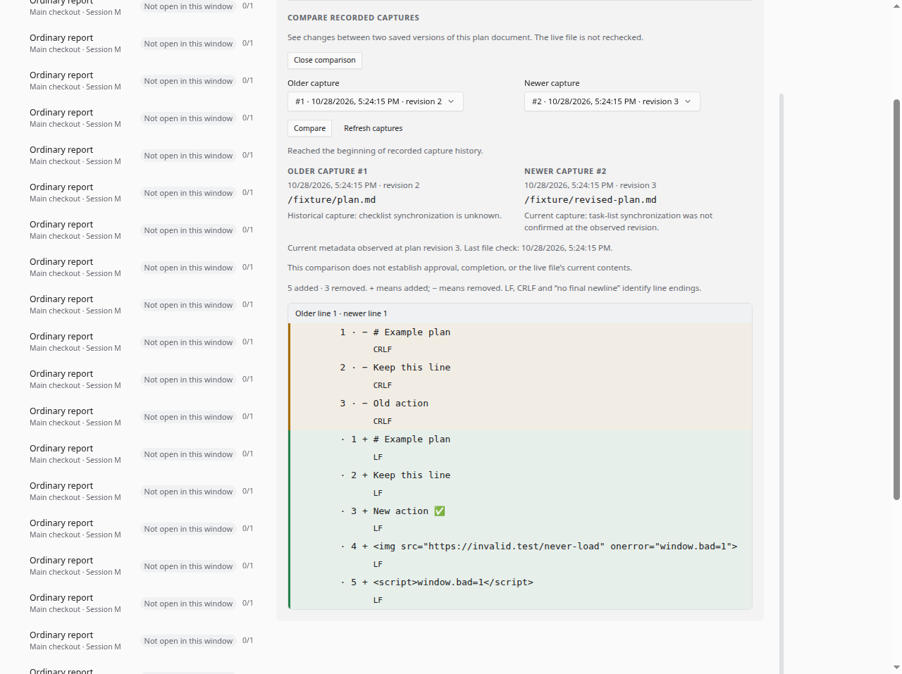
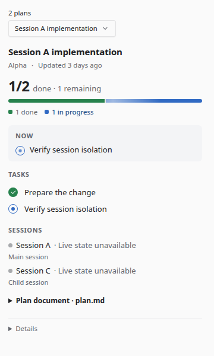
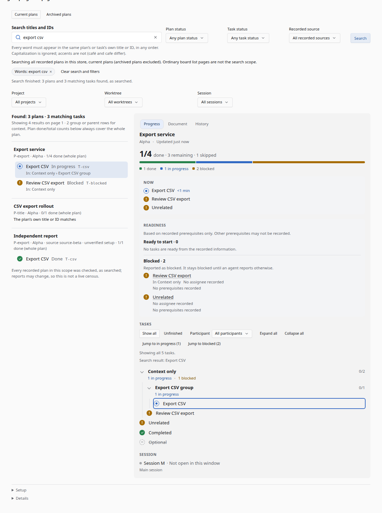
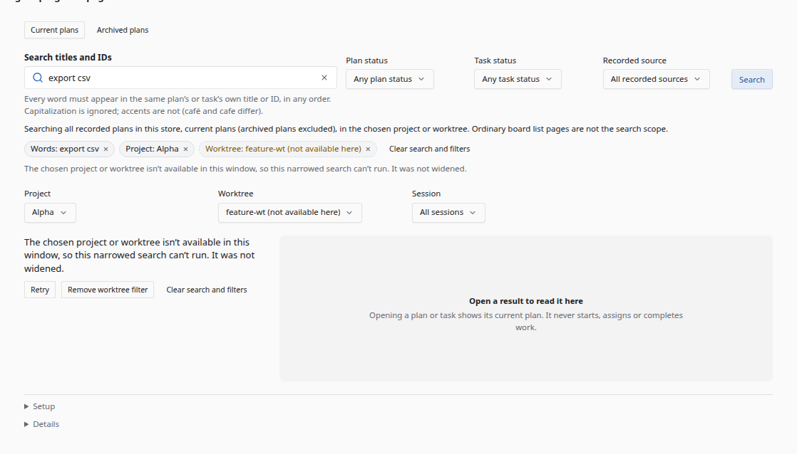
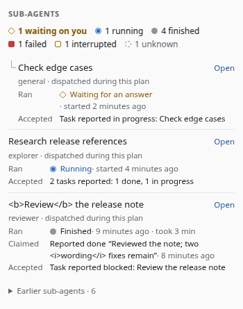
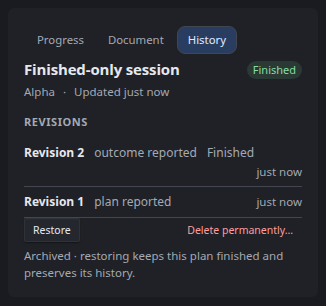
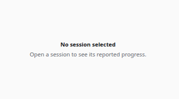

# Progress views

## Report calls in chat

An enabled, approved extension contributes one declarative rule for the full native
tool name `agent_progress_report`: **Agent progress report**, the host's
`list-check-2` checklist glyph, and `text` output. The label identifies the tool;
the glyph is not a success badge. Opening a row exposes its literal receipt or
JSON error body. Pointer, Enter and Space keep the host's normal disclosure
behavior. Native schema failures retain the host's separate red error treatment
and error text (the host normalizes its whitespace). A completed tool execution
whose JSON says `error` is not a successful report or necessarily a native red row.

There is no extension-authored subtitle or dynamic title. A richer outcome summary
is **no-go under the current receipt contract**: `changed` lists submitted IDs,
not proven status transitions; an identical retry returns its original receipt;
and an accepted report can coexist with denied document capture. An effective
change and a same-status report are **not distinguishable from receipt alone**.
Revision, input intent and a finish request never prove effective work, capture
success, approval or verified completion. Capture denial is visible in a later
report read, not added to this row's receipt.

This fixed manifest label is host-rendered, like the existing action labels, not
part of the guest language preference. No store lookup, cache, renderer, permission
or report-contract change is introduced. Other tools retain their rendering.
Without the applied rule, the host keeps generic rows: on the tested host its
humanized report name happens to be the same, but its generic tools glyph returns.
Removing this tools entry alone restores generic presentation without changing
messages, reports, captures or history. The existing host floor is unchanged; see
[tested scope and limitations](compatibility.md#report-tool-presentation).

## Interface language

The rail and fullscreen page have a **Language / Язык** selector in their lower
service area, alongside Setup and Details when those sections are present. It
remains available without a selected session or plan, during loading, before
setup, and after a failed progress read. Work Status uses the same preference
without a separate selector or host-header control. The options are OpenChamber
language, **English**, and **Русский**; there are no flags.

The default is automatic: a valid Russian host locale, including `ru-RU`, uses
Russian; English, unsupported and malformed host tags use English. An explicit
choice overrides the host locale. All three guests use that effective language
for extension-owned text, accessible names, announcements, dates, relative time,
durations, counts and plural forms. The guest document's `lang` follows the shown
interface. Product names, host-owned chrome and host clipboard/toast buttons keep
their own language. User-authored titles, session names, blocker details, search
queries, paths and document contents are not translated or written back.

One SDK **device** preference, `interface-language.v1`, stores only
`{v: 1, preference: 'auto' | 'en' | 'ru'}`. The host partitions it by browser
profile, runtime, extension and installation, not by plan, project, session,
source, progress store or integration account. It is not authenticated-user
isolation or cross-device sync. People sharing a profile/namespace share the
choice; URL aliases need not share it. Uninstall/reinstallation follows the host's
installation-identity rules. No instance/server storage or browser-storage
fallback is used. Missing means `undefined`; `null`, unknown versions and malformed
records are read failures, never an absent preference or an automatic repair.

Device requests require `features.deviceStorage === true`. An older host uses
automatic mode with a visible, accessible explanation and disabled manual
selection. Read errors keep the last confirmed choice, or automatic mode if none
is known. A write applies the selected mode only after success; pending disables
repeat selection, and failure keeps the previous mode with an explicit retryable
explanation. Arbitrary storage errors are not shown.
If a frame returns while a write is still pending, completion enables its selector
without waiting for the follow-up read; the retired write result is not accepted
as a confirmed preference.

Visible frames check the preference at readiness, at the start of the existing
3-second/8-second progress-refresh cadence, and on focus/visibility return. The
check is independent of whether progress/search succeeds and does not delay its
read. Focus alone does not retry progress. Requests coalesce; there is no new
language timer, broadcast channel or device subscription. A read started before a
local choice cannot undo its confirmed save. Concurrent frames eventually read
the final stored value; neither instantaneous propagation nor click-time ordering
is promised. Hidden/disposed callbacks cannot repaint. An already-dispatched
write can finish in storage after hiding, and returning rereads it.

Language changes are presentation-only: selected plans, tabs, task and board
filters, typed/submitted search, disclosures and map selection/pan/zoom survive.
Disclosures are retained even when another frame owns focus. Generated session
and main-checkout names follow the language; recorded session/worktree names stay
literal during workspace reloads and after their choices become unavailable.
Choosing a different search session uses that option's own label, including
sessions discovered only in search results; a retained title belongs only to its
recorded session ID. Visible map counts use the selected locale, while machine
attributes such as `data-count` and revision identifiers keep their raw values.
Work Status fractions and search totals use the same language-aware quantity
formatting; English keeps its existing ungrouped output.
History and Details also keep revision and structural-revision numbers ungrouped;
they are identifiers, not localized quantities.
Language changes neither report progress nor mark History reviewed. Document restoration,
including a retained read error, does not retry solely for translation; explicit
opening/Retry and ordinary data refresh keep their own behavior. External changes
do not steal focus and respect an independent open SDK popup's repaint boundary.
Background repaints retain this frame's logical focused control even while its
document is unfocused, but never call `focus()` to restore it then. Restoration
waits until this frame genuinely regains focus, only while its active element is
body, absent or detached; choosing another control cancels it. Repeated paints
retarget the current rebuilt control, and context/identity changes or disposal
retire the pending return. A repaint starting without an in-frame focused control
does not create a focus target.
Work Status continues its existing content-height synchronization after reflow.

The localization inventory is owned by the existing UI layers:

| Surface | Text owners and boundaries |
| --- | --- |
| Basic views and task reading | `app.ts`, the three `main.ts` entries, `components.ts`, `primitives.ts`, `model.ts`, `live.ts`, `scope.ts`, `format.ts`: loading/failure/empty states, labels, pickers, tooltips, accessibility and time ticker |
| Setup and service controls | `setup.ts`, `cleanup*.ts`, `reporting-health*.ts`: consent/access warnings, confirmations, safe errors and feedback; `supportSummary()` remains language-independent machine text |
| Search, History and documents | `search*.ts`, `change-digest*.ts`, `capture-comparison*.ts`: semantic saved messages and bounded-read qualifications, never query text, captured bytes or review state |
| Map and sub-agents | `dependency-map-view.ts`, `dependency-map-interaction.ts`, `census-view.ts`, `subagents.ts`: labels and structured announcements, not graph facts or activity evidence |
| Copy and exports | `summary.ts`, preview lifecycle in `app.ts`, task-copy controls in `components.ts`: extension-owned words only, with the same disclosure limits and literal escaping |

The glossary keeps **reported working** separate from observed **Running**;
**Ready** is not permission to start; a run, a child claim and accepted task
progress are three different facts. Translation must not turn unknown coverage
into an empty result, a skipped prerequisite into Done, or a retained capture into
the current file. Machine keys, IDs, error codes, routes and support-payload bytes
are unchanged for the same facts.

Progress-update, handoff and explicitly historical summary-only Markdown use the
effective language. English remains byte-compatible for the same input; section
order, task order, privacy omissions, Markdown escaping, LF and absolute UTC ISO
timestamps are unchanged in both languages. An open preview is reformatted from
the same validated held snapshot, without a new progress read. Changed text
starts a new generation, clears selection/copy feedback, and cannot be confirmed
by a late clipboard operation on older text. **Copy** copies exactly the shown
string, never automatically. Task **Copy details…** follows the same rule for its
existing displayed facts. Support-payload formatting is not a localized export.

Focused checks use `tests/browser/interface-language.test.ts`,
`interface-format.test.ts`, the existing summary/controller suites, and
`node --experimental-strip-types tests/browser/interface-language-qa.ts --artifacts <external-directory>`.
The latter launches a fresh disposable Chromium and a synthetic SDK shell over
the current three guest bundles, with controlled storage and refreshes. It never
uses a live host/profile or paid model. Its screenshots and keyboard/layout
assertions are rendered-browser evidence, not native-host or screen-reader
certification. Rebuild all three guest bundles after source changes.

`interface-language-reading-qa.ts` uses the same CLI with a disposable built
service to check retained search drafts/results, filters, map selection/pan/zoom,
pinned History and capture pairs, historical summary-only exports, support bytes,
and the no-I/O language-change matrix for both ready and failed documents. Inline
document repaints retain cached errors; only an explicit Retry (or a new data
reading) starts another read, not the rendering of the error itself.
The reading fixture waits for the initial detail continuation and its rendered
result before measuring language-only traffic. It also checks open map help,
selected-task details, expanded sub-agent coverage notes and retained dismissal
errors; service reply metadata distinguishes unfinished reads from new actions.
The recording-gap outcome's persistent accessible announcement follows a language
change without repeating Dismiss warning. An unchanged outcome and language do not
announce again; a delayed callback cannot restore the earlier language.

## Reporting health

Reporting health is a secondary footer control beside Setup and Details, including when the normal read fails. Opening it shows seven compact labelled status rows with visual indicators; meaning never relies on color alone. Explanations and the support summary are collapsed disclosures, so routine progress reading is not interrupted by diagnostic prose. Opening it or selecting Refresh observations performs a bounded read-only check. Configured delivery, matching loaded-companion observation, capture, selected recorded revision and viewer freshness are explained separately. Unknown/not observed and differing loaded bytes are distinct; differences warn, not block otherwise authorized reporting. A matching load is not a heartbeat or proof that every running instance or restricted child session has the tool. Select a plan to check its recorded revision; unknown states remain explicit.

The support summary is previewed in a labelled selectable text area. Copy is explicit, reports success only after clipboard acceptance, and offers manual copying on failure. It contains fixed observation enums and a numeric version, with private context excluded. No upload, persistent cache, synthetic plan, repair or automatic restart occurs. Account/store/source, selection/filter/archive/search, capture and failed-viewer changes retire the observation; otherwise it remains labelled as the last explicit check.

## Compare recorded document captures

The board's Document tab offers **Compare recorded captures** after the existing
document. Opening it explicitly discovers recorded versions and defaults to the
newest two available capture IDs. Two labelled SDK selectors choose the older
and newer capture; **Compare** reads the selected pair. Choosing the same ID
shows equal text; a reversed pair is refused with a plain explanation. Existing
document reading remains separate. The rail and Work Status never request a
comparison. An absent `documentCaptureComparison:1` capability explains that the
feature is unavailable without calling unsupported routes.



Synthetic fixture, including literal markup used to check text-only rendering.

Discovery reads at most ten bounded windows per explicit action. Empty windows
do not establish no history; **Look for older captures** continues it. The option
page retains at most 50 entries plus the two selected records. Advancing replaces
the page while keeping selected IDs. Refresh discovers new versions without
silently changing that pair. Zero/one-capture messages require exhausted,
successful discovery; failed windows retain prior choices with Retry and never
claim complete coverage. New reports offer refresh while the pair stays pinned.

`capture-comparison.ts` owns one frame-local visit. Identity includes integration
account, service/store/source binding, selected source/plan, board/search scope
and cleanup generation. Leaving Document, selection/context changes, hidden
frames, cleanup and disposal retire reads; no stale callback can continue
discovery or restore removed bytes. A 404 clears retained comparison data and
selections. Archive remains inspectable, but archive/restore restarts the visit.
Normal list/search freshness observes remote deletion; filtered-list absence is
not deletion. A search-opened plan uses complete validated detail metadata even
outside the ordinary 500-plan list. There is no comparison polling or browser
persistence, and no writes to reports, review points or the source document.

The board retires requests synchronously through `beforeUiChange` when effective
selection, tab, archive, filter or search scope changes, before the next paint.
Background repaint deferral applies only to independent expanded SDK popups with
`aria-haspopup`. The reading-owned Filters panel (`data-live-popup`) and its
dropdowns never freeze freshness, capture, comparison or deletion updates.
An open dropdown in the same account/store/mode is moved natively into the fresh
paint with current options and callbacks, while the surrounding warnings/results
are rebuilt. Closed or retired panels cannot retain an old dropdown. Repeated
project controls restore focus by both their test hook and exact `data-project`.

`capture-comparison-view.ts` renders literal text through textContent. Unified
hunks show old/new line numbers, +/− prefixes, three context lines and explicit
omitted-context counts. Changed lines distinguish LF, CRLF and no final newline.
Long lines wrap; selectors and capture metadata stack at narrow widths. Text uses
the host foreground token; border/tint colors supplement the textual prefixes.
No captured HTML, remote assets, markdown rendering or source editing is enabled.

Capture timestamps and paths identify each version. Current checklist metadata
is labelled with its observed plan revision and last file-check time; historical
synchronization stays unknown. Denied/missing/other later file checks can retain
readable earlier captures, explicitly labelled as retained. An equal comparison
does not prove the live file unchanged. Limit states explain why no partial diff
is shown; comparison never establishes approval or completion. See the
[wire limits](contracts.md#recorded-document-comparison-additive-revision-1).

Focused validation: `tests/backend/document-captures.test.ts` exercises real
storage/service reads and pure diff bounds; `tests/browser/capture-comparison.test.ts`
exercises adapters/controller against a real disposable HTTP service.
`node --experimental-strip-types tests/browser/capture-comparison-qa.ts <artifact-directory> --built-service`
drives current guest bundles with real keyboard/pointer input in isolated
Chromium, synthetic SDK events and disposable built services. It records bounded
results, request metadata and synthetic screenshots. This is rendered browser
evidence, not native-host or screen-reader certification.

Three visible guest frames read production contract v2 (`shared/progress.ts`,
`docs/contracts.md`) through `host.serviceRequest`. Rail/page also expose its optional,
explicit finished-plan cleanup actions; Work Status remains read-only. Full-page History
alone adds a "Since you last reviewed" change digest (see Change digests); the board alone
adds plan/task search (see Board search).
- Built from `@openchamber/sdk/ui` and host theme tokens; TypeScript source, classic IIFE bundles.
- This file is the authority for the UI surfaces' structure and behaviour; the wire contract lives in `docs/contracts.md` and `shared/progress.ts`.

## Build and checks

Use Node 24.x >= 24.19.0 on PATH. Checks were tested on 24.19.0; later 24.x
releases are accepted but not separately certified. CI's release gate uses exactly 24.19.0; a second job runs the newest 24.x.

```sh
node_modules/.bin/tsc -p ui/tsconfig.json --noEmit
node --experimental-strip-types --test tests/browser/*.test.ts
bun run bundle:guest ui/panel/main.ts ui/panel/main.js   # same for status, page
bun run bundle:guest background/main.ts background/main.js
```

Entries `ui/{panel,status,page}/index.html` load `main.js`, the generated installable artifact. There are no runtime dependencies, remote assets or CDN loads. The panel ID stays `agent-progress-probe` (`ui/shared/config.ts`), so Work Status can open the rail with `openSurface('plugin:agent-progress-probe')`.

## Layers (`ui/shared`)

| Module | Role |
| --- | --- |
| `i18n.ts` / `language.ts` | Effective en/ru resolution and the shared device preference controller: feature-gated storage, confirmed values, safe failure states and stale-reply guards. Catalogs and text helpers remain pure; language never becomes a reading/cache identity. |
| `adapter.ts` | **Only** module that knows the wire format. Validates and maps v2 replies: `/health`, `/v1/plans`, `/v1/plan` (with optional `timing`), `/v1/document`, `/v1/history`, `/v1/change-digest`, `/v1/search`, `/v1/search-state`, `/v1/setup`. Builds query and setup bodies. Protocol/schema ≠ 2 fails as incompatible. |
| `model.ts` | View model and pure semantics. Plan summaries use server `counts`; detail subtrees use the shared `countItems` (same rule). Hierarchy, current work, participants, document-state copy, and the task-view projection (row membership, branch aggregates, jump order; see Task view). |
| `dependency-derivation.ts` / `readiness.ts` | Pure shared dependency derivation and enriched readiness projection of an active plan's complete detail (see Task readiness). Never changes status, counts or assignments. |
| `summary.ts` | Pure deterministic Markdown for progress updates, handoffs and explicitly historical summary-only snapshots (see Previewable summaries). Uses complete matching detail and the shared readiness projection. |
| `source.ts` | Paged reads through the host proxy (rules under v2 mapping below). Classifies fixed error codes into plain states. |
| `live.ts` | SDK workspace enrichment: projects plus bounded worktree discovery and selected session streams. Shared project membership, coverage, live-state labels, navigation gating (`canOpen`), and `restart()` after a context change. Keeps each stream's directory coverage; never a receipt time (see Sub-agents). |
| `census.ts` | Sub-agents: the pure host census of one root session's verified descendants and the host's last reported activity words (no expiry). |
| `runs.ts` / `subagents.ts` / `census-view.ts` | Sub-agents: one bounded sub-agent runs revision-1 visit per eligible section (`GET /v1/subagent-runs`, one automatic `POST …/reconcile`, and the explicit recording-gap `POST …/dismiss-loss` on rail and board), the pure roster joining recorded runs, host activity and the plan's explicit task facts (Ran / Claimed / Accepted), and its section for rail, Work Status and page (see Sub-agents). |
| `scope.ts` | Server list scope per surface, owned-first ordering, page project/worktree grouping, coverage gap. |
| `setup.ts` | Setup UI, phases, plain-language SetupError and diagnostic text. |
| `cleanup.ts` / `cleanup-view.ts` | Bound cleanup targets, eligibility and plain error copy; rail/page actions and inline delete confirmation. The shared controller owns mutations and cache retirement. |
| `app.ts` / `refresh.ts` | Frame lifecycle, caches and repaint rules (under Controller below). |
| `change-digest.ts` / `change-digest-checkpoint.ts` / `change-digest-view.ts` | Page-History digest: one pinned visit per frame and explicit review (controller), device-scoped review checkpoints (no other storage scope), and the section's DOM plus pure text rules (see Change digests). |
| `search.ts` / `search-view.ts` | Board search: the DOM-free controller (criteria, frozen location membership, bounded windows and pages, freshness, retirement) and its form, chips, counts, coverage and grouped results (see Board search). |
| `dependency-map.ts` / `dependency-map-layout.ts` / `dependency-map-interaction.ts` / `dependency-map-attribution.ts` | Dependency map logic (board Map tab and rail Plan view Map; see Dependency map): the frame-local graph + complete-detail picture, full-plan geometry, frame reading/interaction state and the map's attribution proof over the surface's existing run visit. No DOM. |
| `dependency-map-view.ts` / `dependency-map-style.ts` | The one map renderer for both frames, the Plan view switch, the production frame wiring (`createMapFrame`) and the map-only stylesheet. Work Status imports none of these. |
| `components.ts`, `style.ts`, `format.ts` | DOM pieces, CSS from host tokens only (including reported-progress motion), locale-aware time. |
| `primitives.ts` | Presentation-only shared primitives: status marks, state chips, the segmented bar, the ⓘ info disclosure, the ⋯ plan-actions menu and compact warnings (see Shared primitives). Depends only on the SDK kit, so a view can use one without the plan detail. |

## v2 mapping (frozen contract → UI)

- **List.**
  - Each `data[]` row is a `PlanSummary`.
  - The plan key is `${sourceId}/${id}`; the owner is `sessionId`; `finished` displays as "Finished".
  - List rows and summaries use server `counts` / `working` only.
- **Rail and Work Status.**
  - Read `/v1/plans?session=<ctx session>` only for an explicit selected session. Null/draft/missing session is **No session selected**, even if directory metadata exists: health only, no plan list or part requests and no fabricated store read.
  - A successful empty session read is **No plan reported for this session**. Pending and failed reads stay distinct from that authoritative empty result.
  - The server's filter includes participants (links, assignments, attributed contributions), so a contributing child sees the plan it works on, with a "contributes to a plan from …" note. A fork with no recorded membership does not inherit ancestor plans.
- **Page.**
  - Reads all plans (`limit=50`, cursor pages up to 10).
  - The session filter goes to the server (`session=`); project/worktree narrowing is local, from the recorded `directory` plus live SDK labels.
  - This is the history board, independent of host-selected session. Host A/B/null updates do not narrow current/archived lists or reset its explicit filters. The host may destroy the frame during navigation; reopening starts the page's ordinary defaults, not an implicit host-session filter.
- **Detail** (`/v1/plan`) loads on demand for the shown plan only.
  - Items and contributions page with one cursor: each nested `nextCursor` is passed back verbatim, and reading stops when both are null.
  - If `plan.revision` or the plan's cleanup state/generation changes between pages, the read restarts (bounded); pre-cleanup annotations are never joined to a restored/current detail.
  - Optional `blocker` annotations on blocked task items are re-validated in `adapter.ts` (shape, bounds, provenance, `validAtRevision` equal to the plan revision) and mapped to `ItemView.reportedBlocker`; optional `blockedTiming` is anchored like `timing`. See Blocked (reported blockers).
  - Every page must match the first page's store, source binding and requested plan; a mixed page is a refused read (unreadable reply), never joined into one detail, even at the same revision. A failed continuation or page-cap exhaustion is an error, not a partial detail.
  - A present `dependencies` value must be an array of nonempty strings; anything else refuses the reply instead of reading as "none recorded". An omitted list stays valid.
  - Contributions use `itemIds[]` and never change counts. Relays show "Reported by <reporter> for <child>".
  - Optional `assignmentBinding` on task items (delegation provenance, `docs/contracts.md`) is re-validated in `adapter.ts` (known keys only, `tool:"subagent"`, same plan/item, child equal to the item's assignee, coordinator equal to the plan owner, ISO times, `boundRevision` ≤ revision, `validAtRevision` equal to the plan revision) and mapped to `ItemView.delegation`; call/message IDs are checked, not kept. Anything doubtful is dropped: the assignment still shows from the assignee, with provenance unavailable — never "unassigned".
- **Optional cleanup.** `health.planCleanup === 1` enables actions; absent/unknown hides them and the page explains that cleanup is unavailable. Optional plan `cleanup` is validated separately from progress revisions. Normal/archived list modes never share a scope-cache key; an older service is not asked an unsupported archive query and never establishes an empty archive.
- **Document** (`/v1/document`) loads on demand, when the disclosure opens or the Document tab is shown.
  - Continuation pages pin the first reply's `captureId`.
  - States (`denied`, `missing`, `moved`, `oversized`, `non-text`, `unavailable`, `changed-during-read`) get plain copy.
  - A retained earlier capture stays readable, labelled "last successful capture, not the current file".
  - `checklistSynchronized` adds "task list was confirmed against this capture".
  - `currentFile` is always described as not rechecked; age never implies out-of-sync.
  - Continuation pages pin the first page's capture ID, so the text is always one capture. If any page answers `historical-capture` (a newer capture landed mid-read), the body says "A newer capture was recorded while this loaded. This is the earlier capture." The next refresh loads the new capture.
- **History** (`/v1/history`, page tab): oldest-first pages, labelled plan reported / tasks revised / outcome reported / progress update. The page's History tab adds one pinned `/v1/change-digest` read above it (Change digests); legacy history pages are never fed into it.
- **Health.**
  - `ready:false` is a setup state, never an empty success.
  - `503 {error}` maps to plain states: `corrupt` → damaged, `schema` → incompatible, `busy` → busy, others → service not responding.
- **Navigation.** "Open session" appears only when the plan's `sourceId` equals the verified `sourceBinding.sourceId` **and** the session is in this host's current SDK snapshot. Other plans stay readable with "From another OpenCode setup" and no target.
- **Source identity.** A plan whose recorded source has `verified:false` shows "Unverified OpenCode setup" in its header and an "Unverified setup" (warning) badge in the page list. Details lists every recorded source with its verified flag.
- **Windows directory spelling.** Checkout/worktree membership, directory-scope cache keys and compact location labels compare drive-qualified Windows slash/backslash spellings consistently, including drive-letter case. Folder-name case stays unchanged; similar path prefixes do not establish checkout ownership, and POSIX backslashes remain ordinary name characters. Recorded paths are displayed as received.
- **Cache identity.** Frame generation + `storeId` + `sourceBinding`. A change resets UI state and the detail, document and history caches.

## Surfaces

**Right rail (`ui/panel`).** Shows the scoped plans, never merged. With several, the plan title is the picker: a quiet "⌄ 2 of 3" trigger beside the title (also a pointer target on the title itself) named "Plan 2 of 3: <title>. Choose another plan", whose popup lists every scoped plan with its done/total or lifecycle.
- The chosen plan is **persisted per session** in host storage (`rail-plan:<sessionId>`), so it survives panel remounts and reloads.
- Within the frame, recent session choices are also remembered by source-qualified plan key: A → B → A keeps the choice when still visible even if storage returns no saved preference. Store/source or integration-account changes clear this memory. A pending preference reply cannot override a newer explicit picker choice.
- **Plan view: List / Map** is available whenever a plan is shown, including a single plan. **List** is the shared Progress list; **Map** is the full dependency map of that plan, not a mini-map or subset. D8 chooses Map for a new supported reading whose complete detail records a task-to-task prerequisite, otherwise List (see Defaults below). Cleanup and the separate Sub-agents roster stay outside the map in both views; the plan document, summaries and Sessions stay in List. An explicit view choice lasts only for that reading: session or plan-picker changes reset it, including A → B → A. No selected session means no switch and no graph read.
- **Host limit.** The host can't open the fullscreen board from the rail (the pinned SDK offers no page opener), so the rail hosts the map itself. Nothing in the rail opens, links to or synchronizes with the board.
- Reading order (List):
  1. Plan view: List / Map
  2. the plan header: title (the title-picker beside it), lifecycle when closed, an ⓘ for contribution context ("This session contributes to a plan from …"), the ⋯ Plan actions; one meta line (location, "Updated …", visible source warnings)
  3. done/total and the segmented bar; the nonzero state chips with their ⓘ; concrete qualification lines
  4. the canonical task list (see Progress list)
  5. one session row (the main session, its live state and a verified "Open session"; "N more sessions" opens the Sessions panel; session titles and live state only for plans of the verified bound source; see Session labels)
  6. **Sub-agents** of the selected session for the plan shown (see Sub-agents); none under the no-plan message
  7. collapsed Details (also ⋯ → Details)
  The plan document, summaries, task view options and the full Sessions list open from ⋯ (see Progress list).
- Map: the compact "⌄ Plan 2 of 3" picker stays above the map, which keeps its own header.
- Unconfigured service: the setup flow in compact form. After install, a reload notice.



**Work Status (`ui/status`).** Compact, scoped only to the section's explicit selected session.
- **Automatic** features the most recently reported active plan with explicitly working task IDs (stable plan-key tie-break). Without one, it keeps the existing scoped ordering: owned-first, then active/recent within each ownership group, including the existing finished/cancelled fallback. Live Running/Idle labels never determine selection or completion.
- With multiple scoped plans, the featured plan's title is the picker: a quiet "⌄ Automatic" (or "⌄ Chosen") trigger beside a short title or below a long title, named "Featured plan: <title>, chosen automatically / chosen. N plans; choose another", whose popup offers Automatic and every available plan with its full title and working count or lifecycle. A pointer press on the title opens it too. A single plan is a plain title, not a picker. A manual choice, including a pending or finished plan, stays through refreshes, newer reports and directory moves of the same session. Removed choices revert to Automatic. Choices are frame-local, retained for up to eight recent session contexts, and cleared when the store/source binding or integration account changes; reopening the frame starts Automatic. No asynchronous preference restore or server writes.
- Shows, compactly and in this order (`ui/status/projection.ts` facts from the featured plan's existing detail cache, no extra read):
  1. the title (wrapping to the full available width, never truncated), its picker, and the lifecycle badge on closed plans; the picker and badge wrap below a title when needed;
  2. the whole-plan segmented bar, then "3/8" (spoken "3/8 done, 5 remaining"; with every task done, the done mark and success colour of All done) with informational chips (no list to filter, so not buttons): active plans with complete valid detail show in progress, blocked, ready, waiting and skipped; closed plans and invalid readiness show reported statuses only (in progress, blocked, pending, skipped); without complete detail only the list's in-progress count. Zero chips are absent;
  3. visible qualification lines: "Not refreshed since …" (`stale-banner`), "Capture off: these are the last reported counts." (`capture-off`), readiness unavailable, task details not loaded, or recorded prerequisites outside the plan. A failed detail read shows `status-detail-unavailable` even on a finished, cancelled or failed plan; valid summary totals remain visible without fabricated detail facts;
  4. at most two focus rows (`current-work`): the first reported blocked task, then the first reported working task with its elapsed time, each once and in recorded order; titles wrap;
  5. one meta line: "Updated …" and the owner session's live state;
  6. **+N more plans** (`more-plans`), which opens the picker; its options show full titles with reported working-count hints for active plans or lifecycle hints for closed plans. Select a plan to see its done/total counts;
  7. only with a featured plan and something useful to show, **Sub-agents**: the summary line, one line per running sub-agent (title and its Ran words with real time) that expands in place to every recorded fact, and every other record in one folded list with the existing pager and the one short coverage line (a recording gap only while it needs attention; no Dismiss warning here). No ⓘ here (its popover would be clipped by the auto height);
  8. **Open progress**.
  "No plan reported for this session" has no sub-agent section, count or prompt. Everything wraps at 190 px without horizontal overflow; the host's Project section stays outside the guest.
- Detail loading follows the featured plan. Live project subscriptions take the selected session's own project first, then the featured plan's, including a selection beyond the first three list entries; the two-session-stream/32-total-subscription limits remain unchanged.
- "Open progress" calls `openSurface` to open the rail, whose selection remains independent. The compact picker does not synchronize other panes. Unconfigured shows "Set up", which opens the rail's setup flow.
- **No dependency map.** Work Status has no map UI, entry, explanation, announcer or graph read, also while the board or rail shows a map.
- `setHeight` follows content: each paint asks once for the content height, and so does each disclosure change that changes layout in place (a roster row or record list opening), through the same bounded checks. A queued toggle restoring an already-measured disclosure after a repaint does not send the same layout again; detached roots cannot send. If the host then leaves the frame exactly as it was (a dropped request), the frame asks again, at most three times with growing waits (about 100, 200 and 400 ms, counted in animation frames: no timers), with at most one pending check that a newer paint, hiding or closing cancels. While the frame is hidden its paints send and queue nothing; when it is shown again only the latest height is sent and checked once. A frame the host resized, including one clamped to a host maximum, counts as applied and is never asked again (nor is a later height above that cap), and a newer paint replaces any pending check. A retired check never cancels or delays a newer one. The frame never writes a badge.


**Fullscreen page (`ui/page`).**
- **Listbox membership.** Each project/Current/Finished list seeds its active descendant only from a selected plan object in that exact scoped list, otherwise none. A plan moving into a closed Finished fold does not become an implicit Enter target of the still-focused Current list. Enter without an active option does nothing; explicit keyboard navigation and selection inside an expanded Finished list still work. Equal plan IDs from another source, or a same-key object from another read, are not membership.
- **Focus when plans finish.** If a pointer-focused active plan becomes Finished or Cancelled and moves into its project's closed Finished fold during polling, focus moves once to that project's Finished toggle with one polite explanation. The fold stays closed, including when the user deliberately collapsed it. Later paints/polls do not repeat the explanation. Focus elsewhere or in another board reading is not moved.
- **Plans by project.** Each project's rows are one keyboard listbox: a status mark (named In progress, Active, Finished, Cancelled or Failed), the title, whole-plan done/total and a decorative mini bar. Location, owner session and live state are part of the row's name; Failed, Cancelled, Unverified setup and Other setup stay visible as badges. In Current plans each project's Finished and Cancelled plans fold into one **Finished · N** button (`aria-expanded`, described as "N finished or cancelled plans loaded here. Search finds them too."); failed plans stay among the project's rows and Archived plans shows every row. Folds start closed and belong to the board reading (integration account, store/binding, Current/Archived, filters and submitted search): same-scope repaints and polls keep them, a new scope or a search starts collapsed, an explicit selection of a folded plan opens its fold once, and collapsing never deselects, archives or filters. Opened rows keep their real lifecycle. The loaded count is not a library census. The listbox region sits under the list region's heading **Plans** (`plan-list-heading`, a focus target, never a Tab stop). A focused group listbox rings its active option (or itself, with no active option) in the host focus token; selection keeps its own highlight.
- Detail tabs: Progress / Document / History / Map; D8 chooses the initial Progress or Map view from the reading's existing complete detail (see Defaults below), and the focused tab shows a host focus-token outline. The Progress tab is the same shared Progress list as the rail (without the rail's picker, Plan view switch, Plan document or Details entries: the board has Document/History tabs and a footer Details), followed by **Sub-agents** rooted in the selected plan's coordinator for that plan (verified-source plans only; see Sub-agents). History shows "Since you last reviewed" above Revisions. **Map** shows the selected plan's dependency map (see Dependency map) followed by the same Sub-agents roster; it follows board browsing and search selection, filters and Current/Archived like the other tabs, never the host session. A coverage note covers missing live state, other-source plans and the subscription cap.
- **Board layout.** The page is at most 2400 px wide (centred beyond that) on every tab, so the plan list and the detail tabs keep one position when the tab changes. From 820 px the board has two columns: the plan list (260–340 px) and the detail column. On the Map tab the map uses the whole detail column; Progress, Document and History hold their content to a reading width of at most 1120 px, left-aligned in that column (`plan-detail` carries `data-tab`). Below 820 px the list stacks above the detail, as before.
- **Board bar** (see Board search): Current plans, Archived plans, the search field and **Filters** are its only controls in the quiet state; the project, worktree and session selects are inside Filters. While a search is shown, its grouped results (never folded) replace the plan list; the detail pane and tabs are unchanged.
- Footer zone: collapsed **Setup**, then collapsed **Details**.

**Visible focus (all surfaces).** Kit buttons and triggers whose own focus mark is only the hover tint get an inset host focus-token outline: the task-view buttons, Clear task filters, Open progress, Set up, Try again in failure/stale banners and the rail plan picker (Work Status and participant pickers already had one). App controls keep their existing rings.

## Native session entry and optional host context

The session menu's **Open Agent Progress** action opens the existing panel for
the clicked session, including an inactive session while another chat is visible.
The initial ready item and later `onItem` updates use the same context owner.
The action's explicit session/directory must match current host coverage and the
verified service source binding. Titles, similar paths and same-spelled IDs in
another source cannot substitute for that identity. Loading, missing/unavailable
session, ambiguous location, denied access and incomplete/failed reads are explicit
states, never a fallback to the visible chat or a certified empty result.

The clicked scope stays pinned through chat changes. A new valid action replaces
it; an explicit ordinary panel opening without an item restores current-session
behavior. Runtime/account/source changes retire old responses; project/worktree
moves require revalidation. Multiple eligible plans use the existing picker and
selection indications; a complete empty result says no plan for that session.
Board browsing and filters remain independent. No compose/send/status request,
background frame, cross-frame selection or guessed page URL is used for opening.
Both existing background insertion actions keep their established behavior.

**Host reopening limitation:** an isolated OpenChamber 2.7.1 check found that
closing and reopening the existing panel retains its previous action item.
That does not deliver the ordinary no-item transition above: the panel remains
pinned ([upstream issue #6938](https://github.com/openchamber/openchamber/issues/6938)).
Do not assume closing it restored current-session scope. The pinned-scope row
offers **Show current session** (**Показать текущую сессию** in Russian), including
when the pinned target is unavailable. This explicit local reset returns this
frame to the host's actual current session/directory, or the ordinary no-session
state. It retires old pinned reads and selections without a host/store write,
cross-frame message or persisted preference. When the focused reset disappears,
focus moves to the resulting state's heading. Chat changes and visibility alone
never unpin. Re-delivery of the retained item must not undo an explicit reset;
a genuinely different or host-cleared item ends that replay suppression.

A further isolated 2.7.1 check found a limitation after reset: deliberately
choosing **Open Agent Progress** for the same session again supplies the same
item data as a replay, and the panel stays on the current session instead of
pinning that target again, including after close/reopen. Use a different session's
action first, then the original session's action, or reload OpenChamber. The
supported item has no action-instance identifier; a per-click identifier has been
requested in #6938. A host-cleared item also remains distinct. The reset lasts
for the guest frame: do not infer a new action from visibility, size or chat
changes to work around this documented ambiguity.

Expanded **Sessions** has one localized section heading; the participant list
retains every participant and optional host fact without repeating that heading.

Session details may show **Host-reported agent** (up to 80 code units) and up to
five **Host-linked issue/change** titles (up to 200 each), with a more-links
qualification. These are bounded literal host context, not assignment, task
authority, completion or workflow selection. Missing data is ordinary; malformed
optional data is omitted without invalidating session identity. No URLs are
fetched or made executable and no new polling/cache is introduced. Extension
explanations and accessible names support English/Russian; native action labels
are host-owned fixed text.

There is no **Open Workflows** action: SDK 2.7.0 supplies no supported Workflows
destination or availability contract. `openSurface(string)` does not establish
one. A future verified public navigation API would require a separate change.

## Shared primitives (`primitives.ts`)

Presentation-only building blocks for all three surfaces. They read nothing, store nothing, start no timer and hold no reading state; an owning view supplies counts, labels and callbacks. Status marks, segmented bars, state chips, ⓘ disclosures, ⋯ plan-actions menus and compact warnings are integrated into the Progress reading.

- **Tokens.** Host `--oc-*` tokens only: shapes use the status tokens (`--oc-success`, `--oc-info`, `--oc-warning`, muted), text uses the readable `--oc-*-text` tokens. Orange is the warning and primary colour in several host themes, so it is kept for **Blocked**, primary actions and focus. Selection (a pressed chip) uses the host's neutral selection token, and the map's Unlocks next emphasis is neutral too. Nothing uses a hardcoded palette or font.
- **Status marks** (`statusMark`). An inline SVG with one shape per state: pending (ring), reported working (ring with a dot), blocked (filled disc with "!"), done (filled disc with a check), skipped (dashed ring with a dash), ready to start (ring with a play triangle), waiting on prerequisites (ring with clock hands). The root is `data-testid="status-mark"` with `data-status`. The SVG is always `aria-hidden` and never focusable. A mark with no adjacent status words is `role="img"` with a name; working is named **Reported working**, never "Running" (only sessions and sub-agents are observed running). A mark beside words that already say the status is hidden from assistive technology. Task rows, readiness, search hits, digests, Work Status and the progress legend use these marks through `glyph()`, which keeps the `.ap-glyph` hook.
- **Segmented bar** (`segmentedBar`). `data-testid="progress-bar"`, `role="img"`, named by the owner's summary sentence (done of total, remaining, skipped when present, then in progress and blocked). Segments are decorative `<i data-k data-status aria-hidden>` for done, working and blocked over the task total; the track is the rest. Skipped tasks are outside the total and never drawn as done. No bar is drawn for a zero total, so there is never a NaN, Infinity or invented percentage. Widths are static (the kit bar's animated fill is not used); only the existing reported-progress sheen moves (see Reported in-progress motion). The surrounding `counts` element keeps its dataset. It follows the SDK kit progress look: a 6 px pill track at 6% of the text colour and pill-shaped segments, with done in the success token, the kit's finished green (the bar reads the same host colours as the kit through the `--oc-*` aliases). Unlike the kit's single fill, segments keep their status colours (working stays blue, not the host primary) with 2 px gaps and a 3 px minimum width, so a small count stays visible. The board's decorative row bar stays 3 px.
- **All done** (`allDone`). When every task is done (a nonzero total, nothing remaining and nothing skipped; skipped is never done), the owner's done/total count gets `data-all-done`, the readable success-text colour and a decorative done mark before it, the counterpart of the kit's green check and percentage. The mark is `aria-hidden`; the count's words and the bar's name already say it, so nothing extra is announced. Rail, board and Work Status counts use it; the board's row bars do not.
- **State chips** (`stateChip`, `stateChips`). Root `data-testid="state-chip"` with `data-state` and `data-count`: mark, count and state word. A zero count draws nothing. An interactive chip is a native `<button aria-pressed>` whose accessible name is its visible text (for example "1 blocked"); Enter, Space and click activate it once. An informational chip is a plain `<span>` with no role, tab stop or pressed state. The count is whatever whole-plan number the owner passes; a chip never recounts. A labelled group (`role="group"`, `data-testid="progress-chips"`) holds them; that hook avoids the `state-` prefix the read-failure states use.
- **Info disclosure** (`infoDisclosure`). For generic explanations only, never warnings. Concrete warnings stay visible lines, except the routine sub-agent coverage notes on the rail and board, which sit behind that section's inline **Partial** cue (see Sub-agents, Records and recovery). Wrapper `info-disclosure`, native trigger `info-trigger` (contextual name such as "About readiness", `aria-expanded`, `aria-controls` and `aria-describedby` pointing at `info-content`). Closed content is `hidden`, so it is out of the accessibility tree and Tab order; the trigger's description still lets a screen reader hear it on focus. Keyboard focus or a click opens it without moving focus; a pointer press opens it on click only, so it does not open and close in one press. Enter or Space toggles. The content follows the trigger in Tab order, so any controls inside are reachable; pressing on the text keeps it open. Escape closes, keeps focus on the trigger and does not reopen it until a fresh focus or click. Focus leaving or a press outside closes it. It is not a dialog and has no focus trap. It positions inside the page below the trigger and shifts to stay within the frame width, wrapping at narrow widths. It carries no `aria-haspopup`, so an open explanation never defers a repaint (Controller). The shared `info()` owner tracks handles by painted root, including task-fact explanations created later on toggle. After replacement it disposes the previous paint's handles before restoring focus, removing document pointer and window resize listeners and pending attachment frames. Open-state keys are separate: disposal is not a user close, so the same reading can restore its open explanations on the new paint. Reading retirement and pagehide dispose all remaining handles and clear those keys. Direct primitive owners must likewise call `dispose()` when replacing or retiring their root; cleanup never depends on a later pointer press.
- **In-place explanation removal.** Collapsing a task removes its lazy facts without a full repaint. Before removing that subtree, dispose and unregister its explanation handles, even those never opened. Re-expansion builds fresh facts and controls from the same reading; only reading-local open-state keys survive, not detached DOM or listeners. Other in-place removers of explanation-bearing content must use the same cleanup. Merely folding retained roster records does not remove their DOM.
- **Plan actions** (`planActions`). Wrapper `plan-actions` around the SDK menu: the trigger visibly reads ⋯ and is named **Plan actions**. Menu and menuitem roles, `aria-expanded`, arrow keys, Enter, Escape and the return of focus to the trigger are the SDK's. Items only open existing panes or controls, which render outside the menu. While the menu is open the SDK's `aria-haspopup` trigger defers repaints as for other popups. `dispose()` is the SDK menu's.
- **Compact warnings** (`warningLine`, `warningBadge`). An always-visible qualification line (`.ap-warn`, `data-tone` = `warning` | `error` | `info` | `neutral`): a small triangle or ⓘ mark in the tone's readable colour plus foreground words, so the words carry the meaning and orange stays rare. `neutral` is an ⓘ mark in the muted token, for a routine qualification that is not a warning. A short badge (`.ap-warn-badge`) for beside a title; a neutral badge uses the muted surface. Both wrap at narrow widths instead of clipping.
- **Forced colours, motion and reflow.** In forced colours marks and icons use system colours with their shapes intact, the bar becomes an outlined track with solid, highlighted and hatched segments, a pressed chip gets a Highlight border and popover/badge edges use CanvasText. No primitive animates; the working dot's pulse in the Now callout and Work Status is the existing reported-progress motion. Chips, warnings and info content wrap at 280 px and at 200%/400% reflow without horizontal page overflow.

## Progress list (rail and board Progress)

One calm progress story per plan, built from the shared canonical projection (`progress-projection.ts`) of complete matching detail. Every task appears once, as one canonical row; details open in the row. It reads nothing new and stores nothing: every choice below is frame-local reading state (see Task view › Reading identity).

- **Header.** One title heading (`plan-title`, `tabindex=-1`), the rail's title-picker beside it when it fits or on the next line, the lifecycle badge on closed plans, and **⋯ Plan actions**. One meta line: location · "Updated …", plus visible warning badges "From another OpenCode setup" and "Unverified OpenCode setup".
- **Progress line.** "3/8" (spoken "3/8 done, 5 remaining") beside the segmented bar (6 px, as everywhere except the board's row bars). No percentage; a zero total says "No tasks reported". With every task done the count shows the done mark in the success colour (see All done). The chips below are its legend.
- **State chips** (whole-plan counts from complete detail, zero chips absent): active plans with valid readiness show in progress, blocked, ready, waiting, done and skipped; closed plans and invalid readiness show reported statuses only (in progress, blocked, pending, done, skipped) with no ready/waiting advice. A chip filters the list to that one state; pressing it again clears it. Counts never become filtered totals. The "About these counts" help explains that counts cover the whole plan, ready/waiting use recorded prerequisites only, Ready is not permission to start, and Blocked lists all reported blockers until an agent reports otherwise. Needs you is separately limited to decision/review waits.
- **Qualifications stay visible** as compact lines (`progress-qualifiers`), never behind help: last-reported readiness under the stale banner; "No reported blockers in the last successful read…" / "No reported blockers were recorded. Capture is off…" when Blocked is empty but not current; "Capture is off: these are the last reported blockers…" with blockers shown under capture off; incomplete recorded prerequisites; "Readiness is unavailable for this report: …" for an invalid graph. A current, capture-on plan with no blockers says nothing (the zero group and chip are simply absent).
- **Groups (default attention order).** **Now** (reported working), **Blocked** (all reported blocked tasks), **Up next** (pending: ready or waiting), then **Done · N** and **Skipped · N**, folded. Rows keep recorded item order inside each group. On closed plans and invalid readiness the groups say Reported working / Reported blocked / Pending / Done / Skipped. A group with no shown row is not drawn. Choosing the done or skipped chip unfolds its group without expanding any row; the folds' open state belongs to the reading (`doneOpen`, `skippedOpen`). **Plan order** shows the recorded hierarchy instead, groups with their done/total and in-progress/blocked counts and every task its one canonical row; a plan with only groups always shows its hierarchy. The two views are never drawn together.
- **Row.** Status mark (named: Reported working, Blocked, Ready to start, Waiting on prerequisites, Pending, Done, Skipped), the literal title, and at the right: elapsed time for reported work, the wait category and reported wait for a blocker, "Ready", or "Waits on N" (unfinished recorded prerequisites). The time and chevron wrap together below a long title. Activating the row (its `summary`) expands its facts in place: Reason, Next step and Reported wait (a reported blocker; unknown values say Unknown); **Needs first** (every recorded prerequisite in recorded order, each a "Show prerequisite: …" button, or "No prerequisites recorded", with an ⓘ for what that does and doesn't mean); **Unlocks** (active plans with valid readiness: the tasks whose last unfinished recorded prerequisite this is, from `unlocksNext`, each a "Show task: …" button; ⓘ: hypothetical, not permission); **Group**; **Assignee** (the recorded assignee, "The selected session", or "Not recorded", with any session link shown as "Linked to … (no recorded assignment)"); **Reported** (blocker-detail authorship and each distinct task report: one combined "Details and task reported directly by …" line only when the recorded mode, reporter and attributed session all agree, never by name); the participant-match reasons under a participant filter. A row's facts (and their ⓘ controls) are built when it opens and removed when it closes, so a collapsed row, and its focused canonical `li`, reads as its line alone: status, title and the time, wait or readiness word. Rows hidden by a filter stay materialized with `hidden`.
- **Filters and kept blockers.** State chips, Show all / Unfinished and Participant intersect. On an active plan with valid readiness every reported blocker stays listed in Blocked while any filter is active, marked "kept in view" and counted apart from matches; it is never a filter match. The filter line (`focus-summary`) shows only while filtering: "<filters>: M of N tasks · K blocked tasks kept in view · C shown for context · Clear filters". With no match it says "No tasks match the filter. Blocked tasks stay listed below." (when any are) with **Clear task filters**. A chosen chip whose state no longer has tasks stays chosen and says so in the filter line. Closed plans and invalid readiness use ordinary reported-status filtering.
- **⋯ Plan actions** (the SDK menu): Copy progress update… / Copy handoff… (the inline preview below the header; Close returns focus to ⋯); Task view options… (a labelled panel with Show all / Unfinished, By attention / Plan order, Participant, Expand all / Collapse all and the cyclic jumps; Close or Escape returns focus to ⋯); Show in plan order / Show by attention; Expand all tasks / Collapse all tasks; Plan document (rail; the board has its Document tab); Sessions (every participant, as the former Sessions list); Details (rail); and, for a Finished plan with cleanup available, **Archive plan** or **Restore plan** and **Delete permanently…** (see Finished-plan cleanup). Menu items only open these local panes, act on this plan's rows or start an existing cleanup action; nothing destructive happens inside the menu.
- **Copy details…** in an expanded row opens a local read-only preview of exactly the facts shown for that task, with "Review before sharing", an explicit **Copy** ("Copied." only after the clipboard accepts; otherwise "Clipboard unavailable. Select and copy the text above.") and **Close** (focus returns to Copy details…). Selection and textarea scroll survive repaints, including a temporary detail-loading gap, only for the same reading, item, preview generation and displayed text; ordinary focus restoration keeps the active preview without taking focus from another control or frame. Changed displayed text starts a new generation: selection is not transferred and a held write of older text cannot confirm the new text. Completion updates feedback without moving focus from another control or frame. It never includes source-document text, transcripts or diagnostics, and whole-plan summaries are unchanged.
- **Loading and the view decision.** Without complete matching detail the list shows the existing "Loading tasks" / read-error-with-Try-again state: no rows, chips, menu task entries or completion marker. `planDetail(…, { pending: true })` paints that same placeholder even when detail is cached, for a frame whose initial List/Map view is still being decided.
- **Focus.** Rows, chips, ⓘ, ⋯ and panel controls are native buttons/summaries in normal Tab order; the canonical row `item-<id>` (`tabindex=-1`) stays the one programmatic target of reveals and jumps. A chip keeps focus after it toggles; a panel's heading takes focus when it opens. The Tasks heading is visually hidden and appears while it holds focus (the restoration fallback). Everything wraps at 360 px and at 200%/400% reflow without horizontal page scrolling.

## Change digests (full-page History only)

A concise account of completed tasks, reported blockers and scope changes between the revision a person last **marked reviewed** and a pinned target, from the frozen `/v1/change-digest` read (`docs/contracts.md`). Only the board's History tab shows it, above Revisions; the rail and Work Status stay unchanged and never read a digest or review point (a confirmed delete there only removes that plan's markers). Nothing here changes tasks, revisions, documents or service rows.
- **Explicit review (owner decision).** Only a real keyboard/pointer activation (trusted click/Enter/Space) of **Mark reviewed** on a loaded, visible digest acknowledges, and only its **displayed** target. Mounting, polls, repaints, hidden frames, focus return, dwell, list/detail/history reads and script clicks never do. Before writing, one bounded live read (the first `/v1/plan` page only, no cursors) rechecks store/binding/plan, cleanup state/generation and lifecycle; a moved plan asks for Refresh, a deleted one (404) retires the digest. A newer progress revision does not move the target: the older displayed revision is saved and the rest stays for the next digest. A higher acknowledgement from another window is never rewound ("Already reviewed through revision N"). Pending disables repeats; no automatic retry; repeating the same acknowledgement is safe. Initial and partial digests can be marked; partial ones say that earlier uncompared changes won't be recovered.
- **Shared review point (device-storage exception).** The checkpoint is a preference in SDK **device** storage (`{scope:'device'}`), used only after the host advertises `features.deviceStorage`; never instance storage or any fallback. The host partitions device storage by browser profile, runtime, extension and installation. It provides no authenticated-user isolation: people sharing that namespace and integration account value share review points across sessions, board filters, frames and windows. Review points and the independent interface-language preference are persisted exceptions; task filters, focus and disclosures remain unstored. Review points are not synchronized across devices; URL aliases are not guaranteed to share them.
- **Integration account and existing points.** SDK `connection.account` describes integration-link state, not a signed-in host user. Its value is retained in the review-point identity as a preference partition, not a security boundary. A changed value selects a different set of markers; an empty or missing value uses the same explicit `null` sentinel. Returning to a previous value makes its saved points available again. The version-1 format is unchanged, so existing points remain readable without migration. Keys are `rv1.<sha256 of the versioned tuple (integration account or absent sentinel, store, binding source + verified, source, plan)>.<revision>` (≤ 86 characters); values are `{v, id, revision}` only, never titles or digest text. Readers enumerate keys once (bounded by the SDK's 2,000) and validate only the highest of their context; an older writer's key cannot overwrite a newer one; after a successful write only lower revisions of the same context are compacted.
- **Storage failures.** Unsupported feature, denied access, quota, unreadable/malformed highest record or persistent disagreement (one bounded reread) is **checkpoint unavailable**, never an initial view, and disables Mark reviewed; a failed write keeps the previous point and stays retryable.
- **Pinned visit.** Entering History reads the checkpoint, then one digest for the listed revision (a checkpoint ahead of a lagging list gets one live read first; still ahead is unavailable, never a reversed interval). Unchanged polls and repaints do no digest work; a newer revision shows "Newer changes are available" and **Refresh digest**, never replacing text under the reader. Refresh is one coalesced checkpoint + digest sequence. Visible/focus return rereads only the checkpoint and marks a newer acknowledgement ("Reviewed through revision N in another window or tab") with Refresh. At most the active visit is cached.
- **Invalidation.** Visits are keyed by integration account, store, binding, source/plan and cleanup state/generation; leaving History, another selection, integration account/store/binding change, hidden frames (an in-flight sequence restarts on return; a review not yet written to storage is cancelled and needs a fresh Mark reviewed) and disposal retire every pending reply and control, so a held reply cannot paint or enable a detached Mark reviewed. Archive/restore start a new visit under the new cleanup generation with the **same** review point (archived plans stay inspectable and reviewable). Reopen/finish keeps the plan's identity and review point but requires Refresh before reviewing. A confirmed delete (rail or page) removes that plan's markers best effort; a 404 from a digest or review read does too. A filtered or truncated list absence is not deletion. A write already dispatched can finish only its captured marker; offline profiles may keep inert numbers (invalidation, not secure erasure).
- **States.** Loading; **Initial view — no saved reviewed revision in this profile** (current counts only, no historical claims); comparison; complete-empty ("No new revisions since you reviewed revision N" or "No summarized task changes in revisions A–B"); partial ("Only revisions X–B could be compared (reason); …", the totals still compare both endpoints); baseline unavailable (no totals, proven suffix only); target unavailable (no review); checkpoint unavailable; older service without `planChangeDigests:1` (unavailable, zero digest requests); read failure, conflict (Refresh) and missing plan. Unknown history is never shown as zero.
- **Content.** Endpoint counts `D/T done (P%) → D/T done (P%)` (zero total: no percentage), with **Scope** causes (counted tasks added/removed, skipped/returned) kept apart from **Completion** causes; recorded transitions per facet, counted per change, not per task; changed tasks grouped (Removed, Blockers, Completion, Added, Skipped or returned, Revised) with every facet in text ("Reported blocked · No longer reported blocked · Completed", never colour alone, never "resolved"). Group-only and pending ↔ in-progress updates are not summarized. Omitted rows/references are disclosed; counts still include them.
- **Links.** Each task row's **Recorded changes** disclosure shows its revisions, times, facets and before/after title, status, group and prerequisites from the digest itself (the recorded side's group and prerequisites for additions and removals), including removed tasks (labelled historical, never put back into the live tree). Prerequisites follow the recorded-information rule (Task readiness, Honest copy), with the digest's recorded IDs: an addition or removal says `Recorded prerequisites: A, B.` or `No prerequisites recorded.`; a changed set names both endpoints, such as `Before: No prerequisites recorded. After: Recorded prerequisites: D.`, never a bare "none". Omitted ↔ empty is not a change and adds no sentence; a group placement may still read `Group G → none.` **View current task** (tasks present at the target) waits on History for complete current detail at the listed revision, then switches to Progress and uses the canonical reveal (clears hiding filters, opens ancestors, focuses the row). If the task is gone, History stays and says so politely.
- **Accessibility.** Heading + lists + native disclosures/buttons; unavailable actions stay focusable (`aria-disabled`) so focus survives state changes; visible focus outlines. One persistent polite live region outside the repainted root speaks each explicit outcome once (refresh, review, navigation), never per poll or repaint. No digest animation or transition; at 360 px and 200% reflow everything wraps without horizontal overflow.

## Board search

Find reported plans and tasks by title or stable ID across the whole recorded store, not only the board's loaded list, from the frozen `planTaskSearch:1` reads (`docs/contracts.md`). Only the full-page board has it; the rail and Work Status have no search controls and send no search requests. Without `planTaskSearch:1` the board shows "Search is unavailable with this service version." and otherwise stays as before (never zero results). Search never claims, starts, assigns or completes tasks, opens sessions or writes reports.



- **Bar and Filters.** One bar: Current plans / Archived plans, the kit search field (named "Search titles and IDs", with the help as its description) and **Filters** (named "Filters, N active" while N constraints are set). Filters is a nonmodal dialog right after its trigger in Tab order, with no focus trap: Plan status, Task status and (with several recorded sources) Recorded source, which stay drafts until Search; Project, Worktree and Session, applied on choice while browsing and rerunning the submitted search while searching; the help; the explicit scope; and **Search**. Opening it moves focus to its heading. Close or Escape returns focus to the trigger; an outside press or focus moving to a control outside closes it without moving focus; choosing a location keeps it open; Search inside it closes it and returns focus to the trigger. It stays open across same-scope repaints and location choices and closes when the integration account, store/binding or Current/Archived mode changes. The query problem, the "Not searched yet" notice, chips, Clear search and filters, the outcome line and every warning stay outside Filters. A service without search keeps the bar with Current/Archived and Filters holding the location selects only, plus its unavailable note. Typing only changes a frame-local draft: no request, no repaint. Search or Enter in the field submits; Enter during IME composition only commits text. No keyboard shortcut is added and no document-level key is handled, so Ctrl/Cmd+F, Ctrl/Cmd+K and host shortcuts stay with the host. Texts over 256 characters or 16 words are refused with a plain message, never truncated. Without words, a plan status, a task status or a source, Search does not run: board filters alone are ordinary browsing ("Enter words to search, or choose a plan or task status."). Empty words plus a task status finds every task with that status. Help text: every word must appear in the same plan's or task's own title or ID, in any order; capitalization is ignored; accents are not. While the form differs from the shown results, "Not searched yet: these results are for the previous search" stays visible until the next Search.
- **Explicit scope.** A scope line inside Filters names what is searched: all recorded plans in this store or one recorded source; current plans (archived excluded) or archived plans only; the chosen project/worktree; the chosen session (owner, linked or recorded contributor). It is reachable with zero, failed or unavailable results. The host-selected session never narrows search; host A/B/null keeps it. Archived plans are searched only in the existing Archived plans mode; switching Current/Archived ends the search and resets filters as before.
- **Filters lifetime and input.** The panel remains open across project/worktree choices and new search runs; its lifetime is account + store/binding + Current/Archived, separate from the full board scope used by Finished folds. Explicit Search inside Filters closes it and returns focus to its trigger. Outside pointer dismissal waits through native click delivery so the intended plan/action still activates; keyboard focus departure closes without taking focus back. A replaced or synchronously retired control cannot submit, change a filter/draft or reopen the panel. Ordinary polls preserve an open dropdown's native focus while applying current warnings and options; they do not defer the whole board.
- **Outside popup continuity.** After an outside pointer activation, Filters closes in its own owner rather than repainting the whole board. A Plan actions menu just opened by that activation stays open and usable; its native focus/control is not replaced. The Filters trigger reads its current expanded state so it can reopen after this local dismissal.
- **Chips and Clear all.** Each submitted constraint (words, source, plan status, task status, project, worktree, session) is a removable chip button ("Remove Task status: Blocked"). Removing one searches again with the rest (removing the project also removes its worktree); removing the last search constraint returns to browsing with the remaining board filters. **Clear search and filters** clears words, constraints, board filters and the selection, keeps the visible Current/Archived mode and returns to ordinary browsing. A chosen value this window no longer knows stays as a chip marked "(not available here)".
- **Location choices.** The board's project/worktree/session filters apply to the search. While searching, choices include every project and worktree this window knows plus locations of plans it has seen, without counts (they would describe loaded plans, not the library); browsing keeps its existing choices. For each submitted search the location membership is frozen (`LiveSnapshot` copy) and applied to every backend candidate **before** it is counted or takes a result slot, so a match in another project never produces an empty page. A chosen project **or worktree** this window cannot classify never runs and is never widened to All: its chip stays, marked "(not available here)", and the search stops with Retry, Remove project filter (removes its worktree too) or Remove worktree filter (keeps the project) and Clear search and filters. Three states stay distinct: **missing** (settled discovery proves it absent: an SDK project no longer listed, or a worktree whose directory is no longer inside the project's checkout, one of its ready SDK worktrees or a ready live session location), **loading** (discovery still running) and **unknown** (discovery failed, or never ran for that project in this window). Without a chosen project, a worktree is checked against every known project. Recorded-directory choices stay definable. A settled change that could classify a plan the run has already seen differently retires a narrowed search with **Refresh search** (counts are never silently reclassified): configured projects, worktree discovery or the subscription cap, or the live session (project, directory) of an owner of any candidate the run has seen, kept or rejected. Sessions owning no seen candidate (for example a routine new session in the chosen project) and titles or activity change nothing; past 1,000 distinct owners every live session record is compared instead. Host navigation that restarts discovery and settles unchanged keeps the search; while discovery is loading nothing is judged.

  

- **Progressive results.** Search, Load more results, Continue searching and Retry are the only actions that read; each issues at most 10 sequential windows of up to 50 and stops at a full page of 50 hits, exhaustion or failure. There is no 500-plan ceiling and no automatic continuation. A pause with nothing yet shows "No matches found yet; more recorded plans remain unchecked." with Continue searching, never "No results". Results are grouped by plan (title, ID, location, lifecycle, other/unverified source, whole-plan done/total) with matching task rows (status glyph, title, status, ID and an abbreviated "In: root › … N more › parent" breadcrumb from the reply; nothing is invented). A plan matched only by its own title or ID says so; a group continued from the previous page is labelled. At most two pages are kept (Previous/Next results); earlier pages need a new search.
- **Counts.** "Found so far: P plans · T matching tasks" accumulates only accepted windows' per-plan deltas after the location choice; after clean exhaustion it reads "Found: …". The page line counts shown results and the group/parent context rows apart; plan done/total always cover the whole plan. Coverage lines keep apart: unchecked records remain; skipped unreadable/too-large records (never a complete claim); location membership limited to what this window knows; results removed by archive/restore/delete; plans changed since found. Exhaustion is "as searched; reports may change", not a live census or frozen snapshot.
- **Opening a result.** A plan row selects that plan; a task row selects it and, once the existing detail loader has complete current detail, checks the same run, source/plan identity, revision and archive mode, then uses the canonical reveal (opens ancestors, clears hiding task filters, focuses `item-<id>`) once with "Search result: …". A task no longer in the plan, a plan moved in or out of the archive, or a failed detail read is announced and the plan stays readable. The detail pane is painted from complete detail metadata, never from the search summary; Summary preview and the History digest are offered when the loaded list holds the same revision of that plan. Any change of search run or selection (also for plans outside the loaded list) retires in-flight detail, document and history reads of the previous selection: a released held reply sends no continuation page, paints nothing and never delays the next selection. While searching, those part caches keep only the selection and the three plans opened just before it (across searches of the same integration account/store; a cache reset clears them); others are evicted, and an evicted in-flight read cannot repopulate the cache (it reads again when reopened). Ordinary browsing keeps its existing caching.
- **Freshness.** While results are shown, the frame's existing poll (3 s, 8 s after failure, visible frames only) sends one `/v1/search-state` read for the displayed plan keys plus the selection (≤ 50 per read, at most two) **instead of** the list read; with nothing shown it reads the list as usual. A missing, deleted or archive-moved plan leaves the results; a new revision or cleanup generation (also archive + restore with the same revision) is marked "Changed since found". Either retires continuation and count authority and offers Refresh search. A conflicting store/binding falls back to the list read, which resets for the new store. A successful current poll also updates capture state and its diagnostic in the current and remembered list envelope, preserving the remembered list age and unrelated diagnostics; other cached scopes with obsolete capture state are evicted. A capture change refreshes the selected detail and any open progress/handoff preview even at an unchanged plan revision. Unchanged metadata does not repaint or add detail/list requests. Missing/malformed capture metadata or disagreement between batches is a failed poll: no partial rows or capture state are applied. A failed freshness read keeps the results under the stale banner, never as an empty result.
- **Retirement.** A run is keyed by integration account, store + binding, criteria and a submit counter. New criteria, Refresh search, Clear all, mode switch, a cache reset (integration account/store/binding change, setup action, local cleanup success or ambiguous failure, list eviction), membership change, hiding and disposal retire its in-flight window: a held reply cannot add results or counts, and no further window is sent. Hiding pauses an action; the user continues it explicitly from the last accepted window. Hiding and disposal also retire an in-flight freshness read whether or not a scan is running: generation and visibility are checked before each freshness batch and before any reply is accepted, so a hidden frame sends no further batch and applies nothing. Retired replies carry no capture metadata and cannot clear failures or advance successful freshness. Transport overlap is one retired plus one current window, with one queued follow-up.
- **Accessibility.** Native/kit buttons, selects and field with accessible names; one persistent polite region (`search-announcer`, outside the repainted root) speaks each explicit outcome once, never per poll. Focus, typed text and caret in the field survive unrelated repaints. When an action's own control leaves the paint — Continue searching / Load more results (while results load, and for good after the last window), Retry, a removed chip, Clear search and filters — focus moves once to the results region's heading with a short notice (see Task view › Restoration): **Search results** (`search-results-heading`, present in every result state) while searching, **Plans** (`plan-list-heading`) once browsing resumes; no obsolete result is kept for it. At 360 px and 200% reflow everything wraps without horizontal scrolling.
- **Saved views:** not built. The named-view slice is blocked because host storage has no proven authenticated-user isolation; search reads and writes no preference storage.

## Composer mentions and session actions

Supporting hosts add **Agent progress** to the composer's `@` menu. Type `@` and
a plan title or ID, then choose a source-qualified row. Results rank current
directory, unambiguous recorded project, then other locations; active precedes
closed within each class. Progress/lifecycle, other/unverified setup and **Limited
search** labels qualify found candidates, not a complete library census. Selecting
resolves complete matching detail into an as-of context chip, never a live progress
or sent-message claim. Deleted/archived targets and failed reads refuse resolution.

On OpenChamber 2.7.1, the session menu's **Export** submenu offers **Insert handoff**
and **Insert progress update**. Each
loads an on-demand hidden background frame, without opening a panel or navigating.
The **clicked session supplies the report; the active chat receives the text**,
even if it is another chat or changes while preparation is pending. Both append
to the existing draft. Successful acknowledgement toasts **Added to the active
chat. Review before sending.** It confirms insertion, not sending. No prompt,
clipboard write or progress mutation occurs. A lost acknowledgement asks you to
inspect the draft; there is no automatic retry.

A valid saved rail choice (`rail-plan:<sessionId>` in its existing storage scope)
wins, including a finished plan. Missing/stale choices use Work Status's Automatic
rule: latest active report with working IDs, otherwise owned-first active/recent
scoped order with stable key ties. A failed preference read refuses, not absence.
The complete scoped list must have verified bound-source identity; same-spelled
session IDs in other setups cannot silently supply the report. Multiple plans add
**N other plans reported for this session; only this plan is included**, within
the text budget. Complete empty reads say **No plan reported for this session**;
setup/service, permission and incomplete-read failures are distinct refusals.

Composer text reuses the pure preview formatter/readiness owner. Composer-only
metadata adds the source-qualified key, matched revision, absolute UTC **Reported
as of**, reported-not-verified and review wording. The **16,000 JavaScript code
unit** ceiling includes whole-task omissions and selection notices; no partial
task/prerequisite or safety sentence is cut to fit. Document bodies, transcripts,
blocker details/provenance/waits, tool output, machine paths and hashes stay out.
Literal escaping is not secret redaction or prompt-injection prevention: review
recorded titles before sharing. Existing preview disclosure/format stays unchanged.

Session actions read effective device language once, including host-locale fallback,
without writing preferences or starting a refresh loop. Mention utility text is
**English-only** because requests contain no device language; there is no server
last-language cache. Manifest labels belong to the host. Disable, permission
withdrawal, runtime change and disposal retire pending work; already delivered text
cannot be recalled. No polling, workspace subscription or persistent summary cache
exists. These explicit manual summaries complement, not replace, the companion's
automatic post-compaction **recorded-pointer capsule**, and grant no authority.

## Previewable summaries

**Copy progress update…** and **Copy handoff…** (⋯ Plan actions) open an inline preview for the selected plan in the rail and the board's Progress tab. Work Status stays compact, without these actions. Both formats cover the whole selected plan, regardless of task filters, participant filters or collapsed groups; they never combine plans. They use recorded progress only: no model, new service endpoint, source-document body or transcript read, reporting operation or progress mutation.
- **Preview and copy.** Opening never copies, including after a read finishes. The labelled, read-only plain-text textarea is selectable and shows the exact Markdown passed to the explicit **Copy Markdown** action. Its selection and vertical scroll position survive unrelated paints while the preview generation is unchanged. Titles containing Markdown or HTML remain text, never executable UI. Copy is disabled without preview text or while a write is pending. Copy success (`Markdown copied.`) is announced only after the clipboard write resolves. An absent, throwing or rejecting clipboard API reports `Clipboard unavailable. Select and copy the preview text below.`, not success; the same text remains available to select and copy manually. Controls are keyboard-operable; feedback uses `role="status"` with polite, atomic announcements. Close returns focus once to the ⋯ Plan actions trigger (the menu item that opened it is gone); later paints do not repeat that focus return.
- **Complete input.** One accepted detail read supplies the matching summary, all item pages and all contribution pages. Loading is not an empty summary; a failed or bounded-out read never supplies partial tasks as full detail. No list-row summary is joined to older detail. A read ahead of the list waits for its matching revision before becoming a full preview.
- **Progress update, in order.** `Plan: <title> (<plan id>)`, with ` (archived)` appended when recorded; `Lifecycle`; `Progress: D/T done; R remaining; S skipped`; `Last report` from `reportedAt`, in absolute UTC. Lifecycle uses the existing labels, including Finished. A `Remaining breakdown: W working; B blocked; P pending` line appears only when those task-row counts reconcile with the server's remaining count. Next come **Current work**, **Explicitly blocked**, and, only when relevant, **Freshness warnings**. Blocked task titles say `— blocker details omitted from this summary`: reported reasons, next actions, provenance and waiting times stay out of summaries. Empty work sections say `No current work is recorded.` or `No explicitly blocked work is recorded.` The title is not an objective.
- **Handoff, in order.** The same four header lines, then `Origin session`, `Coverage: full (revision N)`, and the optional reconciled remaining breakdown. **Current work** and **Explicitly blocked** are followed by **Not started** (pending task rows only), then the line `Recorded reports: D direct; R parent-relay`, **Suggested next step (suggestion, not an authoritative plan step)**, and relevant **Freshness warnings**. Report counts count contribution records by direct/parent-relay mode, not distinct agents, changed items or assignments; there is no session roster. Working and blocked tasks never appear as Not started. Its empty copy is `No not-started work is recorded.`
- **Counts and limits.** Done/total/remaining/skipped stay server-authoritative: groups never count as tasks and skipped tasks are excluded from the done denominator and remaining work. Not started lists at most 10 pending tasks in stored order; when shortened, a separate `…showing 10 of N` line names the full pending-list count, not the plan total. Current work and Explicitly blocked have no extra list cap. Both formats use stable section/stored-item order, LF line endings and a final newline, without relative ages or elapsed times.
- **Recorded prerequisites.** Handoff task entries describe declared prerequisites, including done ones, in recorded order using titles and reported status. A skipped prerequisite says `Skipped; does not count as done`; a group says `group; not a task prerequisite`. An unresolved reference says `Prerequisite task unavailable`, without its item ID. An empty or omitted list says `No prerequisites recorded`, not that none exist. An explicitly blocked task stays blocked even when its prerequisites are done; a pending task waiting on prerequisites stays in Not started, never Explicitly blocked. Closed plans and invalid graphs retain recorded task and dependency facts without inventing active readiness.
- **Suggested next step.** Only the shared `readiness()` result on complete matching detail may supply the first ready task in stored order, and only for an active plan with valid, complete readiness. It is a labelled suggestion, never an authoritative next plan step or a working task. Otherwise the section says `No ready next step is recorded.` An unresolved or group prerequisite on a listed pending/blocked readiness entry suppresses the suggestion, even if another task would otherwise be ready; references on excluded working/done/skipped tasks do not broaden this incomplete flag.
- **Freshness.** Warnings reflect recorded document state, checklist synchronization, capture on/off and fixed envelope diagnostics. A failed latest capture can leave a last successful snapshot retained; the current file has not been rechecked. Age alone establishes nothing. Known codes receive fixed plain-language copy; unknown diagnostics get a generic diagnostic-unavailable explanation, never arbitrary raw error text. No body, path or hash is interpolated.
- **Failed reads and summary-only choice.** Retry appears when the accepted result cannot supply full preview text, not during initial loading or a successful full preview. Describe the actual failure category: exhausted revision restarts, detail page limit, refused identity/response contract, unreachable/disconnected/access refusal, not-found, or the applicable HTTP 503 store code (`unavailable`, `corrupt`, `schema`, `busy`; unknown codes use a generic store-unavailable explanation). Never replace these with generic “plan changed” copy. Only a failed read with a validated first-page snapshot for this reading identity offers **Preview summary only**, never a list row or continuation page; without one, Retry only. Choosing it hides that choice while retaining Retry. The historical output contains just the four header lines (including any archive suffix), `Coverage: summary-only historical snapshot; full detail is unavailable.`, `Read failure: <classified cause>`, and relevant Freshness warnings. It omits the remaining breakdown, origin session, task lists, prerequisites, report attribution and suggested next step. The snapshot is not silently relabelled with a newer list revision.
- **Privacy defaults.** Generated text never includes source-document bodies, transcripts, tool output, history, machine paths, source/store/item/capture IDs, hashes, assignee/reporter IDs or internal tracker details by default. The only identifier fields are the plan ID and, in a full handoff, the origin session ID. Recorded literals are Markdown-escaped, with multiline titles flattened and HTML-looking text escaped. Field selection and literal escaping are **not a redaction promise**: recorded titles may themselves contain sensitive text, so review the preview before sharing. There is no identifier toggle, redaction subsystem, persistent summary cache, background generation or automatic clipboard write.
- **Invalidation.** Preview state and callbacks belong to integration account, store/source binding, surface reading scope and selected source/plan, with progress revision, cleanup revision and preview generation guards. A change retires obsolete reads, text and buttons before a new selection can copy. Rail scope follows its selected session; board scope follows its explicit selection/filters and Current/Archived mode, not host A/B/null notifications. Progress revision changes refresh/rebind the preview. For cleanup-only changes, the rail refreshes/rebinds the same selection; the board evicts its selection and retires the preview, leaving no stale text. A same-selection archive change regenerates the text; archived detail remains readable. Removal from a refreshed selection retires its full preview, but disappearance from Current plans does not prove deletion. An actual deleted-plan lookup says not-found, not revision churn. A Copy click validates its current binding synchronously and captures the displayed immutable text before starting the clipboard call; it never awaits a new read and auto-copies later. A write already authorized and started cannot be revoked at the operating-system clipboard, but a retired completion cannot announce success or authorize another selection.

### Synthetic examples

Both examples below are formatter output for one synthetic plan: ten task rows (five done, one skipped, one working, one blocked and two pending), plus a group; five direct and two parent-relay reports. The denominator is nine, with four remaining. The document snapshot is captured and checklist-synchronized, but the current file is not rechecked.

**Progress update**

```markdown
Plan: Add export flow (P\-summary)
Lifecycle: In progress
Progress: 5/9 done; 4 remaining; 1 skipped
Last report: 2026-10-27T09:14:00.000Z
Remaining breakdown: 1 working; 1 blocked; 2 pending

## Current work
- Validate import mapping

## Explicitly blocked
- Migrate legacy rows — blocker details omitted from this summary

## Freshness warnings
- The current document file has not been rechecked.
```

**Handoff**

```markdown
Plan: Add export flow (P\-summary)
Lifecycle: In progress
Progress: 5/9 done; 4 remaining; 1 skipped
Last report: 2026-10-27T09:14:00.000Z
Origin session: session\-example
Coverage: full (revision 7)
Remaining breakdown: 1 working; 1 blocked; 2 pending

## Current work
- Validate import mapping — No prerequisites recorded

## Explicitly blocked
- Migrate legacy rows — blocker details omitted from this summary — No prerequisites recorded

## Not started
- Update export docs — Recorded prerequisites: Validate import mapping (In progress)
- Review rollout checklist — Recorded prerequisites: Dry\-run export (Done)

Recorded reports: 5 direct; 2 parent-relay

## Suggested next step (suggestion, not an authoritative plan step)
Review rollout checklist

## Freshness warnings
- The current document file has not been rechecked.
```

## Task readiness

Read-only classification of an **active** plan's tasks in the shared Progress list (rail and the board's Progress tab; see Progress list): the Up next rows' Ready / Waits on N, the ready and waiting chips, and each row's Needs first and Unlocks facts. It says which recorded tasks are ready to start, waiting on recorded prerequisites, or explicitly blocked. It is not permission to start, proof that every real-world prerequisite is known, or a completion claim. Finished, cancelled and failed plans, Work Status, board list rows and the Document/History tabs have no readiness. There is no cross-plan readiness.
- **Input.** The selected plan plus its complete detail at the same plan key and revision (`readiness.ts`), derived on each paint; no extra request, cache or polling. Only declared direct prerequisites (`dependencies`, intra-plan item IDs) count; nothing is inferred from activity, age, ancestry, titles or directories, and a done task is not re-judged from its own prerequisites.
- **Shared derivation.** `dependency-derivation.ts` accepts the common structural fields of complete detail or plan-graph items from one caller-validated committed snapshot; its results belong only to that snapshot. `readiness.ts` delegates dependency decisions and preserves display enrichment and stored order. Invalid reason priority is duplicate ID, self-dependency, then cycle, including resolvable group edges; invalid graphs return no partial derivation. Every task, including working/done/skipped tasks, has structural longest-path depth: 0 for no recorded prerequisites, otherwise one plus the maximum prerequisite depth. Groups have no depth, and status or parent containment never changes topology. An unresolved/group direct reference makes task depth null and propagates null through task dependents, without changing direct-readiness precedence. `unlocksNext` is only the pending tasks whose references all resolve to tasks and whose sole distinct non-done prerequisite is the named task: hypothetically reporting only that prerequisite done would make them ready, not authorize work. Fresh on-demand upstream/downstream walks include only resolved task-to-task paths, exclude the start and duplicates, and return null for absent/group query IDs. Preparation and retained storage are O(V + E); each closure costs O(V + E) time and O(V) space, not an eager all-pairs closure table. The dependency map (board Map tab and rail Plan view Map) consumes the same derivation; see Dependency map.
- **Precedence** (first match wins):
  1. plan not active → no section; detail loading/failed/for another revision → no list;
  2. duplicate item IDs, a self-prerequisite or a prerequisite cycle → "Readiness is unavailable for this report", with the tasks still shown as reported (no repair or cycle breaking);
  3. groups, and working/done/skipped tasks → never listed (still valid navigation targets);
  4. reported `blocked` → **Blocked** (below), even with every prerequisite done or none recorded; it is never cleared automatically;
  5. a pending task with any skipped prerequisite → **Waiting — skipped prerequisite**, a distinct subgroup of Waiting. A skipped prerequisite never counts as done; the entry still lists every other reason and appears once;
  6. any other prerequisite not explicitly done, unavailable or a group → **Waiting on prerequisites**;
  7. otherwise, including an empty or omitted list → **Ready to start**.
- **Explanations.** Every recorded prerequisite is listed in recorded order with its title and reported status, done ones included, and a task prerequisite is a button. An ID with no item shows the recorded reference and "Prerequisite task unavailable" (no title, no link) and keeps its dependant from being ready; a group reference says it can't count as done. Each entry names its parent group ("In …"); an unresolvable parent reads "Parent group unavailable".
- **Honest copy.** The counts' ⓘ and each row's Needs first ⓘ say that only recorded prerequisites are used and others may not be recorded. An omitted or empty list is "No prerequisites recorded", never "none exist". This is the shared recorded-information rule for every surface that describes prerequisites (readiness, handoff, History change digests and any later map): absent recorded edges say `No prerequisites recorded`, never "needs nothing", a bare "none" or a claim that an agent verified independence, and no certainty signal is inferred from an empty list. A zero ready group or chip is simply not drawn. Empty, all-skipped and all-done active plans make no completion claim. While any detail page is pending nothing is classified (no rows or chips, no "nothing ready" flash); a failed read keeps the existing Tasks error and Try again. Data kept under the stale banner is qualified by a visible line "Last reported readiness. It may be out of date and isn’t a current recommendation."; a newer revision or lifecycle never reuses the older result.
- **Attribution.** Assignment comes only from the item's recorded `assigneeSessionId` (no link, owner, reporter or selected-session fallback). Three cases:
  - recorded assignee → "Assigned to …" (below);
  - no assignee, but the plan's session links name the task → one softer line per linked session, "Linked to <session> · <live state> (no recorded assignment)", for example "Linked to Review session · Idle (no recorded assignment)". This matches the task list's link-based label, but a link is never an assignee: it is never "Assigned to …", never "Assigned to the selected session" (even when the linked session is the selected one), and never affects grouping or counts. The name and live state follow the same rules as assignees: a session this window doesn't list keeps the plain "Session …" label with "Not open in this window" or "Live state unavailable", and a plan from another or unverified source gets "· from another OpenCode setup" with no borrowed title;
  - neither → "Assignee: Not recorded" (in the expanded row).

  "Assigned to the selected session" needs the same recorded session as the surface's comparison session **and** a plan from the verified bound source: the rail compares with its selected session; the board only with an explicit session filter, otherwise labels stay neutral ("Assigned to …" with the live state, such as "Not open in this window"). Host A/B/null changes never filter the board. A plan from another or unverified source never borrows this host's session titles ("Assigned to Session … · from another OpenCode setup"). Reports stay separate from assignment: "Reported directly by …" and "Reported by <reporter> for <child>"; repeated contributions give one line each and never add entries, tasks or counts.
- **Navigation.** Prerequisites ("Show prerequisite: …") and Unlocks entries ("Show task: …") in an expanded row are native buttons. They use the task view's navigation path (see Task view), so a target hidden by a task filter, such as a done prerequisite under Unfinished, shows all tasks again first. Activation looks only inside the plan article that holds the button (same plan ID, source and revision), opens collapsed ancestor groups, focuses the canonical row `item-<id>` (`tabindex=-1`, focus ring) and scrolls it into view instantly, so reduced motion needs nothing extra. No request, route, deep link or session action; "Open session" keeps its existing gate. A button from a replaced paint does nothing; a missing target in the current article shows a local notice. Refreshes never move focus. Focus that survives a repaint returns only to the same plan (source + ID), never a same-ID item of another plan.
- **Limits.** A missing `dependencies` field and an explicit empty list cannot distinguish "none" from "not recorded". Readiness reflects the last read, not live state.

## Needs you inbox

The rail starts with a **Needs you** inbox, above the selected session's plans;
the board places the same inbox before its list/search content. It spans all
current plans in the verified source, not just the chosen session or board filter.
Only explicitly reported decision and review waits enter Needs you. **Also blocked**
is a separate, initially collapsed disclosure for dependency/external/other waits,
unknown categories, and tasks with no usable details. These are reported waits,
not inferred obligations or proof that the viewer must act.

Rows name the plan and task, reported category, reason, next step and reported
waiting time. Missing facts say Unknown; invalid details never expose rejected
text. The compact list can expand its loaded rows. Complete observed counts show
N; partial coverage shows N+ and explains that only some plans were checked. A
complete empty first group says "Nothing needs you right now." Incomplete empty
coverage never claims that nothing needs attention. Gaps, stale reads and capture
off stay qualified; unavailable/older services show an unavailable note, not zero.

The **Work Status line** comes before the featured plan. It says "N tasks need
you", "At least N tasks need you", or "Nothing needs you", and opens the rail
without a task payload or automatic host-session navigation. An unreadable,
unverified or unsupported inbox has no Work Status line. The line's count is
source-wide; the plan card's **Blocked** chip remains plan-local.

Health must advertise exactly `needsYouInbox:1`. The first window rides on the
frame's existing first list-page read (`needsYou=1`); rail and board add
`needsYouTiming=1`, while Work Status requests counts without timing. There is no
extra timer, automatic continuation or inbox poll. **Check more plans** explicitly
requests `/v1/needs-you`, pinned to store/source and timing mode. Counts are
cumulative, never added as page deltas. Changed first windows, identity changes
or a continuation 409 retire loaded pages; the list visibly starts again rather
than splicing revisions. Waiting labels reuse the frame's monotonic label ticker.

Opening a row reads current plan detail in place, labels it **Opened from Needs
you** (or Also blocked), reveals the canonical task, and focuses it. It does not
approve, resolve, settle, reassign or open another host session. The reading is
pinned to observed identity and rechecks current revision/cleanup; removed or
no-longer-blocked work is explained. **Back to session progress** returns focus to
the opener when available, otherwise the inbox heading. Board reading occupies
the detail pane. No report/status write is added.

QA hooks: `needs-you-inbox` (`data-availability`), `needs-you-heading`,
`needs-you-count` (`data-count`, `data-exact`), `needs-you-row` (`data-task`,
`data-row`), `needs-you-category`, `needs-you-reason`, `needs-you-next`,
`needs-you-wait` (`data-timing`), `also-blocked` (`data-count`),
`needs-you-expand`, `needs-you-more`, `needs-you-partial`, `needs-you-gapped`,
`needs-you-restarted`, `needs-you-unavailable`, `needs-you-line`,
`needs-you-reading`, `needs-you-back` and `needs-you-reading-status`.
Historical per-plan `needs-you-*` hooks remain stable despite the Blocked rename.
Device contracts/hooks and the pinned guest SDK are additive groundwork only:
phone-specific layout and mobile opt-in ship in a later PR. `applyDeviceHooks`
is currently a no-op; simulated narrow/touch QA is not physical-phone proof.

`needs-you-inbox-qa.ts --source --real-service --artifacts <dir>` drives rail,
board and Work Status against the actual service and a disposable synthetic
store. It covers keyboard opening/back focus, pointer/touch reading, desktop and
narrow Russian/dark rendering, first-page opt-in, cadence, real 50-row bounded
continuation with cumulative counts, a real 409 restart, empty and older-service
states, screenshots and console errors. The SDK shell is synthetic; native host,
screen-reader speech and physical devices remain outside this evidence.

## Blocked (reported blockers)

The Progress list's second group is now **Blocked**, right after Now and ahead of Up next; its chip is "N blocked". It includes every explicitly blocked task, not only decision/review waits. The full group appears with readiness on the rail and the board's Progress tab for active plans with valid readiness. Work Status shows the plan-local blocked count and the first reported blocked task in its compact focus preview, qualified by freshness/capture state. It is read-only: no Resolve/Approve or other progress-changing action, additional request, timer, alert, toast or automatic navigation. A wait can belong to another session or person; a review wait is not approval.
- **Membership.** A visible active plan, its complete detail at the current revision, and tasks explicitly reported `blocked`: one row per store/source/plan/task in stored order, never deduplicated by title or text across plans. Pending tasks waiting on prerequisites stay in Waiting. Finish/cancel/fail and archive/delete end it (closed plans have no readiness); restore leaves a finished plan finished. Reporting blocked → pending/working removes the row without completing the task. Task filters never hide it.
- **Heading and empty states.** The group heading "Blocked"; its meaning (reported blocked tasks remain until an agent reports otherwise; Needs you only shows decision/review waits) is in the counts' help. With none and a current, capture-on read there is no group, chip or line. Otherwise a visible line says "No reported blockers in the last successful read. This may be out of date." (stale banner) or "No reported blockers were recorded. Capture is off, so newer reports aren’t recorded."; rows shown while capture is off add "Capture is off: these are the last reported blockers, not current guidance." Loading and failed detail show the Tasks loading/error state with no partial list and no empty claim.
- **Row.** The canonical task row: collapsed, its category label and reported wait at the right; expanded, its prerequisites, group and assignment as for every row (see Progress list), plus:
  - a category label — Decision, Dependency, Review, External, Other, or **Category unknown** (none reported, or a category this version doesn't recognize; never mapped to a known one). Labels only, not filters or groups;
  - Reason and Next step, each the reported literal text (text nodes only; HTML-looking text stays text) or **Unknown**. Present but unusable details (bad shape, bounds or provenance, or a revision marker from a later revision) show the fixed warning "Reported details couldn’t be read" in the collapsed row as well as the expanded facts, never the rejected text. A marker from an earlier revision is not current: details read as Unknown;
  - **Reported wait** (see below);
  - responsibility only from the recorded assignee ("Assigned to …", "Assigned to the selected session", link-only context or "No assignee recorded", exactly as readiness);
  - who supplied the current details, from the annotation's own server-recorded provenance: "Details reported directly by <reporter>" or "Details reported by <reporter> for <child>". The task's other reports ("Task reported directly by …", "Task reported by … for …") stay separate report context and never imply they wrote the details; only when the task's one recorded report has the same mode, reporter and attributed session do the two read as one line, "Details and task reported directly by …". With no recorded report at all, an item reporter reads "Last reported by … · report mode unavailable".
- **Reported wait.** How long the task has been **reported** blocked, from the optional `blockedTiming` of `GET /v1/plan`: not real-world waiting, model activity or working time, and never report age. Whole minutes as for elapsed time: exact "2 h 5 min" (title "Reported blocked at …"), lower bound "at least 3 h" (title "Already reported blocked at …; the start is earlier and unknown"), **Unknown** when the reply has timing but no usable entry for the task, **Unavailable** when the service sends no blocked timing (older service). Never zero. The anchor is `readAt − since` from the service clock at receipt plus local monotonic time, kept in the detail cache so repaints, polls at the same revision and cached revisits keep it; a new reply brings a new anchor. The frame's one label ticker advances it; no per-task timer or request. Under the stale banner or with capture off it is part of the last report.
- **Summaries.** Progress-update and handoff exports keep their fields: blocked titles say "— blocker details omitted from this summary", without reasons, next actions, provenance or waits.

## Sub-agents

At-a-glance tracking of a plan's sub-agents that goes beyond a todo list, without the clutter of one row per child. Every row keeps three facts apart, and none is inferred from another:

- **Ran** — host facts about the run: dispatch, native execution events, or the host's session history (sub-agent runs revision 1, `docs/contracts.md`), refined by the host's current activity for a still-open run.
- **Claimed** — the child's own optional one-line handoff, always labelled "Reported done/partly done/blocked" with its real report time. Absence is ordinary and says nothing.
- **Accepted** — the task status explicitly reported in the plan shown ("Task reported blocked: …"). It does not mean new review or approval.

A finished run is not a finished task, and a claim is not acceptance: a child that finished and claims done while its task is blocked shows all three as they are.



- **A plan in scope is required (defect A).** Rail: the plan shown for the selected session. Work Status: the featured plan. Page: the selected plan, rooted in its coordinator (`ownerSessionId`), verified-source plans only, independent of the host's selection; the History and Document tabs have none. Without a plan in scope — including "No plan reported for this session", a draft, a child session without a plan, or a page with no plan selected — there is no section, heading, count, root row, history control or prompt, however many children the host lists or runs. Such views start no sub-agent read or reconciliation, and a plan → no-plan change retires the visit so held replies paint nothing. With a plan in scope, the section is still absent when there is nothing useful (no running, waiting, task-linked or recorded child). This is display gating only: the companion keeps capturing dispatches and plan-free child handoffs.
- **Root and lineage.** Rail and Work Status follow the selected session's own subtree; a selected child roots its own subtree (no climb to its parent). Host lineage is exact `parentId` inside the root's own project stream, with identity conflicts and root cycles leaving those sessions out (census bounds: 2,000 records, depth 32). Nested rows show depth by indentation, an elbow mark, `aria-level` and a screen-reader "started by …" note.
- **Summary.** One compact line of counts over the recorded runs the service retains for this root: **N waiting on you · N running · N finished · N failed · N interrupted · N unknown** (zero parts omitted; each with its own mark shape and words, colour only reinforcing it). "Finished" is a host-succeeded run, never task progress. Waiting comes from the host's current activity. "so far" is added while older history is still being loaded. Every counted child lands in exactly one part. A child the host lists without a loaded run record adds to the running or waiting count only when every recorded child is loaded (the read's distinct-child count equals the loaded rows' children); otherwise it may be an unpaged recorded child already in the recorded totals, so it is still listed (waiting first) but counted nowhere. Paging therefore never double-counts: a recorded child is counted once whether or not its row is loaded, and a genuinely unrecorded host child is only added once every recorded child is loaded (so a total can rise by such children when the last recorded rows load, never by a recorded one). Without recorded runs (older service), only what the host lists now is counted.
- **Featured rows.** Rail and page show only **running** children individually (including a child running again), one line each (title, agent, the Ran words with their real time) that expands in place to its Ran / Claimed / Accepted facts, lineage, source and verified Open. Every other record — waiting, task-linked, finished, failed, interrupted, idle, unknown and the earlier list — is in one **Other records · N** disclosure (**Sub-agent records · N** with nothing running), with the same pager; waiting and other counts stay visible in the summary line. Work Status uses the same rows without the agent on the collapsed line. The service's featured set (running and waiting children and children with explicitly reported tasks of this plan, waiting first, then running, then task-linked, newest first, bounded per surface: rail 6, Work Status 3, page 10) supplies the running rows; its other rows lead the folded records. The same disclosure also contains children only **dispatched during this plan** (context from an unambiguous plan association, never "assigned"), with expandable facts and a **Show N more** pager (rail 10, Work Status 5, page 20 per step) that reads further pages, then the history view, only on request. While the service holds a continuation cursor the pager stays (as **Show more** when the estimated remainder is zero, e.g. a host-only row standing in for an unloaded record), so every recorded row stays reachable. Its open state, pager focus and shown count survive repaints and refreshes. No empty "Unassigned", "No update" or filler "This session" lines; no normal-state row-cap warning.
- **Ran words.** Running · started <age> (native start, else "dispatched <age>"); Waiting for permission / Waiting for an answer (host activity on an open run); "Idle now, no outcome reported yet" only when this window saw the child go from an active activity to idle *after* it first displayed this execution's start, while the run has no terminal event. Transition evidence is execution-scoped: the workspace numbers each active → idle and idle → active change it observes in one subscription with a monotonic sequence, and an execution (keyed by run and its start or end event) only accepts changes numbered after the sequence current when it was first shown. A first idle or completed snapshot, an unchanged cached value, a reload, or an earlier execution's transition in the same subscription never ends a native Running row; a new subscription starts without evidence; Finished · <age> · took <duration> (only from a proven start; "<d> after dispatch" when only the dispatch time is known); **Failed: <type>** (a safe error-type token, never a message); **Interrupted: <reason>** (stopped by the user, the host shut down, replaced by a newer run, inactive too long, reason not recorded); Outcome unknown · last updated <age> for a historical session without a known outcome; Dispatched, not confirmed yet / Dispatch failed before a run was confirmed / Not confirmed by the host. A child the host lists but no run record covers shows the host's word only (Running, Waiting…, Turn ended, Turn failed, Idle), with no time. The tooltip names the source (run events, dispatch record, session history, or what OpenChamber lists now).
- **Real times, no expiry (defect B).** Ages are real host times: execution start/end, the session's last completed run (`time.idle`) or its last update for history. The time a frame received a snapshot is never shown, so reopening, resubscribing or a host reload never makes old work look recent; a two-day-old child reads "2 days ago". Nothing expires: a Running row stays Running after 60 seconds or any other elapsed time, through identical callbacks, title-only and other-child updates, the host's periodic loading → ready reload and view re-entry, until a host terminal event or a different host activity says otherwise; that change shows promptly and never touches task facts. The frame's single label ticker only advances age text; there is no per-row timer, heartbeat or receipt renewal. A missing snapshot, a refused stream or a stale cached value is not a state change: the last recorded run state stays, without host activity words.
- **Coverage gate.** Host activity counts as current while the root's session stream shows a ready snapshot with complete directory coverage — including the host's periodic loading → ready reload of the *same* subscription, which keeps the rows of its last ready snapshot (`live.ts` marks such a reload and whether that snapshot was complete), as long as the reload reports no failed directory. So waiting and running-again words do not flicker on every reload. Host words are withheld only when the stream is refused or failed, a directory's coverage is failed, absent or not ready in a ready snapshot, a reload reports a failed directory, the retained rows came from a snapshot that was itself incomplete, or a new subscription has no complete ready snapshot yet. Withheld means: no waiting, idle now or running again, and no host-only running row; retained rows still supply identity (titles, nesting, verified Open), and a host-only child with reported tasks keeps its row as "Current activity unavailable". Recorded run facts are unaffected — a native Running row stays Running. When this withholds something, the rail and page say so in a visible coverage line and Work Status shows the one short line "Current activity unavailable."; otherwise there is no note.
- **Correlation.** Only the child ID on a run record joins it to a host session. A dispatch the host has not confirmed yet ("Dispatched, not confirmed yet") and a new host child stay separate rows, even when they look like the same work: the dispatch borrows no activity, tasks or navigation. Task facts belong to the child, so they appear once, on its latest recorded run. That latest run (which alone also receives the host's current activity and any "running again") is the row the service marks `latestForChild`, ranked across the whole retained scope, so a newer record on a page not loaded yet still counts. The ranking is by execution evidence: any dispatch record outranks a historical session summary, whose update time is session-wide metadata rather than an execution; between dispatch records the proven start (else the dispatch time), then the dispatch time, then the native sequence decide; a historical row is the latest only when the child has no dispatch record. The UI repeats that order over the loaded rows only as a consistency check. When the marked row is not loaded, the mark is missing (an older service) or the loaded marks disagree with each other or with that order, no loaded row of that child gets host activity, task facts or "running again"; each shows only its recorded outcome, and the child is still not listed again as a host-only row. When a child's latest run has ended and this window then saw the host change it from idle to active (a resumed turn outside a recorded dispatch), its Ran line adds **Running again now** (or the waiting word); the recorded run is not rewritten and only then does the child count as running. A Running snapshot the host still holds from the same execution after its terminal event is not a resume: the row shows only the terminal fact and is not counted as running.
- **Records and recovery.** The first eligible view of a root whose history was never reconciled asks (per frame) for one bounded metadata-only reconciliation; capture off asks nothing. A successful request is never repeated by polls or repaints. If that automatic request fails transiently (busy, unavailable, disconnected, paused), a later visible list poll asks again, backed off (after one, then two polls) and at most three automatic attempts in all; no new timer. Once those are spent, or after a non-transient failure, a coverage line says "Older history couldn't be requested" with **Retry history** (one request per click); Work Status adds no line for it. The general explanation of Ran / Claimed / Accepted (a finished run is not a finished task; tasks are reported working, never running) is behind the heading's ⓘ "About sub-agent records". On the rail and page the coverage qualifications are split in two (owner decision: heavy users see the routine ones nearly all the time):
  - **Visible lines** (`subagent-coverage`), exactly as before, tones included (information for loading and capture off, a warning otherwise): records unavailable from this service, a read failure, capture off ("new runs aren't recorded; earlier records stay readable"), older history loading, not loaded (**Retry history**), not requested (**Retry history**) or unavailable until the companion runs, and withheld current activity (Coverage gate).
  - **Routine notes behind the Partial cue**, with their full wording and a neutral mark (`data-tone="neutral"`: the muted ⓘ). Orange is kept for one case, a recording gap that needs attention (see Recording gaps below): only that note then gets the warning mark. The notes: a recording gap ("Some run information wasn’t recorded." with its date text), older history only partly loaded (**Load more history**), not loaded while capture is off, more nested sub-agents than are counted, sessions that couldn't be verified as sub-agents, and a host census that hit its limit (128 rows, 2,000 sessions or 32 levels; census order is stable by creation time, so which children fall past it never depends on their activity). While any of these applies, a small muted **Partial** badge (`subagent-coverage-cue`) is the last item of the counts' wrapping row (or sits directly in the section header when there are no counts to show); it is the explicit cue that the counts are not complete, and it replaces the summary's former **more not checked**. It is a native button named "Partial sub-agent coverage" with `aria-expanded` and `aria-controls`, closed by default, that expands the notes inline below the header (`subagent-coverage-notes`, `hidden` while closed), pushing the rest down: no popover, no hover. A `details` would not do: the badge sits in the counts' row and the notes below the whole header. Enter, Space and click toggle it; Tab then reaches **Load more history** and **Dismiss warning** inside. Its open state carries across repaints while the cue of the same plan and selected session stays painted (like the frame's `details[data-testid]`), and it starts closed after the cue has been absent. Focus on the cue or on Load more history survives repaints. Any update can remove a focused coverage control from the next paint: this frame's history request (its button gives way to the visible "Loading older sub-agent history…" line) or dismissal, history completed or a gap dismissed from another frame, or a host census back under its limit. The frame's focus restoration then hands focus on, within the same section scope (`subagent-activity` `data-scope`: the plan and the selected session): from Load more history or Dismiss warning inside the notes to the cue when it remains (after a dismissal it always does: the gap stays listed), otherwise (and from the cue or a visible line's Retry history) to the section heading (`tabindex=-1`, never a Tab stop), never to the page. It moves nothing when focus was on any other control, when focus had left this frame, or when the plan or selected session changed in the same paint (focus then follows the frame's usual restoration by test ID or stays unset). The badge is neutral unless a recording gap needs attention.

  Below the host limit nothing is said. Work Status has no cue, keeps the summary's muted **more not checked** at the host limit and one short line for genuine unavailability, a recording gap that needs attention ("Some run information wasn’t recorded."), withheld current activity or a hit host limit only ("Not every sub-agent is checked."), in that unchanged order. An old, dismissed, migrated or older-service gap gives Work Status no line.
- **Recording gaps (run format 2).** A recorded gap in run information (`capture.loss`) is permanent: it keeps `coverage.reasons` `capture-loss`, the Partial cue and `subagent-activity` `data-complete="false"` whether or not it needs attention; nothing in the view clears it or derives completeness from attention, a dismissal or a Work Status line. **Attention** comes only from the service (`capture.lossNotice.attention`: a dated detection under 24 hours old by the service's clock, not yet dismissed); the browser clock never decides it and the view adds no timer. Inside the disclosure the note (`subagent-loss-note`, `data-attention`, `data-date` = `known` | `migrated-unknown` | `legacy-unknown`) reads "Some run information wasn’t recorded." followed by "Last detected: {date}." (the stored detection time in the frame's locale, medium date and short time, in a `time` element whose `datetime` is the ISO instant: never a migration, dismissal or read time), "This happened before the update; the date is unknown." (a gap migrated without a date) or "Date unknown." (an older service without the metadata, which also never claims the gap predates an update). While attention lasts the Partial badge takes the warning tone (`data-tone="warning"`: the host's warning tokens and a triangle, so not colour alone) with the accessible description "Recent recording gap." (a hidden element referenced by `aria-describedby`; the name stays "Partial sub-agent coverage"), and the gap's own note gets the warning mark; every other routine note stays neutral. Otherwise the badge is muted and the dated note stays listed.
  - **Dismiss warning** (`subagent-dismiss-loss`), rail and board only, inside the disclosure under the gap, only while the gap needs attention and the service supports it (`canDismiss`): a native button described by "Quiets this warning for this store. New recording gaps will warn again." It acknowledges exactly the detection on screen, store-wide, through the run visit (`RunsController`); while the request is pending the button stays focusable with `aria-disabled="true"` and repeats are ignored. A failure keeps everything as it was and shows "Couldn’t dismiss the warning. Try again." beside the control; a newer gap committed first is refused by the service, and the view shows the newer gap with "A newer recording gap was detected. Review it before dismissing." (`subagent-dismiss-status`, `data-state` = `error` | `conflict`). On success the initiating view quiets at once: the badge turns muted, the control goes, the disclosure stays open with the dated gap listed, and focus moves to the cue (coverage fallback above). Outcomes are spoken once each through one persistent polite live region outside the repainted root (`subagent-announcer`, like the digest and search announcers): "Warning dismissed." (never while a gap still needs attention), the failure or the conflict message.
  - Other open surfaces learn of a dismissal or a newer gap on their next successful ordinary refresh; there is no cross-frame channel, stored preference or extra poll, and a hidden view reads on return. A later gap gets a new detection and warns again. Ageing past 24 hours on the service clock quiets it the same way (date kept, no control).
- **Refresh and retirement.** One visit per eligible section; the frame's existing visible 3 s list poll re-reads its first page (the service's read time alone never repaints). Hidden frames read nothing and drop in-flight replies. A visit's identity is the integration account, store, binding, source, root, plan and cleanup generation; any change, or a paint without an eligible section, retires it, and a retired reply cannot repaint, page, reconcile or navigate.
- **Unchanged.** Totals, counts, Now, Readiness, featured-plan choice, participant filter options/matches and plan reads ignore the roster; it adds no participant, assignment or authority. Navigation ("Open", named "Open session <title>") needs the verified bound source and a host-listed child, and is not offered for the session already open in the rail. The section is static (no motion), plain text only (HTML-looking titles and handoffs render literally), wraps rather than overflows at narrow widths and 200% zoom, and keeps focus through refreshes.

## Session labels

Host session titles and live state ("Review session · Idle") label recorded sessions only on plans of the verified bound source. Every other plan (another or unverified source, or any plan while the binding is unverified) uses plain recorded labels ("Session …") and "from another OpenCode setup" instead of a live state, even when a host session has the same ID. One rule (`recordedLabel` in `components.ts`) covers every expanded row's Assignee and Reported lines ("Task reported by … for …"), the session row and Sessions panel, the Task view's participant labels, the board's plan-list subtitle and the rail's "This session contributes to a plan from …" note. The same source rule decides **placement**: only verified-bound-source plans are placed in a project/worktree by their live owner session (`placeOf` with the bound source); every other plan (another or unverified source, or any plan while the binding is unverified) is placed by its recorded location only, so a same-ID session of this host never moves it. Board grouping, project/worktree filters, location labels, board search classification and counts all use it; session filter choices owned only by such plans keep plain labels and no live children. "Open session" keeps its own gate (`canOpen`).

## Task view

Reading controls of the Progress list (rail, and the board's Progress tab): the state chips, and ⋯ → **Task view options…**, a labelled panel (Close or Escape returns focus to ⋯) with Show all / Unfinished, By attention / Plan order, Participant, Expand all / Collapse all and the jumps. On every lifecycle: Finished, Cancelled and Failed plans keep them, with the same predicates. Work Status, board list rows and the Document/History tabs have none. They only change what this frame shows: no request, polling, stored preference, status/assignment/lifecycle change or session action.
- **Availability.** Only with complete detail for the plan's current revision; a loading or failed read keeps the existing Tasks state and never reads as "no matches". A plan with no items keeps "This plan has no tasks yet."; groups without task rows say "No task rows are recorded in this plan, only groups." (no completion claim).
- **Show all / Unfinished** (pressed buttons in a "Show tasks" group; Show all is the default). Unfinished keeps pending, working and blocked tasks; done and skipped hide (skipped is not done, but it is not remaining work either). Membership never reads dependencies, live state, report age or lifecycle. Every existing ancestor of a matching task stays as context: groups, and a nonmatching task-parent labelled "shown for context". Keeping an ancestor keeps none of its other children. A branch without a matching task hides, empty groups included; a group's own status never matches or counts. Unknown-parent rows stay top-level roots; no ancestor is invented. Show all with All participants restores every recorded row.
- **Participant** (a kit select, "All participants" by default). Always a deliberate choice: the rail's selected session, the plan owner and the board's session filter never preselect it, and it never changes which plans are listed. Options: All participants, every session this plan records (owner, assignees, links, item reporters, contribution reporters and attributed sessions, including a reporter-only session the Sessions list omits), each with its task count, and **No participant recorded**. A session matches a task only through that task's own recorded facts, shown on each matching row (task-parent summaries included):
  - `assigneeSessionId` → "Assigned to this session" (no owner, link or reporter fallback);
  - a direct contribution → its reporter "Reported directly by this session", and a differing attributed session "Direct report attributed to this session";
  - a parent relay → the attributed child "Reported for this session", the reporter "Relayed by this session" (the row's "Reported by … for …" line stays); neither becomes an assignee;
  - an item reporter that no contribution proves a mode for → "Recorded reporter · report mode unavailable" (a proven mode replaces it);
  - a session link naming the task → "Linked to this session · not an assignment"; a link to a group, or to no task, matches no descendant.

  One task is one match however many facts or repeated reports name it. Groups never match or pass facts to their tasks; IDs naming no task of this plan (removed items, groups) add no row or match, though their sessions stay choosable. **No participant recorded** matches tasks with none of these facts (a known reporter without an assignee is not unknown). A chosen session that a later revision no longer records stays chosen, marked "no longer recorded", with no matches, until cleared or the reading identity resets; the view never silently widens. Session titles come from the host only for plans of the verified bound source, as in Readiness; other plans use plain recorded labels ("Session …"). No "Open session" action; no live session is needed. Filters combine by intersection with Show all / Unfinished.
- **Task-parent rows.** A task with children keeps its own status and title in its summary, alongside full descendant done/total and in-progress/blocked counts, just like a group branch. Its own assignee and provenance appear once in its expanded facts, not in the collapsed summary; descendants never inherit those facts.
- **One canonical list.** One `ul.ap-items` holds either the attention groups or the plan-order hierarchy, never both. Filtered rows stay materialized with their IDs, order and native `details`/`summary`; a hidden row gets `hidden`, which takes it out of the tab and accessibility order. There is no second, offscreen or virtualized tree.
- **Counts.** Plan done/total/remaining/skipped, the chips and Sessions always cover the whole plan; while a filter is active the filter line says so. It counts task rows (skipped included, so it is not the progress denominator): matching M of N, blocked tasks kept in view K and kept for context C (its dataset also carries the hidden count). In plan order each group summary keeps its full descendant done/total and in-progress/blocked counts whether collapsed or filtered. Nothing hidden is described as removed.
- **No matches.** Header, counts and controls stay, with "No tasks match the filter." ("Blocked tasks stay listed below." when blockers are kept), a line for a session no longer recorded, and **Clear task filters**, which resets every task filter (chip, Show all, participant).
- **Expand all / Collapse all.** Every task disclosure of this plan, filtered branches and the outer Done/Skipped folds included, as one local change; never the plan document, Details, Setup or another plan. The outer folds' reading state is updated synchronously so the choice survives a repaint (the existing selected Done/Skipped state filter still opens its matching outer fold). Focus stays on the button (or returns to the plan-actions trigger after a menu action). A later individual toggle or reveal wins until changed again; new branches start open. Plan-order folded counts follow the disclosure state without changing full descendant progress or filter-hidden totals.
- **Branch counts.** Both group and task-parent plan-order summaries keep full descendant done/total and in-progress/blocked totals separate from tasks hidden by filters, tasks shown for context and tasks folded by a closed disclosure. Closed-plan aggregates say "Last reported". The muted summary text updates when the native disclosure opens or closes; folded tasks exclude those already hidden by filters.
- **Reading-owned explanations.** All reading ⓘ disclosures, including About sub-agent records, survive benign same-reading repaints but retire with the reading. Returning to a prior session/plan does not reopen them; detached old callbacks cannot restore their state.
- **Popup keyboard ownership.** Menu/listbox arrow-key selection is not changed by a pointer boundary event caused by layout or scrolling under a stationary pointer. Actual pointer movement restores hover selection; pointer activation remains available.
- **Pointer activation.** Background paints preserve a pressed control through pointer release and native click delivery. Pointer capture delivers releases outside the guest iframe; release outside the control cancels activation. Cancellation, capture loss or window blur releases the deferral without a timer. Navigation, authority changes and explicit UI actions still retire immediately; map-background drags keep their own live repaint/capture path.
- **Reading expanded facts.** When a task's expanded facts cross the top of the viewport, preserve that facts body's offset rather than anchoring the following task. Changing prerequisite-body height must not scroll the facts being read out of view.
- **Jumps.** "Jump to in progress (n)" and "Jump to blocked (n)" ("Jump to reported …" on closed plans) cover every reported working/blocked task of the whole plan in hierarchy order, whatever order or filter is shown. Repeated activation advances and wraps, announced in the task view's status line ("In progress 2 of 5: <title>"); a removed last target restarts at the first. With no target the button is disabled and says so ("No blocked tasks").
  - Jumps, prerequisite and Unlocks links, History's View current task and search task hits share one navigation path. It acts only inside the current plan article (same plan, source and revision), opens the row's Done/Skipped fold (recorded in the reading) and ancestors, focuses the canonical row (`tabindex=-1`, focus ring) and scrolls it into view once, instantly. A button from a replaced paint does nothing; a missing target shows a local notice.
  - A target hidden by a filter, kept only as context, or a blocker kept in view (never a filter match) clears every task filter to Show all / All participants / no chip and is revealed after that one repaint, announced "Showing all tasks so this task is visible."; a matching target keeps the filters. Polls and repaints never replay a jump.
- **Reading identity.** The state is frame-local in the shared controller, never host storage: integration account + store/source binding + the surface's view scope + plan key; a revision is reconciled, not a new identity. (The History digest's review point is the only device-stored reading fact; see Change digests.)
  - Open explanations, Task view/Document/Sessions panels and task-copy previews belong to this lifetime too. A same-reading loading paint keeps their state; retiring the reading clears it, including on an equal-ID return. A held task-copy completion cannot update a later preview, even for the same task.
  - Rail: the selected session's view. Another session, even of the same plan, starts at Show all, also when returning (A → B → A). A null session has no controls.
  - Board: its own list scope and Current/Archived mode, never the host session. Host A/B/null and directory changes keep it; another plan, list filter or mode resets it. The Progress/Document/History tabs of one selection share it.
  - Same-identity repaints, polls, revisions and same-session directory moves keep filters, jump cursors, task disclosures, logical focus and the reading position. Store/binding/integration account changes, a setup action, cleanup or eviction of the plan, and disposal clear it; equal IDs never carry it over. A control or callback from a retired identity does nothing.
- **Restoration.** Task disclosures are remembered per reading identity, survive the loading paint of a new revision, and forget IDs that complete detail no longer has. The Tasks section carries `data-complete` only when painted from complete detail, so a plan whose tasks were all removed is complete, not loading: it forgets every disclosure and parked focus, and the same IDs reported again start at their defaults. Logical focus on a row or summary returns without scrolling while still shown; otherwise it goes to the nearest shown ancestor summary. A completely removed task then falls back to the Tasks heading, never an unrelated task, with a short notice. A still-recorded row hidden by a filter may instead fall back to the next and previous shown task in the old reading order before the Tasks heading. During a loading gap focus on a task row or a task-view control (they exist only with complete detail), for example while a new revision is read, waits at the Tasks heading and returns only if focus is still there: a control goes back to the same entry's control (same plan, source and entry), or stays at the Tasks heading when that entry is gone. The first task row that intersects the viewport keeps its viewport offset across repaints (or the next surviving row). With no task row in view, for example while reading the header above the tasks, the page offset itself is kept, also across a loading paint; an off-screen task never pulls the page along. The viewport-offset guarantee is bounded by the page's maximum scroll position: whenever holding the row's offset would require scrolling past that maximum (whether the page shrank or grew), the browser's end-of-page clamp is the physical bound of the rule, not a restoration failure.
- **Self-removing controls.** A control that removes itself after acting hands focus once to its owning section heading (`tabindex=-1`, focus ring, never a Tab stop) with a short notice "…, so focus moved to <heading>.", extending the Tasks-heading fallback above from repaints to actions: **Clear task filters** → the Tasks heading ("Task filters cleared, so focus moved to Tasks." in `focus-notice`); **Try again** on a failed or stale read, once it recovers → the recovered owning heading (board `plan-list-heading`, rail `plan-title`, Work Status `status-plan-title`, else the empty or unscoped state), or, when the service answers but is not set up, the setup state (`setup-needed`, else the setup panel's `setup-status-heading`) with "Setup is needed", notice `focus-handoff-notice`; board search actions → see Board search. It is one-shot and identity-bound: focus moved elsewhere (another control or frame) before the result painted, a context change, or a store/binding change cancels it (it never focuses or announces in another store); a control only disabled while its action runs gets focus back once usable. The notice stays while focus stays on that heading.
- The board's narrow layout scrolls an explicitly selected plan's detail into view once per selection; later paints never scroll back to it.

**Item identity for consumers.** See [Item identity and structural revisions](contracts.md#item-identity-and-structural-revisions) for retained, removed and reused IDs. An item ID matches rows only within its enclosing store/source/plan and the view's existing reading context; it is not a lifetime token. A complete observed removal breaks retention, but equal IDs across missed revisions cannot prove continuous presence. `structuralRevision` counts structural report operations, not topology differences. These limits also apply to the dependency map's layout (see Dependency map), which keeps no position across observed removal and stores nothing. Existing digest rows remain ID-grouped historical summaries, not per-incarnation identities.

## Finished-plan cleanup

- **Placement.** Archive, Restore and Delete permanently… are secondary actions in the plan's **⋯ Plan actions** (rail List and the board's Progress tab), after the other entries; the Delete confirmation is never inside the menu. Views without that menu (rail Map, the board's Map, Document and History tabs) keep the same actions as buttons below the plan. An archived plan keeps its visible line "Archived · restoring keeps this plan finished and preserves its history."; the result of each action is the existing notice.
- **Archive** is the ordinary action for a selected explicitly Finished plan in the rail/page. It hides the plan from ordinary lists and featured choices, retaining tasks, counts, report age, document and history. Archived plans cannot receive further reports until restored. No action for Active, Cancelled or Failed plans, and no automatic/bulk cleanup.
- **Archived plans** is a page-level view above filters, including when ordinary results are empty. It uses the existing list/detail/document/history views. **Restore** preserves Finished lifecycle and history; it does not reopen the plan. Switching Current/Archived plans resets filters and selection so archived work is discoverable.
- **Delete permanently…** is a separate action for either a visible or archived Finished plan. It opens an inline confirmation (not a modal) naming the plan and explaining deletion of stored tasks/history/copied document, preservation of the original file, irreversibility, the minimal replay guard and non-secure-erasure/recovery-backup limits. Nothing is sent on open or Cancel. The confirmation opens below the plan and is scrolled into view once; Cancel receives focus; Enter there cancels, Escape cancels, and focus returns to the opener (the ⋯ trigger, or the Delete permanently… button where the buttons are shown). The destructive button requires its own activation. Pending controls are disabled and the controller rejects duplicate submissions.
- **Binding.** The confirmation captures store/source/plan, current progress revision and cleanup generation. Context, integration account/store, selection or revision changes invalidate it. A retired confirmation callback cannot act on a newer dialog. The controller checks eligibility and binding again before the POST; the server remains authoritative.
- **Failure.** Conflict/busy/unavailable responses have plain feedback and an authoritative re-read; ambiguous requests are never silently retried or claimed successful. Cleanup is disabled while a read is stale/failed. Failed archived lookup is an error or explicitly stale prior data, never an authoritative empty archive. Capture-off does not disable explicit cleanup.
- **Invalidation.** On success or ambiguous failure, retire list and part-read generations, clear list/detail/document/history memories and the affected selections, then refetch. Late replies cannot refill retired caches. Cleanup generation changes invalidate content even if the agent revision is unchanged. Every other mounted surface converges on its existing successful poll; a complete refreshed scope that loses a key evicts remembered scopes/parts and that key's recent choices too. No new bus or polling cadence. Known persisted rail choices are cleared when their removed keys are observed.
- Setup's capture removal still retains history; only this separately confirmed plan deletion removes stored plan content. SQLite recovery files/backups are not erased or automatically restored.



### Diagnostics placement

Only the progress story is in the normal reading order. These live in one collapsed **Details** disclosure (`data-testid="details"`): store and plan source IDs, binding (verified or not), every recorded source with its verified flag, capture on/off, coverage value, plan ID and revision (structure), absolute report time, last reported location, document path, state, capture ID, hash and checked time, live-subscription count, last refresh error, and translated envelope diagnostics.
- Placement: at the end of the rail, and in the page footer below Setup. Work Status omits it.
- No fixture or probe labelling appears anywhere.

## Setup UI (`ui/shared/setup.ts`)

### Managed configuration and migration

Only `delivery.kind:managed`, revision 1 enables managed controls. Old, missing or
unknown delivery metadata is unsupported, with neither managed mutations nor a
global-install fallback. The normal form accepts only an optional private store;
the service resolves source roots and returns the exact reviewed targets. Typed
and deliberately cleared store input survives hints, cancellation, failed/late
inspection and refresh. Account changes retire reviews.

Configured managed status is reread on the existing successful visible list or
search-freshness refresh cadence, without another polling loop. A deferred native
load can therefore replace the initial not-observed state in the same frame even
though managed activation remains unknown. Store/binding adoption retires old
setup replies and requests replacement status for the adopted context.

Review explains full-user plugin/service privileges and conditional lifecycle.
After acknowledgement, mutations echo only the reviewed store, opaque expected
identity and `confirmed:true`. No executable bytes, arbitrary roots or global
configuration edit is supplied. Pending controls retain native/logical focus with
`aria-disabled`/busy semantics and guarded activation, not duplicate submissions.

Available/pending legacy migration appears in the shared reading order, including
the rail, as **Switch to extension-managed capture**. Invalid/conflicting state
offers no switch. Completion is not loaded-companion proof. An uncertain failure
drops consent and rereads status before a new explicit inspection/confirmation;
there is no automatic retry, enable, global restoration or staging cleanup.
Partial recovery explains capture off and retained files; interrupted removal can
be a full-ownership conflict requiring separately authorized manual cleanup.
Crash-retained configuration locks remain busy, not automatically taken over.
Ownership/identity conflicts do not remove **Turn off capture** for a verified
selected managed Store. It uses the same review, acknowledgement, Confirm/Cancel
and focus-return flow, but never switches to migration consent or edits legacy
files. Enable and migration remain unavailable. Operational inspection failures
instead show localized **inspection unavailable** copy, the fixed underlying
diagnostic and **Retry inspection** (`setup-retry`), not ownership cleanup advice.
This state uses `setup-migration-unavailable`; it does not claim a matching load.
Verified capture-off remains available here too; retry only rereads status.

Cancel initially owns confirmation focus if the opener still owns focus. Space
toggles acknowledgement; Enter confirms; Escape/Cancel returns to the opener.
After a confirmed result, return to that opener or Setup heading if it disappeared;
never reclaim focus the user moved. English/Russian labels, errors, disclosures
and accessible names share the existing localization owners and narrow layouts.

Unknown mode copy distinguishes watched-file disposal from caller-owned
`OPENCODE_CONFIG` fallback requiring explicit restart for contribution add/remove
or toggle changes, not necessarily every same-path Git replacement. Binding/history survive
disable/removal. Terminal, external/remote, isolated-space and VS Code runtimes
are outside managed reach; legacy and explicit **Add to global config** copies
can outlive the extension. Closing a view is not disable. A held-permission report
cannot append after retirement, but its session may require interruption: no
graceful cancellation guarantee. Host updates choose companion bytes. Differing
loaded bytes warn only, explicitly weaker than private hash-attested legacy
payloads; matching is not heartbeat, inventory or progress proof. Setup/Reporting
health distinguishes unknown/not observed, matching and differing loads in English
and Russian. In the isolated caller-owned-config Git update test, the service's
loaded-fingerprint observation went matching → different → matching after the next
report turn without restart; this does not independently attest which cached
importer executed. No automatic restart or all-session activation is implied.

### Historical legacy UI reference (not the managed path)

The following describes retained compatibility helpers and historical UI evidence,
not controls offered by the current managed Setup. Its three-root global install,
separate companion update and removal instructions do not apply to normal setup.
Legacy phases came from `GET /v1/setup`: `unconfigured`, `installed`, `disabled`, `reload-required` (selected files without a matching observed load), `removed`, `recovery` (staged files present). Legacy rules:
- **Prefill.** An unconfigured service may add `suggestions` (`configRoot`, `dataRoot`, `storeRoot`, each `{ value, state: 'resolved' | 'candidate' }` or `null`) to `GET /v1/setup`.
  - The form appears as soon as health says the service is not set up, with "Looking for your OpenCode folders on this computer…" while the reply is pending. Hints fill only fields the user has not typed in; a deliberately cleared field counts as typed.
  - Precedence: configured targets (no form) > the user's edits > suggestions. Late replies, the setup refresh an unconfigured frame does on navigation, and inspect errors never overwrite an edited field. A later unknown (`null`) hint never wipes an earlier prefill.
  - The store suggestion is `<data folder>/openchamber-progress`. While the store field is untouched, it follows a data folder the user types; once the user types or clears the store, it is never re-derived.
  - The form accepts POSIX absolute paths and drive-qualified Windows paths (`C:\…` or `C:/…`). A derived store keeps the data folder's separator style and preserves drive roots. The form passes typed roots to inspection without resolving them; the service remains responsible for canonical paths, ownership, permissions and unsupported targets.
  - Per-field hint copy:
    - resolved: "Found on this computer; not yet confirmed as your OpenCode folder";
    - candidate: "Usual location on this computer; not found there or not confirmed";
    - derived store: "Suggested inside the OpenCode data folder; created private if missing";
    - typed or unknown: the plain path help.
  - No hints at all: blank fields plus "Your OpenCode folders could not be detected on this computer. Enter them below." This is not an error state. The UI never guesses paths itself.
  - Malformed hint fields read as unknown, and a configured reply's hints are ignored.
- **Review before any change.** "Check these folders" sends `POST /v1/setup/inspect` with the three roots exactly as they stand in the form (after any edits). It writes nothing.
  - The review card then shows the resolved companion folder (`<config>/plugins/agent-progress`), OpenCode data folder, progress store, any installed version, diagnostics, the **privilege** disclosure (full user access; records only reported progress) and the **separate lifecycle** disclosure: capture survives closing, pausing or uninstalling the extension; use "Remove capture" before uninstalling the extension, because uninstalling it alone leaves capture installed (the companion's remove utility also works afterwards); history is always kept. The host offers no uninstall hook, so nothing is cleaned up automatically. The "Remove capture?" confirmation repeats the before-uninstall advice.
  - Install needs the acknowledgement checkbox. It sends `confirmed:true` with exactly the inspected roots.
  - If the typed folders already hold the companion, the review becomes **Review before updating** and sends `update` with exactly those roots. This can recover a missing legacy service binding by re-binding the same store and source; current stable bindings survive extension replacement (`docs/setup.md`).
  - The "Install again" route over an existing companion keeps Install disabled with "Use update instead".
- **No silent target switching.** Disable, enable, remove-capture and update send only `{confirmed:true}`, so they act on the configured folders. Each confirmation card restates those folders and the consequence. Only install/update with an explicit inspect can choose folders.
- **Confirmation focus.** As with plan cleanup, opening a disable/enable/remove-capture confirmation sends nothing and gives **Cancel** focus; Cancel (Enter) and Escape close it without a request and return focus once to the action that opened it. After a confirmed result focus returns to that opener or, when the result replaced it (Turn off capture becomes Turn capture back on), to the status heading (`setup-status-heading`); the existing success notice says what changed. A refused action gives its button focus back once usable.
- **Bodies.** They contain only `configRoot`, `dataRoot`, `storeRoot` (all three or none) and `confirmed`.
- **Errors.** `SetupError {error: code}` renders in plain language; unknown codes show as "Setup could not finish (code)". Partial install codes are titled "Setup only partly finished".
- **Reload.** "OpenCode has not loaded the current companion files yet. Restart OpenCode when convenient…" appears while the service reports `activation: reload-required` (after install or a companion file change). It never promises that a new session reloads the companion, or that every open project or session is current. While it is pending, every refresh re-reads `GET /v1/setup`, so the notice clears in the same open frame once the service observes the loaded companion (the last observed load, not a check of every running session). File installation is never presented as activation, and the UI never restarts anything.
- **Companion update (upgrade UX).** A configured, verified, installed reply may carry `update` (`state: current | available | newer-installed`, `candidateVersion`, `rootVersion`; `docs/contracts.md`). The adapter drops it when malformed or on a reply that is not configured, verified and installed with a version, so absent means unknown, never "up to date".
  - Notice, shown at the top of the rail and the page (above the plan, before the reload note) and inside the Setup status card:
    - `available`, versions differ: "Companion update available · Installed 0.2.2 → bundled 0.2.3" with **Review update**;
    - `available`, same version: "Different companion build available" (never "newer");
    - `newer-installed`: warning "Installed companion is newer than this extension" with both versions, the advice that updating the extension is usually better, and a plain **Review**, never upgrade wording.
  - `current` and absent show nothing, and there is no green "up to date" or "loaded" claim. Work Status stays compact and shows no notice.
  - Review reuses the existing update flow (`inspect` with no roots, then `update` with `confirmed:true`; no new route or body field). Inspect replies carry no comparison, so the review takes the bundled version from the frame's latest setup read (inspect never replaces it). It shows the configured folders, the installed version (from inspect) and the bundled version before the acknowledgement. A comparison for another installed version is out of date, and a missing one makes no claim: the review then says it cannot say which version updating selects. This also applies while it is open, so a refused update whose re-read drops the comparison drops it from the review too. A downgrade review is titled "Review before switching to the older companion", with matching acknowledgement and button text.
  - A review started from the top notice renders in place there, and its errors and success stay with it (with Dismiss once no review is open); the Setup card then shows the plain status. Cancel closes the review and its error and brings the notice back from the same read. A refused action re-reads `GET /v1/setup` once, so the notice reflects the service again (for example, it disappears when the service no longer compares a modified installation).
  - Independent of activation. The notice clears only when a reply reports the bundled files selected (`current`); the reload note clears only on a matching observed load. Both can show at once and look different (info banner with an action vs. warning line).
  - Setup card facts: "Installed version" (the selected release), "Bundled version" ("· same files as installed" when `current`), and "Folder utility" when `rootVersion` differs. The folder utility is the loader and remove script written when the companion was installed (including Install again), which updates keep; it is not the companion agents run.
  - Detection adds no reads: frame start, setup open, readiness changes, after actions, and the existing pending-reload recheck. Progress polling never re-reads setup.

## Honest states (plain language, distinct from authoritative empty)

| State | Shown as | testid |
| --- | --- | --- |
| Loading | spinner "Loading progress" | `state-loading` |
| Service not set up | rail/page setup flow; Work Status "Agent progress is not set up yet" + Set up | `setup-needed`, `setup-panel` |
| Grant missing / paused / disconnected / not responding / busy / damaged / newer format / unreadable reply | toned banner with Try again | `state-not-approved`, `state-paused`, `state-disconnected`, `state-unavailable`, `state-busy`, `state-damaged`, `state-incompatible`, `state-invalid` |
| Refresh failed after good data | last data kept + "Showing progress from HH:MM … may be out of date" | `stale-banner` |
| Service reports not set up after this frame showed data | last data kept, banner "Progress setup can’t be read right now" | `stale-banner` (kind `setup-lost`) |
| Capture turned off | quiet warning line | `capture-off` |
| Selected session has no reports / board store has no plans | kit empty state (compact in Work Status) | `empty-state` |
| Sidebar has no selected session, regardless of directory | "No session selected"; health/setup/error diagnostics remain available | `unscoped-state` |
| Filters match nothing | page detail empty | `filtered-empty` |
| Detail / document / history loading or failed | inline line, Try again where useful | `detail-loading`, `document-loading`, `history-loading` |
| No live SDK coverage / other source | chip "Live state unavailable" (unwatched/unknown) or "Not open in this window" (ready stream without the session), "From another OpenCode setup", page note | `coverage-note`, `other-source` |
| Plan from an unverified source | "Unverified OpenCode setup" in the header, "Unverified setup" list badge | `unverified-source` |
| Document text from an earlier capture | warning line above the text | `document-historical` |



Live session state (Running, Retrying, Waiting for permission, Waiting for an answer, Idle, State unknown, Checking…, Live state unavailable, Not open in this window) is always separate from task status. Age is information only: nothing is inferred from it.

## Reported in-progress motion

Subtle motion marks work that agents **reported** as in progress. It never means a model is running right now, and session chips stay static.
- **Status text.** "N in progress" is blue: in the legend (rail, page) and in Work Status's compact counts line. It uses the host's readable `--oc-info-text` (`--oc-info` only as a fallback for older hosts). Task titles and paragraphs are never tinted or pulsed.
- **Gate.** Motion runs only when all of these hold (`showsLiveness`, `model.ts`): the plan is active, it has working tasks, the last read succeeded (no stale or failure banner) and capture is on. The plan element (`plan-<id>`) then carries `data-motion="on"`. Closed plans (even with tasks still marked working), stale or failed views, capture off and plans with nothing in progress stay static. Report age is not an input.
- **What moves.** All four use one 2.4 s period:
  - a light sheen sweeps across the blue working segment of the bar;
  - the working status mark's inner dot pulses on the Now group's rows (rail, page) and in Work Status's working focus row (marks elsewhere, chips and counts stay static);
  - the status text pulses;
  - on the dependency map (board and rail), beads loop along an arrow from a working prerequisite to a waiting or blocked task (see Dependency map › Arrows). The map region carries its own `data-motion="on"` with a stricter gate.
  The list's keyframes animate only `transform` and `opacity`; the map's one keyframe animates only the SVG `stroke-dashoffset` of its bead layer. Bar widths, counts and arrows never fill or grow, so the motion can't look like progress.
- **Contrast-safe text pulse.** The text keeps `--oc-info-text`. A same-glyph `::after` overlay (alt text `""`, so it isn't read twice) fades in towards a colour mixed with the foreground. Every phase therefore has at least the token's own contrast. Measured: 5.8–6.1:1 at rest in light, 6.4–6.9:1 in dark.
- **One phase across repaints.** A repaint replaces the root. `alignMotion` (`app.ts`) starts the new root's animations at the document timeline's origin, and an `animationstart` listener does the same for animations the browser restarts by itself (for example, a frame shown again). This uses no timer, no rAF loop and no per-task registry.
- **Stops.** Reduced motion removes every animation, including `::before`/`::after` and the map's beads (which then stay still). Status text and counts stay. A hidden or disposed frame sets `html[data-ap-hidden]`, which removes the animations; they resume on the shared phase when the frame is visible again (the map's beads only after its picture is revalidated).
- No completion effects.

## Elapsed time (reported in progress)

From the optional `timing` of `GET /v1/plan` (`docs/contracts.md`). It shows how long a task has been **reported** in progress, never CPU, token or model time, and never proof that work continued.
- **Where.** At the right of each Now row (rail, page; repeated as "Reported working" in its expanded facts) and in Work Status's focus row.
- **Copy.**
  - Whole minutes: "<1 min", "12 min", "3 h 5 min", "2 days 4 h"; never seconds.
  - Labels with a known start (exact or lower bound) use the readable blue `--oc-info-text`, like the status text; "time unknown" stays muted. Task titles are not tinted, and the labels don't animate.
  - Exact start: title "Reported in progress at …".
  - Lower bound: "at least 1 h 35 min", title "Observed in progress by …; start unknown".
- **Unknown.** A reply without `timing` (older service, or unreadable) shows no label at all. A working task without a usable entry shows "time unknown", never zero. This covers an unreadable entry and a start after the reply's own read time. Groups, other statuses and closed plans get no label.
- **Clock.** `readDetail` anchors each entry when the reply arrives: `readAt − since` (service clock only) plus the local monotonic time since receipt. Browser wall time is never used, so clock skew or a clock jump doesn't move it.
  - The anchor lives in the detail cache (plan key + revision), so repaints and cached revisits keep it.
  - A new revision or a remount reads a new anchor; for an unchanged interval that is the same `since`.
- **One ticker.** A single 30 s in-place label ticker per frame (`planLabels`, `app.ts`) updates ages and elapsed times.
  - It changes text only when a label differs, and never repaints, schedules a render, or uses a per-task timer or a network request.
  - It runs only while the frame is visible and shows such a label; it stops when hidden, on `pagehide`, and when no label remains.
  - On return it recomputes from the anchors at once. This replaced the old always-on 30 s age interval.
  - Reduced motion doesn't affect it: the times stay truthful text.
- **Test ID.** `elapsed-<itemId>` (`data-kind` = `exact` | `lower-bound` | `unknown`).

## Host-owned extension updates

The rail, Work Status and board have no official-main update notice or compact
line, version-read scheduler, dismissal storage activity or replacement update
indicator. They never request `/v1/extension-update`, including readiness, refresh,
session/visibility changes and unconfigured/failure states. Existing dismissal
data stays inert; progress reads, Setup, language controls and height/focus behavior
remain independent. Work Status keeps the host sidebar's horizontal gutters and
scrolling, without an extra guest inset or reserved scrollbar gutter.

Use **Settings → Extensions** for OpenChamber's Git check and explicit Update;
source selection, version-based offers and permission deferral are described in
[Setup](setup.md#updates-observations-and-integrity). There is no guest updater or
Settings-navigation action. Managed load observations above concern local loaded
bytes, not remote availability or a separate companion update.

For at least one release the service retains authenticated
`GET /v1/extension-update` as a fixed, network-free unknown/unavailable compatibility
reply ([contract](contracts.md)). An unchanged old guest accepts it and shows no
notice after its next successful read; a notice already cached in an open frame
can remain until that read or remount. Current guests do not trigger even an older
service's checker, regardless of whether it would reply available, 404 or malformed.
An old service with old guests retains its old behavior; rollback to both can
restore the former metadata traffic.

## Controller

- **Refresh (latest context wins).**
   - Full ready snapshots adopt session and directory together before callbacks or refresh. Observed native ordering is ready → directory → session; duplicate incremental context is idempotent. A context notification re-reads only when the **list scope** changes; same-session directory enrichment keeps the read already in flight.
  - When the scope changes, the obsolete read is retired, not awaited: the new read starts at once and the old reply is dropped by generation. Overlap is bounded to one obsolete plus one current read; anything more collapses into one queued follow-up. Same-scope requests still coalesce (one in flight, one follow-up).
  - `pagehide` stops the gate (no new or queued reads) along with timers and subscriptions.
  - Hiding (`visibilitychange` → hidden) pauses polling and retires in-flight plan detail reads: a held reply released while hidden issues no continuation page and paints nothing, and a hidden frame starts no detail read. Becoming visible repaints and reads them again through the normal refresh. Completed details stay cached, so their elapsed and reported-wait anchors are kept.
  - **Host limitation (observed on Linux OpenChamber 2.5.1).** Closing the rail with its ✕ keeps the rail frame alive, and the host keeps reporting it as visible. The hide boundary therefore never fires while the rail is closed, so its list polling continues within the existing bounds until the frame is next shown, remounted or disposed. This describes host-reported visibility only; the extension does not change or work around host behaviour.
- **Scoped reads and recent memory.**
  - Each read carries its scope key and is never shown for another session or directory.
  - Each frame remembers the last **complete, validated** list read of up to 8 recent scopes (`RECENT_SCOPES`), keyed by integration account + store ID + bound source + verified flag + scope. Any store or binding change, setup action or disposal clears it.
  - Returning to a remembered scope paints it immediately, with no spinner, and revalidates quietly; the view repaints only if the reply differs. If the service is failing, the remembered data shows under the out-of-date banner with its own time.
  - An unseen scope still shows loading, never another scope's data.
   - Plan detail, document and history stay cached by plan key plus revision or capture. Live session chips always come from the current live subscription, never from memory.
   - A failed detail read stays a stable error and is retried once per successful list refresh (the existing poll, or Try again), or at once for a new revision; never on every repaint.
   - A detail read remembers the listed revision it was started for. If the plan changed during the read, its reply can be newer than the list: it is kept but not shown until the list announces that revision, and it is not read again meanwhile. So there is at most one detail re-read per observed revision change, never one per repaint; the read's own revision restarts and page limits are unchanged.
   - A changed scope clears the previous read/error before adopting its own recent entry. Retired generations cannot issue continuation requests or use old document/history/cleanup callbacks; draft has no plan-read authority. Rail preference restores and picker callbacks also carry selection generations.
  - The rail also remembers the chosen plan for up to 8 recent sessions, so a revisit paints its own selection at once (host storage stays the durable copy and is re-read).
  - **Limit:** a frame the host rebuilds (for example, the per-project rail open state swapping rail and Work Status on a project switch) starts cold.
- **Polling.** 3 s; 8 s after a failure; paused while hidden; stopped on `pagehide`. While board search results are shown, that same poll runs the search freshness read instead of the list read (`ViewSpec.freshness`), with the list refresh's setup recheck (a pending reload notice is re-read after each successful poll); every cache reset, hiding and disposal also retire view-owned search work (`ViewSpec.retire`), and the dependency map's graph work in the board and rail. A shown, unsettled map re-pins on this cadence through `ViewSpec.refreshed`. No second timer exists. Board search also binds part-read retirement to its run + selection (`ViewSpec.partsKey`) and bounds the part caches while searching (`ViewSpec.retainParts`); completions are accepted only by the exact pending cache entry they created. A detail reply captured under an obsolete capture flag is discarded and read again; preview bindings include capture state so old copy callbacks cannot use a superseded preview. Completed cached summaries from the previous capture state stay unavailable while the replacement detail is pending.
- **Label ticker.** One 30 s text-only ticker while visible with labels (see above); no remote-version scheduler.
- **Workspace subscriptions.**
  - Projects: 1 stream. Session streams are capped at rail 4, status 2 and page 16. Remaining slots up to the host's total of 32 watch worktrees for configured projects in SDK order. This reads existing host discovery; it never opens projects, starts discovery itself or watches every project's sessions.
  - Membership uses an exact configured main checkout or a ready, unambiguous SDK worktree (including its subfolders). The same resolver chooses board groups/filters and session subscriptions. Captured repository IDs are not compared to SDK path-derived project IDs. Current session coverage can supply its owning project.
  - An unknown location is grouped by its recorded directory, not an enclosing project such as Home. Missing, pending, invalid, error, ambiguous or capped-out discovery never establishes ownership. New/changed worktree snapshots reclassify stored plans without a new report or migration. Main-checkout subfolders without discovered worktree or session coverage also retain the directory fallback.
  - Streams are released on change and on dispose, including late resolutions; replacements wait for retired slots. Restart clears membership and rejects callbacks from previous subscriptions. Store/source binding changes also restart enrichment.
  - **Restarted on every session/directory notification.** The host's PluginPane clears a frame's workspace subscriptions without telling the guest when its effect re-runs (observed on session navigation), so the guest re-subscribes.
- **Repaint.** Only when data, live state, context or UI state changed.
   - A background repaint waits while a kit popup is open, but a context change paints immediately so retired content cannot remain actionable.
  - Focus, scroll, open disclosures and typed setup fields survive a repaint. Focus inside a plan article is restored only into the same plan (`plan-<id>` + `data-source`). Task disclosures, task focus and the reading position of a `data-reading` plan article follow its reading identity instead (see Task view). A repaint alone never moves focus to a heading: only task-reading restoration and an action's one-shot hand-off do (Task view › Restoration, Setup UI › Confirmation focus), never into a frame that does not own focus. The reading anchor is applied after those focus steps and their notices.
  - Setup typing does not repaint.
- **UI updates.** Functional `updateUi` merges onto the latest UI state, so writes after an await are safe.

## Synthetic large-plan QA baseline

`tests/fixtures/large-plan.ts` supplies the shared `large-plan-v1` sequence:
980 tasks in 20 layers of 49, 20 groups, 2,000 authored task dependency links,
and status seed `0x4c504631`. Containment is not a dependency edge. The exact
topology, seeded status multiset, loader API and S0–S8 checkpoints are documented
in [the backend fixture guide](backend.md#deterministic-large-plan-qa-fixture).
This is reusable sequence input, not a map, layout policy or completed map QA.
Status-only checkpoints preserve ordered topology; title-only S4 advances the
structural counter without changing topology. S6 must be observed absent before
S7 reuses the leaf ID as pending. IDs and structural counters are not incarnation
tokens or topology hashes, and there is no position-retention promise across
removal/reuse or missed revisions.

With Node 24 and pinned dependencies, the focused library proof is:

```sh
EVIDENCE=evidence/large-plan-fixture/logic node --experimental-strip-types --test tests/browser/large-plan.test.ts tests/browser/dependency-derivation.test.ts tests/browser/plan-graph.test.ts tests/browser/ready-tasks.test.ts
```

It uses the actual dependency core on frozen complete graph/detail-compatible
inputs, checking readiness witnesses, task-only vertices, depth, representative
closures and replay invariants. Optional `logic/summary.json` separates pure-core
preparation/closure CPU measurements (one warm-up, three samples) from HTTP and
browser work. It does not calculate an all-pairs closure table.

The existing synthetic SDK shell has a separate, validated opt-in mode:

```sh
node --experimental-strip-types tests/browser/plan-task-search-qa.ts --only large-plan --built-service --measure --artifacts evidence/large-plan-fixture/browser
node --experimental-strip-types tests/browser/plan-task-search-qa.ts --built-service --artifacts evidence/large-plan-fixture/search-regression
```

The mode requires `--measure`, an already-installed Chromium (optional
`--chromium` selects it), and existing generated service/guest entries. It loads
only this plan through the shared staged production-report loader into a fresh
temporary store; it does not load the search library. Existing default search,
`--only j1` and `--only capture` scenarios retain their behavior.

Synthetic host session `M` selects the rail. Initial measurements isolate the
360 px rail and 1100 px page using the document-visibility seam as well as CSS.
Real pointer/keyboard actions cover Unfinished, Show all, disclosure, working
jump and readiness-to-canonical-task reveal. Each load/action receives one
warm-up and three samples without reseeding. The S1–S8 replay runs once with
both surfaces visible at their designated widths; each must observe complete
matching detail and readiness, including committed S6 removal, before the next
step. Both retain a collapsed group over S1; the actively focused page retains
its unaffected task focus (only one iframe can own focus). Work Status gets a
count/complete-plan smoke check, not graph/readiness certification.

The mode checks two completed ordinary polls for no duplicate detail stream or
data repaint, and releases a held detail continuation while that frame is hidden.
The retired read must neither continue nor repaint while hidden. Time-label
updates are not counted as data repaints. Pinned `readPlanGraph`/derivation probes
use the same real service, observe its health capability and record one warm-up
plus three samples. They are labelled `harness-probe`, never guest traffic; no
graph read is added to a production surface.

Local smoke acceptance uses median ≤2,000 ms for complete-ready load, median
≤500 ms for each loaded action, and ≤8,000 ms for each replay observation in
each surface. Graph/core timings have no millisecond gate. The existing 20 s
wait guard and 8 s service abort remain unchanged. Failed budgets fail the mode;
they are not dropped or retried away. These are local fixture guardrails, not a
product SLA. Replay report-to-visible includes the ordinary poll and is never
reported with an assumed poll duration subtracted. Root-render CPU (instrumented
application paint callbacks) is separate from HTTP and the visible outcome after
animation frames; it is not compositor/raster time.

Sanitized `results.json`, `requests.json` and `performance.json` include identity,
seed, viewport, reduced motion, request/byte counts, DOM counts and labelled
measurements. Screenshots are `rail-ready.png`, `page-ready.png`,
`page-after-structural.png`, and `page-dark-narrow.png` (360 px dark task controls
with no horizontal overflow). Local `evidence/large-plan-fixture/baseline.md`
compares these numbers with historical service/synthetic runs, explaining their
different fixture and timing boundaries. This is synthetic-host + real-service
proof, not native host/plugin invocation. Profiles, stores and child services are
disposable; failures exit nonzero and retain measured evidence.

## data-testid contract (stable for browser QA)

- **Root and plans:**
  - `progress-root` (`data-surface`)
  - `plan-<planId>` (`data-lifecycle`, `data-source`, `data-revision`; `data-motion="on"` while reported-progress motion runs); its title heading `plan-title` (`tabindex=-1`)
  - `focus-handoff-notice` (short notice after a self-removing control's hand-off; see Task view › Restoration)
  - status text: `.ap-working-text` (legend and Work Status counts)
  - `counts`, with `data-done`, `data-total`, `data-remaining`, `data-skipped` (and `data-all-done="true"` when every task is done); the bar `progress-bar` (segments `[data-status]` = `done` | `working` | `blocked`)
  - `other-source`, `unverified-source`
- **Shared primitives** (see Shared primitives): `status-mark` (`data-status`; also `.ap-glyph` on task marks), `state-chip` (`data-state`, `data-count`; `aria-pressed` when interactive) in `progress-chips`, `info-disclosure` with `info-trigger` and `info-content`, `plan-actions` (its SDK trigger button is named Plan actions)
- **Items** (Progress list):
  - `items-<planId>` (the one `ul.ap-items`; `data-order` = `attention` | `plan`)
  - groups `progress-group-<now|needs-you|up-next|done|skipped>` on each group's owning wrapper (`data-count`, `data-shown`; Done/Skipped also `data-folded`); the fold's `details` carries no hook (the reading owns it)
  - `item-<itemId>` (`data-status`, `data-state` = a progress state; `tabindex=-1`, the one programmatic task target) and `group-<itemId>` (plan order)
  - `item-toggle-<id>` (every task row's expansion) and `group-toggle-<id>`
  - expanded facts `task-facts-<id>` (blocked rows: also `needs-you-facts-<id>`), `task-assignee-<id>` (`data-assignment` = `none` | `selected` | `other`), `task-elapsed-<id>`; Copy details `task-copy-<id>`, `task-copy-preview-<id>`, `task-copy-status-<id>`, `task-copy-text-<id>`, `task-copy-confirm-<id>`, `task-copy-close-<id>`
  - under a filter, rows carry `data-focus` = `match` | `retained` | `context` | `hidden` (hidden rows also `hidden`); plan-order branch rows carry full-descendant `data-working`, `data-blocked`
- **Task view** (inside `plan-<id>[data-reading]`; the Tasks section `.ap-tasks` has `data-complete` when painted from complete detail and `data-readiness`; its heading is `.ap-tasks-h`):
  - header `plan-actions` (⋯, SDK trigger named Plan actions); state chips `state-chip` in `progress-chips`; qualification lines `progress-qualifiers` (`data-readiness`, `data-reason`, `data-qualifier`, `data-stale`) holding `readiness-invalid`, `readiness-stale`, `readiness-incomplete`, `needs-you-empty`, `needs-you-qualifier`
  - panels `focus-controls` (Task view; heading `task-view-heading`, `task-view-close`), `plan-panel-document`, `plan-panel-sessions` (each with `plan-panel-<kind>-close`); compact sessions row `contributors` with `sessions-more`
  - `focus-mode` (`data-mode` = `all` | `unfinished`) with `focus-mode-all` / `focus-mode-unfinished` (`aria-pressed`); `focus-order` (`data-order`) with `focus-order-attention` / `focus-order-plan`
  - `focus-participant` (`data-participant` = `all` | `none` | `s:<sessionId>`, `data-available` = `false` for a chosen session the plan no longer records); matching rows under a participant filter hold `reasons-<itemId>` (`data-relations` = space-separated `assigned` `direct` `direct-attributed` `relayed-for` `relayed-by` `reporter` `linked`, or `none`)
  - `focus-expand-all`, `focus-collapse-all`, `focus-jump-working` / `focus-jump-blocked` (`data-count`)
  - `focus-summary` (the filter line, empty while unfiltered; `data-rows`, `data-matching`, `data-retained`, `data-context`, `data-hidden`) with `focus-clear-filters`, `focus-notice` (status line), `focus-empty` with `focus-clear`, `focus-no-tasks`
- **Readiness facts** (inside the canonical rows; the former `readiness`, `readiness-notice`, `readiness-ready/waiting/skipped`, `needs-you` and `readiness-entry-*` sections are gone with the duplicate lists):
  - `readiness-assignee-<itemId>`, `readiness-link-<itemId>` (link-only tasks; each line `data-session`), report lines `[data-report="direct" | "parent-relay" | "reporter"]`
  - blocked rows hold `needs-you-category-<itemId>` (`data-category` = a category | `unknown` | `unclassified`) on the collapsed line, and in the expansion `needs-you-facts-<itemId>` (`data-details` = `reported` | `unknown` | `invalid`) with `needs-you-reason-<itemId>`, `needs-you-next-<itemId>` or `needs-you-details-<itemId>` (unknown values carry `data-unknown`), `needs-you-wait-<itemId>` holding `blocked-elapsed-<itemId>` (`data-kind` = `exact` | `lower-bound` | `unknown`; `data-timing` adds `unavailable`), and `needs-you-source-<itemId>` (`data-blocker-report` = `direct` | `parent-relay`)
  - prerequisite rows `[data-dep="<id>"]` with `data-dep-state` = an item status | `not-task` | `unresolved`; buttons named "Show task: …" / "Show prerequisite: …"
- **Work and sessions:**
  - `current-work` (Work Status only: the focus-row list, rows `status-focus-<itemId>` with `data-status`; the rail and board show working tasks in the Now group)
  - `contributors`, `contributor-<sessionId>` (`data-role` main/child)
  - `open-session-<sessionId>`
- **Document and history:**
  - `document-<planId>` (`data-state`), `document-state`, `document-text`, `document-loading`, `document-historical`
  - `history-<planId>`, `revision-<n>`, `history-loading`
  - `detail-loading`
- **Change digest** (page History only, inside `plan-<id>`): `change-digest` (`data-state` = `loading` | `initial` | `comparison` | `baseline-unavailable` | `target-unavailable` | `unavailable`; `data-reason` = `service` | `checkpoint-<unsupported|denied|quota|malformed|failed|disagreement>` | `ahead` | `missing` | `conflict` | `read`; `data-review` = `idle` | `pending` | `saved` | `already` | `failed` | `stale`; `data-after`, `data-to`), `digest-loading`, `digest-unavailable`, `digest-coverage` (`data-complete`, `data-reasons`), `digest-stale`, `digest-elsewhere`, `digest-newer`, `digest-counts`, `digest-scope`, `digest-summary` (rows `[data-facet]`), `digest-empty`, `digest-group-<removed|blockers|completion|added|scope|revised>`, `digest-task-<itemId>` (`data-present`, `data-status`), `digest-entry-<itemId>`, `digest-history-<itemId>-<revision>`, `digest-view-<itemId>`, `digest-omitted`, `digest-actions`, `digest-mark-reviewed`, `digest-refresh`, `digest-review-note`, `digest-status`; the persistent live region `digest-announcer` (outside `#root`).
- **Board search** (page only): `search` (area), `search-form`, `search-query` (holds the field `#ap-search-q`), `search-help`, `search-lifecycle`, `search-task-status`, `search-source`, `search-submit`, `search-problem`, `search-pending-edit`, `search-scope`, `search-chips` with `search-chip-<q|source|lifecycle|status|project|worktree|session>` (`data-available="false"` when unknown here) and `search-clear`, `search-status` (`data-stop` = `none` | `paused` | `failed` | `hidden` | `conflict` | `identity` | `changed` | `membership` | `retired`), persistent `search-announcer` (outside `#root`), `search-unavailable`; results `search-results` (`data-run`, `data-page`; heading `search-results-heading`), `search-loading`, `search-counts` (`data-matched-plans`, `data-matching-tasks`, `data-shown`, `data-context`, `data-final`, `data-current`), `search-coverage` (`data-state` = `partial` | `exhausted` | `gapped`), `search-empty`, `search-none-yet`, `search-failed`, `search-blocked` (`data-reason` = `missing` | `loading` | `unknown`, `data-parts` = the unavailable `project` / `worktree`), `search-group-<source>/<plan>` (`data-changed`), plan hits `search-plan-<source>/<plan>` and task hits `search-task-<source>/<plan>/<item>` (both `.ap-hit` with `data-kind`, `data-source`, `data-plan`, task `data-item`, `data-status`; `aria-current` on the opened one; never canonical `item-*` IDs), `search-context` (`data-omitted`), actions `search-actions`, `search-more` (`data-action` = `more` | `continue`), `search-retry`, `search-refresh`, `search-prev`, `search-next`, `search-remove-location` (`data-part` = `project` | `worktree`), `search-clear-blocked`; detail placeholder `search-pick`.
- **Dependency map** (page Map tab and rail Map view; never Work Status): the board's fourth tab is `detail-tabs` `[role="tab"][data-id="map"]`; the rail's Plan view switch is `plan-view` with `plan-view-list` / `plan-view-map` (`aria-pressed`). The map paints into `map-host` and uses the `map-*` hooks under Dependency map → Presentation, with one `map-announcer` per map-capable frame outside `#root`. Scope every selector to its frame.
- **Sub-agents** (rail, Work Status, page Progress and Map tabs; absent without a plan in scope): `subagent-activity` (`data-state` = `ready` | `host-only`, `data-complete`; rail/page `data-scope`), `subagent-count` (summary; parts `.ap-sub-part[data-kind]` = `waiting` | `running` | `finished` | `failed` | `interrupted` | `unknown`), rows `subagent-row-<runId | host-sessionId>` (`data-run`, `data-session`, `data-ran` = `active` | `waiting` | `idle` | `finished` | `failed` | `interrupted` | `unknown`, `data-depth`, `aria-level`) with facts `[data-fact="ran" | "claimed" | "accepted"]`, the Ran mark `.ap-obs` (`data-state` = `active` | `waiting` | `idle` | `ended` | `failed` | `interrupted` | `unknown`), `open-observed-<sessionId>`, row expansion `subagent-toggle-<key>` on every surface, `observed-more` (Other records disclosure), `subagent-more` (pager, `aria-disabled` while reading), `subagent-coverage` (`data-notes`; rail/page: the notes that stay visible lines; Work Status: its one short line), `subagent-coverage-cue` (rail/page **Partial** button, last in `subagent-count`, or directly in the header when no counts render; `aria-expanded`, `aria-controls`, `data-scope`), `subagent-coverage-notes` (its routine notes, `data-notes`, `hidden` while closed), the cue's `data-tone` (`neutral` | `warning`) and its hidden description `subagent-coverage-cue-recent` ("Recent recording gap."), `subagent-loss-note` (`data-attention`, `data-date` = `known` | `migrated-unknown` | `legacy-unknown`) with `subagent-loss-date` (`time`, ISO `datetime`), `subagent-dismiss-loss` (Dismiss warning, `aria-disabled` while pending), `subagent-dismiss-status` (`data-state` = `error` | `conflict`), the persistent live region `subagent-announcer` (outside `#root`), `subagent-retry-history` (Load more history inside those notes, Retry history on a visible line), `subagent-heading` (rail/page heading, `tabindex=-1`, the focus landing when a focused coverage control (the cue, Load more / Retry history, Dismiss warning) disappears; the section's `data-scope` limits that to the same plan and selected session), `subagent-truncated` (Work Status only: the summary's muted "more not checked"). There is no `subagent-about` disclosure: generic explanations are behind the heading's ⓘ "About sub-agent records"
- **Rail:** `plan-selector`, `helping-note`, `scope-note`, `details`
- **Work Status:** `status-plan-selector` (the title-picker; its SDK trigger is named "Featured plan: …"), `status-plan-title` (`tabindex=-1`), `counts`, informational `state-chip`s, `stale-banner`, `capture-off`, `status-readiness-invalid`, `status-detail-unavailable`, `status-readiness-incomplete`, `current-work`, `more-plans` (the "+N more plans" button), `open-detail`, `setup-needed`, `setup-needed-action`; the roster uses the shared `subagent-row-*` / `subagent-toggle-*` / `observed-more` hooks
- **Page:**
  - bar: `search` (area; `board-bar` on a service without search, whose form is `board-filter-bar`), `board-filters-trigger` (`aria-haspopup="dialog"`, `aria-expanded`, `aria-controls`), `board-filters` (the dialog, `hidden` while closed; its owner carries `data-live-popup`), `board-filters-close`; inside it `filters` with `filter-project`, `filter-worktree`, `filter-session`
  - `plan-list` (heading `plan-list-heading`), per project `board-project` (`data-project` = the exact project key; replaces `project-<projectKey>`), `plan-row-<planId>` (`data-source`: two sources can report the same plan ID; `data-lifecycle`), Finished folds `board-finished-toggle` and `board-finished` (both `data-project`), `list-empty`
  - `plan-detail`, `detail-tabs`, `coverage-note`, `setup-section`
- **Cleanup (rail/page only):** `cleanup-actions` (the section: notes and the confirmation); in ⋯ the menu items `cleanup-archive` / `cleanup-restore` / `cleanup-delete` are SDK `menuitem`s (ids ending in that name, present while the menu is open) and the ⋯ holder carries `cleanup-delete` as the focus-return hook; where buttons are shown, `cleanup-archive`, `cleanup-restore`, `cleanup-delete` name their button holders; `cleanup-confirm`, `cleanup-cancel`, `cleanup-confirm-delete`, `cleanup-notice`, `cleanup-error`; page `cleanup-modes`, `cleanup-visible`, `cleanup-archived`, `cleanup-unavailable`. Existing `plan-row-<id>` / `plan-<id>` carry source identity for same-ID records from different sources, including document/history articles and Work Status.
- **Setup:**
  - `setup-panel` (`data-phase`), `setup-form`, `setup-configRoot`, `setup-dataRoot`, `setup-storeRoot` (each with `data-hint` = `resolved` | `candidate` | `derived` | `none`)
  - `setup-hints-loading`, `setup-hints-unknown`
  - `setup-inspect`, `setup-review`, `setup-ack`, `setup-confirm`, `setup-cancel`, `setup-disclosure`
  - `setup-status` (heading `setup-status-heading`, also the unconfigured form's title), `setup-disable`, `setup-enable`, `setup-update`, `setup-remove`, `setup-reinstall`
  - `setup-confirm-disable`, `setup-confirm-enable`, `setup-confirm-remove-capture`
  - `setup-error` (`data-code`), `setup-notice`, `setup-reload`, `setup-recovery`, `setup-loading`
  - companion update: `update-notice` (`data-kind` = `upgrade` | `rebuild` | `downgrade`) with `update-notice-review`; `update-review-panel` (a review started from that notice); `setup-update-notice` (in the Setup card); `setup-review` (`data-action`, `data-kind`), `setup-review-versions`
- **States:** the testids in the table above.

## QA harness (`tests/browser`)

- **`model.test.ts`** (38 tests) covers:
  - v2 list mapping and count rules; participants
  - scope, navigation gating (verified source + coverage) and live labels
  - page filters and age text
  - list paging and unconfigured health
  - detail revision-change restart and dual-cursor paging
  - document capture pinning, retained capture, and a capture replaced between pages (historical); history
  - fixed error codes; setup body, phases and plain-language codes; setup suggestions parsing, prefill precedence and provenance copy
  - companion update: comparison parsing (valid, absent, malformed, contradictory), notice kinds (upgrade, rebuild, downgrade; nothing for current or unknown; independent of a pending reload), and review versions from inspect plus the snapshot (stale or missing makes no claim)
  - refresh orchestration: same-scope coalescing, latest-switch-wins with bounded overlap, stop on dispose; recent-scope memory bounds and keying; subscription cap, restart and late release
  - elapsed time: whole-minute text boundaries, optional timing parsing (absent, unreadable, bad or future entries), service-clock + monotonic anchoring regardless of browser clock, and the anchor following a revision restart
  - update retirement: current controllers make no compatibility-route or dismissal-storage calls across readiness, refresh, session, visibility and disposal, including old-service available/404/malformed replies; the unchanged pre-retirement consumer is checked separately against the network-free reply in `tests/backend/extension-updates.test.ts`
  - blue elapsed labels (muted for an unknown start)
  - reported-progress motion: the gate (closed, stale/failed, capture off, nothing working); CSS contract (motion only under `data-motion`, `transform`/`opacity`-only keyframes, reduced motion and hidden also stopping pseudo-elements, readable text token); the map stylesheet's one gated bead animation (`stroke-dashoffset` only, whole bead spacings per 2.4 s linear cycle, no `!important`, no transitions, nothing animating blocked arrows)
- **`dependency-map-arrows.test.ts`:** arrow state over the reported endpoint statuses (the whole prerequisite × dependent table, direction), eligible pictures (lifecycle, archived, current/ready), the motion permission (Map shown, visible, fresh, capture, something working, eligible picture), the shipped cost bounds below/at/above each limit and inside the contract's outer bounds, eligible flow counts (hidden endpoints, selection chain; filters never bypass the full-plan arrow ceiling) and the waiting-inspector sentence (direct prerequisites once, hidden ones included, zero parts omitted, singular wording, skipped warning kept, nothing new without current guidance).
- **`fixtures.ts`:** v2 wire fixtures (P1/P2/P3 plus an other-source plan, setup replies).
- **`ready-tasks.test.ts` / `ready-tasks-fixtures.ts`:** readiness precedence over the synthetic `P-ready` plan and its variants (status changes, closed lifecycles, omitted/empty lists, unresolved and group references, malformed lists, duplicate IDs, self-edge, cycles, 1000-task chain), unchanged inputs and counts, recorded-only assignment, link-only context (assignee / link only / neither) and deduplicated reports; detail read boundary (held 20 + 1 page, unequal item/contribution cursors, bounded revision restarts, mixed store/binding/plan pages, page cap, 1000 tasks at page size 20); and the actual controller with held continuations, context and store changes, bounded detail-error retry and the null rail session.
- **`needs-you.test.ts`:** Needs you logic over the real in-process service and `tests/fixtures/needs-you.ts`: paged detail with one row per reported blocked task in stored order, field-for-field annotation mapping, literal text, explicit unknowns, preserved details provenance versus later status/relay reports, recorded-only assignment, same IDs in another plan/source never borrowing details, closed plans; exact/lower-bound/unknown/unavailable waits with service-clock and monotonic receipt anchoring under a skewed browser clock; adapter refusals (stale, future or missing markers, bounds, NUL, extra keys, mode/session mismatch, prototype keys, oversized timing) and unclassified categories; empty-claim qualifiers; cleanup-generation restarts between pages; summary omission; and the actual controller (M → U → M keeps the cached anchor, unblock gives a new revision without completion, a held continuation retired by a session switch sends nothing further, a held first page released while hidden requests no continuation and becoming visible re-reads, and a revision bump that repaints through loading returns focus to the same readiness entry's button, over a minimal element model of the controller's own focus path).
- **`ready-tasks-fixture.ts` / `ready-tasks-qa.ts`:** synthetic SDK host (rail, Work Status and page frames) plus a self-contained CDP driver. Run `node --experimental-strip-types tests/browser/ready-tasks-qa.ts --artifacts <dir>`: it starts the fixture on a free loopback port and an already installed headless Chromium with a fresh disposable profile (never downloads one or attaches to another browser), emulates reduced motion before navigation, drives real mouse/keyboard input at 280/360 px rail and 360/1100 px board widths in light and dark, and stops only what it started. It writes `results.json`, `race-results.json` and sanitized screenshots. Current-bundle UI proof only, not native-host, relay, Windows or real-service proof.
- **`focus-controls.test.ts` / `focus-controls-fixtures.ts`:** task-view projection over the synthetic `P-focus` plan and its variants (Show all / Unfinished membership and context, participant membership and relationship reasons — assignment, link, direct, relay child/reporter, reporter with unknown mode, No participant recorded, removed links/reports, group-only links, removed IDs, vanished and foreign sessions — disjoint matching/context/hidden row sets, full branch aggregates under filters, all done/skipped, empty, group-only, orphan roots, closed lifecycles, hierarchy-order jumps with wrap, a 1,000-item mixed plan and a 1,000-item deep chain), with unchanged inputs, counts and readiness; and the actual controller's reading lifetime (session/store/integration account resets, directory moves, retired handles, held revisions and continuations, 3 s / 8 s cadence, bounded list overlap and detail retry, hidden and disposed frames).
- **`focus-controls-fixture.ts` / `focus-controls-qa.ts`:** synthetic SDK host and self-contained CDP driver in the readiness driver's pattern. The fixture adds closed (cancelled/finished/failed), empty and group-only plans with long untrusted titles, a same-ID plan from another source, held replies (built at reply time, or frozen at request time with `eager`), a lagging list and live-session pulses that force repaints. `node --experimental-strip-types tests/browser/focus-controls-qa.ts --artifacts <dir>` drives real mouse/keyboard input through the task view, including the participant choice, in the rail (280/360 px) and board (360/1100 px) in light and dark, under reduced motion with a normal-motion sample and a 200% reflow emulation (half the CSS width at device scale 2). It covers races and changing structure (held page 2 across store/integration account/session changes, reparented/removed focus, loading and error gaps, detached controls, narrow selection→jump→poll), and controlled revision-change-during-load windows on the 1,000-item plan in the rail, board and Work Status (one hidden), which classify each frame's detail requests into read starts, internal restarts and continuation pages and allow at most one read per observed revision change whatever the repaint count. It records diagnostic 1,000-item render, interaction, request, hidden-frame and disposal measurements; `--baseline` records only the measurements that exist without the task view, for comparison. It writes `results.json`, `participant-ui-results.json`, `race-results.json`, `performance.json`, `request-results.json` and sanitized screenshots. Current-bundle UI proof only, not native-host, relay or real-service proof.
- **`subagent-activity.test.ts`:** host census logic over synthetic snapshots (exact parentage, directory only choosing the stream, conflicts, cycles, coverage states, bounds), activity words without any time input, `LiveWorkspace` without receipt times, defect B with a controlled wall/monotonic clock (Running at 59,999 ms, 60,000 ms and 180,000 ms through identical, reload, title-only and sibling callbacks and view re-entry; a real host change moves it) and the real `refreshLabels` path (time text moves, the Running label never does), defect A (no plan in scope: no roster on any surface, even with running children and run rows), Ran words and durations (failed type, every interruption reason, dispatch-only duration, historical unknown with its real age, host waiting refining an open run), host words kept through a same-subscription reload of a complete snapshot (no note) but withheld and disclosed on failed or incomplete coverage, an incomplete retained snapshot or a new subscription, with recorded Running kept, a native Running row kept against a cached idle/completed snapshot (first in a subscription, reloads, re-entry) and moved only by an active → idle change seen after that execution was first shown, consecutive executions in one subscription (execution N's idle never ends N+1), three layers (claimed done with a blocked task), 156-run summary with only running/task-linked rows featured, a host census past its 128-row limit disclosed with host-only counts marked incomplete (quiet at exactly 128), the coverage notes split between the rail/board Partial cue (recording gap, partly loaded history, history off, traversal limit, host gaps, host limit) and visible lines (everything else), recording gaps from the service's notice (recent: attention, the stored date and dismissable, warning tone only for that note; exactly 24 hours old or dismissed: muted with the same date; migrated: unknown date; older service: unknown date, never dismissable; always listed and routine), a pager kept on every surface while a continuation cursor exists, 51 recorded running children with 50 loaded never counted as 52 (a possibly-recorded host row listed but not counted, paging changing no total), an unconfirmed dispatch and a new host child kept as separate rows, task facts once per child on its latest run (the service's `latestForChild` mark decides, so a newer record on an unloaded page withholds host activity and tasks from the loaded older ones and a missing or inconsistent mark is never guessed; a dispatch record never displaced by a historical summary's later session update, so a resumed child keeps its waiting state and tasks), no "running again" from the same execution's still-cached Running snapshot after its terminal event and only after an observed idle → active change, the real-Store revision-1 fixture (`tests/fixtures/subagent-activity-runs.ts`) parsed with identity drift refused, and the runs controller (a transiently failed automatic history request retried on later polls with backoff, bounded to three, then the manual Retry, at once after a non-transient failure, and never repeated after success; repaints read nothing; plan → no plan, hidden and held replies never repaint; one automatic reconciliation per root and frame, none with capture off; no request when unavailable).
- **`height-sync.test.ts`:** Work Status frame height with a fake host and frame scheduler: a dropped first request is re-sent once and the frame recovers; an applied or clamped request is never re-sent (also on a later paint asking for the same or another height above the cap, while a height below it is checked again); retries are bounded to three with growing waits; a newer paint cancels a pending check. Its scheduler retains every queued callback (as requestAnimationFrame does), so leaks show: many paints leave at most one pending chain; paints while hidden send and queue nothing, and on return only the latest height is sent and checked once; hiding cancels a pending check; dispose cancels everything.
- **`subagent-activity-fixture.ts` / `subagent-activity-qa.ts`:** synthetic SDK workspace + sub-agent runs service fixture (Alpha: coordinator A with running C1, nested N1 waiting for an answer, finished C2 claiming done with a blocked task and HTML-looking text, an idle child without tasks, failed/interrupted/finished runs and two historical sessions; B with two host children and no plan; M with 213 runs; Beta lookalike; another-source plan) serving the current built guests on loopback 47873, and a CDP driver: `node --experimental-strip-types tests/browser/subagent-activity-fixture.ts`, then `node --experimental-strip-types tests/browser/subagent-activity-qa.ts [CDP port] --out <dir>` (without a port it starts and stops its own isolated headless Chromium; never downloads one). Real keyboard/mouse input at 360 px rail, 280 px Work Status, 1100/390 px page, light/dark, reduced motion and 200% reflow widths; asserts the owner's clutter never returns, a busy history request retried automatically three times then offered as Retry, a steady Work Status card sending no further height requests and a dropped height request re-sent once with the frame recovering, a host census past its row limit disclosed (the Partial cue and its notes on the rail; the muted "more not checked" and short line on Work Status, which has no cue) and quiet below it, the Partial cue on rail and board (closed by default beside the counts, no warning lines; its notes neutral with a muted ⓘ while visible lines keep their tones; Enter/Space toggle it inline below the header; Tab reaches Load more history inside; open state and focus survive a repaint; Load more history sends one request, shows the visible loading line and leaves focus on the cue, or on the heading when that was the last routine note; coverage cleared by a background update with focus on the cue (→ heading) or on Load more history (→ the open cue, or the heading when no routine note remains), and left alone when focus was on another control or outside the frame; recording gaps through the fixture's controlled service clock and store state (a format-2 notice, `POST …/dismiss-loss` with held, failing and stale-sequence replies, two stores; synthetic transport, not native-host proof): a recent gap's warning-tone cue with its description, the stored date, Dismiss warning and its explanation on rail and board; a failure, a pending request ignoring repeats, keyboard and pointer dismissal (muted cue, notes kept open with the dated gap, focus on the cue, "Warning dismissed." announced), Work Status's short line while attention lasts and none afterwards (withheld activity keeping its line), propagation to Work Status and the board on their ordinary refresh, a later gap warning again, a stale dismissal refused with the newer gap shown, ageing at 24 hours of service time, migrated and older-service gaps, the other store unaffected, `data-complete="false"` throughout, and a dark 180 px rail and 390 px board without overflow; a visible capture-off line beside it on the board; no overflow at 300/180/150 px rail and 390 px board widths with the notes open; a system-colour focus outline in forced colours), the 51st of 51 host-listed running records reachable through the pager, the coverage gate (a periodic reload of a complete snapshot keeps "waiting on you" with no note; incomplete or failed coverage withholds it with recorded Running kept, the visible coverage line and the Work Status line; restored on full coverage), both no-plan cases, held replies after plan → no plan, 213 children on the card, keyboard paging across server pages, history on request, A → B → A without "just now", a steady run past 60 s on the real ticker without repaint, a host change, absent capability, capture off and recovery unavailable. Writes `results.json` and screenshots to the given directory. Synthetic UI proof only, not native-host proof.

- **Native sub-agent regression helpers:** `subagent-activity-harness.ts` waits for current-plan detail and a recorded roster in which the linked child shows its task facts, then returns the same freshly read snapshot used by assertions (run/session per row, Ran/Claimed/Accepted fact hooks, featured or earlier, summary kinds, and booleans for removed copy and prompt/output/raw-error canaries; never page text). `subagent-activity-native.ts` asserts rail/Work Status/page rosters, the earlier list's claim and distinct failed/interrupted runs, no section for a host-selected session without a plan and for a draft, A → B → draft → A, and a real native turn shown as running again for as long as the host reports running and cleared promptly when it reports idle, with recorded run and task facts unchanged. The observer fixture ends that turn after 15 s, so no native run passes 60 s; that proof stays with the controlled-clock and real-ticker browser regressions. Native coordinate input uses bounded actionability polling, re-resolves after scrolling, rejects hidden/inert/disabled or occluded selection targets, and confirms host session selection before guest-retirement assertions. Screenshots wait for the requested state, settled transitions/fonts, the whole section fitting inside its frame, and matching host/guest geometry across rendered samples before a single capture, within the host's usual bounded wait; a frame that never grows to fit (or a clip shorter than its section) fails as "partial capture" instead of saving a clipped strip, and any other deadline fails rather than blindly repeating capture.
- **`worktree.test.ts`:** external-worktree membership with Home configured and distinct SDK/repository IDs; shared grouping/filter/subscription resolution; pending/error/ambiguous coverage, membership changes/removal, restart, late release and the total subscription ceiling.
- **`seed-real.ts`:** seeds a real store through the production write path without a model.
  - Loads the **installed** companion (hash-checking loader → release payload) and calls its registered `agent_progress_report` tool.
  - Caller identity comes from real session records of the isolated host.
  - Supports `rev:"auto"` (reads through the tool first), simulated permission denial, file `write`/`rename` steps, and a per-step `clockOffsetMinutes` test clock (seeding process only) for genuinely old reports.
- **`real-tool.ts`:** the installed-companion loader shared by `seed-real.ts` and `live-adapter.ts`.
- **`live-adapter.ts`:** runs the packaged service standalone (host-shaped loopback port and bearer, explicit binding) and drives `ui/shared/source.ts` against it. It injects real companion writes between pages: a revision change mid-detail (restart) and a document re-capture mid-read (historical).
- **`race-document.ts`:** the same re-capture race in a real frame. It holds the frame's pinned continuation request at the host page (CDP `Fetch`), runs real writes, releases it, and checks the historical note.
- **`cdp.ts`:** drives the isolated desktop host over CDP: real frame clicks (`fclick`), bounded waits (`fwait`), keys, screenshots and console capture. Frames are chosen by URL part, or by `surface:<panel|status|page>` (matched on the view's own `data-surface` root). The relay runtime delivers guest documents as `srcdoc` frames with no URL, so it uses the latter, with click offsets taken from the frame's owner element.
  - `viewport WxH` persistently resizes an isolated Chromium window for responsive interaction across commands; `shot --size WxH` is a capture-only emulation and must not be used to claim mobile interaction coverage.
- **`status-picker-fixture.ts` / `status-picker-qa.ts`:** dependency-free synthetic SDK host on loopback port 47841 and a CDP-driven compact-picker regression. Start the fixture with Node's `--experimental-strip-types`, open it in an isolated Chromium with CDP, then run `node --experimental-strip-types tests/browser/status-picker-qa.ts <CDP port>`. Checks 280/360/480px guest layout, keyboard/focus, long/finished/Automatic selection, refresh and context isolation; saves sanitized screenshots under `evidence/cleanup/`. This is current-bundle UI proof, not a real-service or native-host check.
- **`change-digests.test.ts` / `change-digests-fixture.ts`:** the production digest parser over real `Store.changeDigest` DTOs (identity/interval/cleanup mismatch and malformed coverage refused; initial, baseline-unavailable and target-unavailable distinct), text rules (scope vs completion, no percentage at zero total, grouping), and the checkpoint protocol over a synthetic device namespace (bounded keys and minimal values, identity partitioning, fixed version-1 compatibility, 8/10 interleavings, crash gaps, idempotent same target, quota/denied/malformed/unsupported, bounded reread).
- **`change-digests-controller.test.ts`:** the actual `startView` and digest controller over a real in-process HTTP service: two/three frames sharing one device/integration account, different integration-value/device-namespace separation, empty/changed/restored integration values, board-filter-only change, held replies across plan/integration account/store switches, hiding, disposal, archive/restore/reopen/delete, review preflight on a deleted plan, polls never acknowledging, displayed-target-only saves, unsupported/older-service states and zero digest work while History is closed or in rail/status.
- **`change-digests-shell.ts` / `change-digests-qa.ts`:** synthetic SDK shell (two page frames on device namespace `profile-1`, one on `profile-2`, rail and Work Status) over two real disposable HTTP services, with labelled seams: held replies, storage faults, device-storage feature, integration account/store switches, stripped capability, a hidden-frame visibility override and a removed history row. `node --experimental-strip-types tests/browser/change-digests-qa.ts --artifacts <dir> [--built-service] [--only prerequisites]` drives real mouse/keyboard input at 1100/400/360 px and 200% reflow under reduced motion, light and dark, and writes `results.json` (with run mode, selected/skipped scenarios and the tested guest bundle hashes), `race-results.json`, `request-results.json` and sanitized screenshots. The shell's synthetic selected session is `session-example`, so the rail shows its plans and plan picker. `--only prerequisites` runs just the recorded-prerequisite wording case on its own synthetic plan (rail and page readiness wording, History endpoint and added/removed sentences, 360 px dark wrapping) and skips the rest. Without `--built-service` it runs the current TypeScript service. Current-bundle UI proof only, not native-host, relay or cross-device proof.
- **`plan-task-search.test.ts` / `plan-task-search-fixture.ts`:** board-search browser logic over a real in-process HTTP service with the accepted search fixture: strict window/state parsing and refusals (other store/binding/criteria, counts that disagree with per-plan deltas, results outside the chosen filters), query bounds and chips/scope text, F1 all-word matching (plan-only vs task hits, status never bypassed by plan text, full totals), F2 location filtering before presentation pagination over 1,200 plans (matches past 50/500/1,000, ten windows per action, two retained pages, no repeats), freshness (archive with unchanged revision, archive + restore generation, deletion past plan 500, failure stays stale), retirement (held replies, bounded overlap, hidden, disposed), pinned in-plan conflict, deep breadcrumbs, membership changes and unavailable choices, a fault-injected gapped record, the verified-source placement rule (search and ordinary board) and freshness retirement when an idle search is hidden between batches.
- **`plan-task-search-controller.test.ts`:** the actual `startView` with the board's search hooks: unchanged polls send only `/v1/search-state` for displayed keys, deletion past plan 500 converges, one detail re-read per observed revision, failing freshness stays stale, local cleanup/integration account/store changes retire the search, hidden and disposed frames send nothing, rail and Work Status send zero search requests; capture off/on refreshes both open summary formats at unchanged plan revision, invalid flags and HTTP failures remain stale, retired replies cannot claim freshness, and a held pre-toggle detail cannot restore an obsolete warning.
- **`plan-task-search-shell.ts` / `plan-task-search-qa.ts`:** synthetic SDK shell (page, rail, Work Status) over two real disposable services (current TypeScript service, or the generated `build/service/main.js` with `--built-service`) seeded with the search fixture and a 1,200-plan library. Labelled seams: held/failed/partially failed replies, a stripped capability, SDK project and session snapshots, host session A/B/null, integration account and store switches, visibility, fixture-side cleanup and inserts; reply metadata (status, bytes, the service's work counters) is recorded, never bodies. `node --experimental-strip-types tests/browser/plan-task-search-qa.ts --artifacts <dir> [--built-service] [--measure]` drives real keyboard/pointer input at 1100/360 px, light and dark and 200% reflow through the plan's cases: Tab/Enter entry, typing without requests, mixed results and canonical reveal, progressive Continue past plans 500/1,000 inside a project, exhausted no-match, chip removal and Clear all by keyboard, membership (unrelated new session kept; project or worktree removal → unavailable, never widened), busy and partial-window failures with Retry (no double counting), archived search with Restore, deletion elsewhere removed by freshness, IME Enter, unintercepted host shortcuts, old capability, zero preference storage (saved views blocked) and zero rail/status search work; the J1 review cases (a held multi-page detail read of a plan outside the loaded list superseded by another result: no queueing, no continuation; bounded part caches over successive results; `--only j1` runs just these), capture off/on with already-open handoff/progress previews, unchanged request/paint bounds and a hidden held capture reply (`--only capture` runs just these), and the F3 races (held replies after new criteria, Clear all, mode switch, hiding, local Archive, a new search during a held detail read, integration account change; cleanup generation with the same revision; insert behind the cursor; host session changes; store change via freshness conflict). Writes `results.json`, `races.json`, `requests.json` (hard gates from the service's own counters: ≤64 plan slots, ≤128 membership rows, ≤8 MiB input, ≤50 hits and ≤256 KiB per window, ≤10 windows per action, 1–50 freshness keys; page retention, unchanged polls, hidden frame and disposal), with `--measure` `performance.json` (three samples after a warm-up), and sanitized screenshots. `--only keyboard-focus` (search fixture plus a synthetic `KF` session from the focus-control fixture items) and `--only keyboard-focus-replay` (the large-plan S0–S8 replay, each surface owning focus at removal) are keyboard/focus verification without measurement: real Tab/Shift+Tab walks from neutral shell sentinels with per-stop focus ownership, the rail/board/Work Status action paths, hand-off destinations and notices, opener-return, external focus never stolen, same-clip focused/unfocused light/dark pairs; setup reads/actions are answered by a labelled shell seam and never forwarded. They write `results.json` (per-K coverage, Tab inventory, recorded skips, failed expectations), `races.json`, `requests.json` and screenshots, and exit non-zero on any failed assertion. Current-bundle UI proof only, not native-host or relay proof.
- **`cleanup.test.ts`:** capability/metadata parsing, bounded request bodies and matching receipts, finished eligibility, confirmation identity/revisions, old-service archive behavior, paging and removed-choice eviction.
- **`cleanup-fixture.ts` / `cleanup-qa.ts`:** synthetic SDK shell with two real disposable built HTTP services/SQLite stores, using the accepted backend fixture. Launch `node --experimental-strip-types tests/browser/cleanup-fixture.ts`, open loopback 47851 in isolated Chromium/CDP, then run `node --experimental-strip-types tests/browser/cleanup-qa.ts <CDP port>`. The driver resets only its disposable stores at each explicit run, uses real mouse/keyboard input, reads SQLite side effects and original-source preservation, and saves cleanup screenshots. Fault seams are labelled: stripped capability, synthetic busy/network reply, held pre-action list/detail/document/history and mutation replies. Conflict comes from a real concurrent cleanup. SIGTERM stops its owned service children and removes their roots. No native host/install claim.

- **`setup-intercept.ts`:** setup interceptor on the host's service proxy (CDP `Fetch`). It logs every guest service request (method and path only), can hold `GET /v1/setup` replies (late hints), can strip `suggestions` (a service without hints), and can strip or replace `update` in setup reads (an older service, malformed metadata). It can also strip plan-detail `timing` or drop entries (an older service, an unknown start) and replace `/v1/extension-update` replies (404, malformed): labelled QA seams. It is controlled live through a JSON file.
- **`motion-probe.ts`:** motion QA for an isolated host. It holds reduced-motion emulation for the whole command and reports, per guest frame:
  - the gate and the running element and pseudo-element animations;
  - status-text contrast at rest, at peak and as sampled (composited over the real backdrop);
  - phase error against the document timeline, including across real repaints (`phase`);
  - renderer `Performance` deltas, repaints, in-place text updates and service requests over a window (`perf`);
  - `instrument <surface>` reloads that frame with a counter of its 30 s label-ticker timers.
- **`perf-probe.ts` / `perf-analyze.ts`:** lifecycle and performance probe (it recognises any plan ID) for an isolated host. It attributes every guest→host SDK message, frame mount, service call and visible render state to a frame instance while driving real session switches (`perf/*.json` scenarios). The analyzer exits 1 when a revisited scope shows loading, a switch needs more than one list round, another scope's plans appear, or idle data repaints. `perf-hostcost.ts` and `proc-cpu.sh` compare host navigation latency and CPU with the extension enabled and disabled.

The real-service run is recorded in `evidence/ui/qa.md`.

## Known gaps

- Change digests: device-storage sharing is proven in a synthetic SDK shell, not on a native host or relay; no cross-device sharing exists by design.
- Board search: saved/named views are blocked (no proven authenticated-user storage isolation). Browsing keeps its loaded-list location choices; live project choices appear once a search is shown. Summary preview and the History digest of a search-opened plan need the same revision in the loaded list. Proven in a synthetic SDK shell, not on a native host or relay.

- The relay runtime was verified once on OpenChamber's public cloud relay between two isolated desktops (relay-only pairing link). There is no isolated or self-hosted relay route for repeatable testing (`evidence/ui/qa.md`).
- The web runtime was verified through the desktop host's embedded web server in an isolated Chromium, not a separately launched web CLI.
- Running/waiting live labels still need model-driven sessions; the recorded checks covered idle and recorded-only sessions.
- Sub-agents (historical, superseded by sub-agent runs revision 1: its 60 s expiry and observed-child fallback were removed): U4's native regression (`evidence/subagent-activity/integration.md`) renders the section on rail, Work Status and page in a disposable OpenChamber 2.5.1 host, with current bound and unassigned rows, nested rows and A → B → draft → A. It shows a silent child turning unknown at its original 60 s deadline despite a native loading → ready reload, and real native activity renewing only that child. Still untested on a native host: retrying and waiting-for-permission labels, a stream that stays loading or fails, coverage loss beyond a brief reload, silent runs much longer than a few minutes, identity conflicts and cycles (synthetic fixture only), and an actual transport outage (U1 saw cached values persist; only expiry or coverage loss reveals it). Linux only.
- Closing the rail with ✕ on Linux OpenChamber 2.5.1 keeps its frame alive and reported visible, so the hide boundary does not fire while it is closed (see Controller). Host-reported visibility; no host change is claimed.
- Dependency map: the rail can't open the fullscreen board (no host page opener), so each frame hosts its own map and nothing is shared between them. Board and rail behaviour is proven in the synthetic SDK shell, not on a native host (resize, rail closure) or relay; automated accessibility-tree checks do not certify screen-reader speech. Isolated automated Orca speech-dispatch verification passes all six board/rail scenarios, including the selected task's native name after rail View as list, subsequent navigation and quiet repaints. The rail handoff crosses a painted frame through the persistent guest container before removing the map. This is speech-text evidence, not human-listener acceptance or certification for other screen readers.

## Plan graph data adapter

The DOM-free `readPlanGraph` helper is the boundary for the additive graph revision-1 contract, not a replacement for `readDetail`. Callers supply already observed health capability and an immutable expected store/service-binding/source/plan/progress-revision/cleanup-generation identity. Only `planGraph === 1` sends one pinned graph request; absent, malformed or unknown capability returns explicit unavailable with zero requests. There is no health fetch, pagination, retry, fallback, polling or cache in this helper. The strict adapter checks the response ceiling, complete minimal envelope, item count, identity and complete graph invariants; the result is complete success or unavailable/conflict/not-found/invalid/read-failed with no usable graph on failure. A validated zero-item graph alone is empty success. Detail restart/cap semantics remain unchanged.

## Dependency map

One reported plan as task cards and prerequisite → dependent arrows, in two places: the board's fourth detail tab **Map**, and the right rail's **Plan view: List / Map** (see Surfaces). Both frames use the same renderer and behaviour, each with its own independent state; the map observes reports and never schedules, starts, assigns or completes work. Work Status has no map. The ordinary task list stays the accessible alternative in each frame (board Progress, rail List) and its attribution wording is unchanged.

- **Defaults (D8).** For a new reading, supported graph capability (`planGraph === 1`) plus current, complete matching detail containing at least one recorded dependency from a task to another recorded task selects Map. Group metadata, missing targets and an edgeless detail do not satisfy the predicate; no readiness/validity inference is made. An unsupported service selects List/Progress without graph discovery traffic. While capability/detail is unresolved, List/Progress is provisional and shows a loading placeholder rather than a populated-list flash. A failed detail read keeps the default decision pending but shows its actual error and Try again, never endless loading; a successful retry may resolve to Map. No graph request is made merely to decide the default, and automatic selection never moves focus or announces a task.
  - Activating any view, including reactivating provisional List/Progress, makes an explicit choice that wins over later detail arrival. The settled automatic or explicit view survives same-reading revisions/polls and does not change when edges are later added or removed. A new account, store/binding, surface scope, source/plan or cleanup generation resets the choice; rail session changes and plan-picker changes reset it, including returning to a prior plan. Board host-session notifications alone do not reset its independent reading. Nothing about the map (view, selection, filters, zoom, position) is persisted; there is no preference or URL switch.
- **Graph reads.** A frame requests the plan graph only while its own Map is shown and the frame is visible, pinned to the complete detail its existing loader already holds (the Map tab requests detail just as Progress does). Selecting Map in one frame never activates the other. Leaving Map, hiding and disposal retire graph work; a settled map does nothing on unchanged polls, and an unsettled one (loading, Updating or failed) re-pins on the existing refresh cadence through `ViewSpec.refreshed`, with no extra poller. An old service without graph capability shows a plain unavailable state and both lists stay usable.
- **Frame wiring** (`createMapFrame` in `dependency-map-view.ts`). Each participating entry owns one frame instance outside its replaced root: the snapshot coordinator, the full-plan layout cache, the interaction controller and the view. The entry calls `sync` on every paint with its reading plan and scope (board filters/search run; rail `rail:<selected session>`), `paint` only into the Map host, and forwards `afterPaint` and `retire`. The canvas width it measures after each paint feeds edgeless packing and the viewport. Card attribution comes from the surface's one existing run visit (board: the plan's coordinator; rail: the selected session), the same visit as the separate roster.
- **In-frame task handoff.** Board Progress and rail List remember only the most recent explicit canonical task reveal/focus or row pointer selection in that reading. Opening Map consumes it once (see Plan view below): the board's Map tab and the rail's Map button both own focus for that handoff. **View as list** returns to Progress (board) or List (rail) in the same frame and canonically reveals the selected task once (ancestors opened, hiding task filters cleared); with no selection, or a task no longer in the list, focus lands on the frame's Progress tab or List button rather than the page. Focus moved elsewhere, another reading or a failed list read retires a pending reveal, so it never takes focus later. There is no cross-frame handoff.

### Snapshot and geometry

`dependency-map.ts` owns one frame-local accepted picture and at most one candidate. `ViewContext.detailResult` exposes only the existing cache's completed result, with a continuation-current guard; it starts no read. A failed read's first-page snapshot cannot become complete detail. `refreshSerial` and the optional `ViewSpec.refreshed` notification expose the existing successful list/search-freshness cadence without requiring a changed-data paint. The production map refresh callback does nothing while Map is not shown. Visibility notifications before SDK readiness start no refresh; consumer callbacks require a ready host context.

A claim binds account, store, verified/unverified service binding, explicit surface reading scope, source/plan and cleanup state/generation. Board scope means the board's filters/search reading, **not** its host session; a host-session A/B/null notification does not erase board selection or map state. Rail scope means the selected session: A → B → A or null retires the old reading and its map, view and task target (a fresh D8 decision and Show all), whereas same-session directory enrichment does not. A late stored plan-choice callback cannot override newer explicit navigation, and a stored plan choice cannot restore map/view/task state. Board and rail instances do not share pictures, requests, selection or transforms.

Only active, visible claims with observed graph capability can request a graph pinned to a successful complete detail identity/revision. Acceptance checks structural revision, cleanup state, item coverage/order and common fields (ID, kind, status, parent, normalized recorded dependency sets). Header metadata, detail, contributions, links, graph and shared dependency facts remain one owned picture, never a new header on old cards. Missing usable identity is unavailable. A newer/mismatched candidate or conflict retains only the last same-identity picture as Updating; current readiness emphasis and live overlays must be suppressed. Other failures preserve their category, 404 clears the picture, and changed identity/cleanup resets immediately. A settled revision does no graph work on unchanged polls; unresolved revisions get at most one attempt per successful refresh. Hiding/leaving retires continuations; visible re-entry revalidates. Disposal permanently retires the instance.

`dependency-map-layout.ts` retains full-plan geometry outside the replace-root DOM. The cache key uses ordered task identities, deduplicated prerequisite → dependent task pairs and card metrics, never status, title, attribution, timestamps or operation-based structural revision. Groups provide no vertices or inherited edges. Invalid graphs fail closed. Initial connected placement uses the shared longest-path depth and at most two deterministic barycenter sweeps; fixed slots do not overlap. Topology updates retain feasible surviving columns and available row slots rather than left-compacting. Observed removal/task-to-group conversion forgets the old slot, so later ID reuse starts fresh. Edgeless plans pack row-major in stored order, recomputing only when packing metrics/width change. Filtering is a projection, not a geometry input; connected resize does not relocate world coordinates. Pure anchor/neighbour/direct-relation helpers do not bind any UI events.

Rendering keeps the existing root-replacement controller: keyed state and cached geometry survive outside painted nodes, with same-reading `afterPaint` restoration. The map article never uses the canonical task-list `data-reading` marker.

### Presentation

`dependency-map-view.ts` is the one renderer for both frames (`frame: 'board' | 'rail'`); page and rail import it, Work Status does not. It paints one consistent picture and never recomputes or filters geometry: cards sit in the frame owner's full-plan slots (`data-x`/`data-y` are the unpadded layout coordinates), so filters and status changes never move a card or change its size. Every recorded string lands through `textContent`.

- **Header and help.** "Dependency map", the literal plan title, lifecycle badge, `Revision N` and full-plan counts use the list's count rule. Current active plans show reported working, Ready, explicitly blocked and Unlocks next counts; closed plans say they show reported status only. Empty or group-only dependency explanations and stale/unavailable warnings stay visible. **Map help and definitions** is a native, keyboard-focusable disclosure near the controls. It holds the map keys, relationship highlights, recorded-prerequisite and permission caveats, arrow qualification, the arrow key (`map-arrow-key`: blue beads = prerequisite reported working, moving beads are a looping sign of reported work, not progress or proof that the work is happening now, and still beads mean the same; a bar before the head = explicitly blocked prerequisite; dashed = skipped; faint = done) and assignment/session-activity definitions. It starts closed, stays open through same-reading repaints, and closes on Escape, an outside click or completed/cancelled outside pointer gesture, leaving Map, a reading change or disposal. Escape returns focus to its summary. The canvas has a concise accessible description pointing to help. **View as list** remains available in every state.
- **Plain statements.** A plan with no recorded prerequisites at all says exactly "No prerequisites recorded for this plan" and that cards are placed in list order, without arrows. When only groups record prerequisites: "No task-to-task prerequisites recorded", plus a pointer to group context. A plan with no tasks says "No task cards" (group-only plans add that their context is listed below) and still gives D5's exact sentence: recorded prerequisites must target tasks, so a plan without tasks can record none. (Should a reading ever carry group prerequisites without tasks, the renderer falls back to "No task-to-task prerequisites recorded" rather than D5.) A filter that matches nothing says "No tasks match these filters." with **Show all tasks**; a removed chosen group says it is no longer recorded instead of widening.
- **Filters.** *Tasks* (Show all / Unfinished) uses the ordinary list's predicate and reading-state status. *Group* offers All groups, No group recorded and each group by its path; a chosen group shows its recorded subtree (containment only, never prerequisite inheritance). A muted line counts what is hidden: "Showing 7 of 9 tasks · 2 tasks and 5 arrows hidden by filters". *Tasks* is the list's own pressed-button pair (`role="group"` "Show tasks", `aria-pressed`, same look as the list); *Group* is a native select.
- **Cards.** A fixed slot (frame metrics) with: a status mark and words; the literal title clamped to two lines (the full title is in the card's accessible name and the inspector); the nearest recorded group label; and an **Unlocks next · N** chip on active, current pictures. Done and skipped cards are quieter (muted title on a faint surface; skipped has a dashed outline) but keep readable text and the same focus ring. The selected card (`aria-current="true"`) gets a primary-colour border, a 1.5 px ring, a faint tint and a shadow, distinct from the offset focus outline.
- **Status words and marks** (shape plus words; colour only reinforces):

| Words | When | Mark |
| --- | --- | --- |
| Reported working | status working | ring with centre dot |
| Ready | active, current, every recorded prerequisite done | ring with right-pointing triangle |
| Waiting | active, current, an unfinished recorded prerequisite | ring with clock hands |
| Waiting on skipped task | active, current, a recorded prerequisite was skipped | dashed ring with clock hands |
| Explicitly blocked | status blocked (never advertised as unlocked) | filled disc with “!” |
| Done | status done | filled disc with check |
| Skipped | status skipped (never counts as done; no Unlocks next) | dashed ring with dash |
| Reported pending | pending on a closed plan, or while the picture is not current | plain ring |

- **Arrows.** SVG paths (decorative, `aria-hidden`; relationships are in card names and the inspector) from the prerequisite's right side to the dependent's left side, each ending in an arrowhead marker. Ports spread along card sides so converging arrows stay distinct. Adjacent columns use one curve inside the column gap; longer spans travel along a row gap, which the shared slot grid keeps free of cards, instead of passing behind cards. Arrows from a done prerequisite are quieter; arrows from a skipped prerequisite are dashed; arrows from a pending prerequisite stay plain. Hidden endpoints hide the arrow and everything drawn on it (line, beads, bar, head) without changing the full-plan counts or layout.
- **Arrow state** (`arrowCue` in `dependency-map-view.ts`). Only for an **eligible picture**: an active, unarchived plan whose displayed picture is current (not loading, Updating, failed, unavailable or not found). Otherwise every arrow keeps the styles above. The cue comes from the two reported statuses in that picture only, never from another frame, session activity or report age, and it changes no task status, readiness, count or geometry:

  | Prerequisite → dependent | pending | working | blocked | done | skipped |
  | --- | --- | --- | --- | --- | --- |
  | working | beads | plain | beads | plain | plain |
  | blocked | stop bar | stop bar | stop bar | plain | plain |
  | pending / done / skipped | plain / quiet / dashed in every column |

  - **Working (beads):** round blue beads (3.4 px, one every 10 px at 100%) over a faint 1.5 px blue line with a blue head. A working → blocked arrow keeps its beads: they describe the prerequisite's report, not the dependent's separate blocker. Working → working stays plain: neither end is waiting for that work to start. A task that reads Waiting on skipped task can still get beads from another, working prerequisite; the skipped warning stays.
  - **Blocked (stop bar):** a solid 2 px line in the warning colour with a bar just before the head. It never moves or pulses and doesn't say the dependent is blocked.
  - **Selection:** chain arrows keep the chain colour, width and priority; their beads use the chain colour and the stop bar keeps the warning colour. Off-chain beads fade with their arrows and stand still.
  - **Motion:** beads move steadily from prerequisite to dependent, 40 px (four bead spacings) per linear 2.4 s cycle on the shared reported-work phase, so the loop is seamless and a repaint doesn't restart it. Nothing fills and nothing depends on arrow length, report age or counts. Motion needs, beyond the eligible picture, the reported-work gate (`showsLiveness`: last read succeeded, capture on, something reported working; `mapMotionPermitted`), Map shown in a visible frame, motion not reduced, and every cost bound below. The map region then carries `data-motion="on"`. Without that permission beads stand still; capture off on a still-current picture keeps the beads and bars, still. Hiding the frame, leaving Map or disposal revokes the permission in place; only a repaint after the picture is revalidated can move beads again.
  - **Cost bounds (shipped limits, `MAP_MOTION_LIMITS`):** beads move only while the plan has at most **300** recorded task-to-task arrows (the full plan; filters never lower it), at most **24** eligible visible working arrows (both ends shown; only the selected chain's while a task is selected) and the zoom is at least **50%**. Past any of them every bead stands still (`data-motion-fallback` names the bound) and no map animation runs; nothing animates an arbitrary subset. Filters, selection or zoom that bring every bound back resume the beads on the shared phase without a new read. Zoom is applied with the viewport, without a repaint. The shipped limits equal the contract's outer bounds: a one-time comparison with the previous guests (1920 px board, isolated Chromium) measured the worst case they allow, 300 arrows with 24 moving flows at the 50% floor, at about 2 ms of main-thread rendering per frame with the CPU slowed 4×, idle or panning; the 100-task reference at about 1 ms; and no change for the 2,000-arrow plan, which stays still. Moving beads still repaint their layer every frame (the dash offset is not a compositor-only property), which is why the bounds exist.
  - **Drawing:** each canonical arrow stays one `path[data-from][data-to]`; beads are separate decorative paths (`data-flow-from`/`data-flow-to`, `data-chain` on the chain). Beads that may move sit in a second, small SVG layer (`.ap-map-flows`, same size and transform, `aria-hidden`, no pointer events) so a moving dash doesn't repaint every arrow; still off-chain beads stay with the static drawing.
- **Inspector** (`map-inspector`): always stacked below the canvas in the rail (360 and 600 px) and on a board whose map is narrower than 760 px, with wrapped controls and no guest-level horizontal overflow. On a board whose map is at least 760 px wide it is the **selection panel** (`data-placement="over"`): it appears over the canvas's right edge only while a task is selected (at most 340 px and 42% of the canvas wide, 8 px inside the canvas edges) and is hidden otherwise, so no empty panel is shown; the hint "Select a card…" then lives in Map help. The canvas never resizes for it. The panel has a **Close task details** control (`map-inspector-close`), which is the existing clear-selection action ("Selection cleared.", focus back to the card that was selected, no pan); Escape on the canvas and a background click still clear the selection as before. The panel is not modal: no focus trap, nothing becomes inert. It is a focusable, labelled region ("Selected task") after the canvas in Tab order, so long content scrolls with the keyboard, and its scroll position survives same-selection repaints. No animation. It shows the status and literal title, a plain readiness explanation (on an eligible picture a waiting task's also counts its direct reported-working and explicitly blocked prerequisites, each once and including ones hidden by filters, zero parts left out: "Waiting on 3 unfinished recorded prerequisites: 1 reported working, 1 explicitly blocked."; with a skipped prerequisite the skipped warning stays and the counts follow it), the full group path, the reported blocker reason and next action (absent parts say "Not reported"; an unreadable blocker says so), direct recorded prerequisites and dependents in stored order (each with its status and "hidden by filters" when hidden), Unlocks next targets, and any ancestor group's **own** recorded prerequisites labelled as group metadata. Choosing a relationship clears only the filter hiding it, selects that card and moves focus to it. No transitive arrows and no inferred relationships.
- **Group context.** A disclosure lists every group's path and its own recorded prerequisites, stating that they are group metadata, not inherited by tasks and never drawn as arrows. It opens by default when there are no task cards or no task arrows.
- **States.** Loading: "Waiting for the complete plan and its recorded prerequisites", with no partial cards. Ready with a current picture: no banner (a screen-reader line names the revision). **Updating…**: a quiet info line keeps the last consistent picture, names its revision as last reported, hides Ready/Unlocks next (pending tasks read Reported pending) and offers Try again; with no earlier picture it says nothing partial is drawn. Read failure: a warning line, the same retained-picture rules and Try again. Unavailable (no graph capability or no usable identity): a neutral note that nothing is drawn and the task list is unaffected. This holds even when an earlier picture is retained by the coordinator: the earlier map is not shown (the note says so), never presented as Updating. Not found: the plan is no longer recorded, also with no diagram. In both, the region reports no revision and zero tasks/edges.
- **Without an interaction binding** (only the test-only read-only render preview) the canvas is a native scroll container (both axes) whose scroll position survives root replacement for the same plan; every card is an ordinary button and Tab stop; Enter/Space or a click selects. Production frames always bind interaction, so the interactive canvas below applies.
- **Edgeless packing width.** The optional `onCanvasWidth(width)` callback reports the usable canvas width (inside the viewport, excluding world padding) when first known and when it changes, so a frame owner can pack edgeless plans to the canvas instead of the frame. It is never driven by status changes.
- **Theming and accessibility basics.** Map CSS lives only in `dependency-map-style.ts`, never in the shared stylesheet, so Work Status carries no map selectors. The view injects it on mount as one `<style data-map-style>` per document in `<head>`, outside the repainted root, so remounts and root replacement neither duplicate nor drop it. Colours come only from host `--oc-*` tokens in light and dark. Forced colours: card outlines, arrows and arrowheads use `CanvasText`, the selected card a 3 px `Highlight` border, and marks keep their shapes in system colours; working beads stay round `CanvasText` dots, blocked arrows a thicker line with its bar, skipped arrows dashed, and chain lines, beads and heads `Highlight`. There are no transitions. The only animation is the working beads (see Arrows): reduced motion and a hidden frame remove it through the shared stylesheet's `!important` rules (the map CSS never overrides them) and leave the beads and bars in place, still.
- **QA hooks.** `map-region` (`data-frame`, `data-state`, `data-current`, `data-revision`, `data-tasks`, `data-edges`), `map-card-<id>` (`data-task`, `data-x`, `data-y`, `data-status`, `data-readiness`, `data-unlocks`, `data-mark`), SVG `path[data-from][data-to]` with `marker-end`, `map-world`, `map-viewport`, `map-inspector` (`data-selected`), `map-state` (`data-state`), `map-status`, `map-group`, `map-hidden`, `map-list`, `map-retry`, `map-title`, `map-counts`, `map-summary`, `map-context`, `map-empty`, `map-clear-filters`, `map-group-context`, `map-prerequisites`, `map-dependents`, `map-unlocks`, `map-group-prerequisites` and `map-relation-<id>`; the pressed pair `map-status-all`/`map-status-unfinished` inside `map-status`; `map-help` and `map-help-trigger`, with the arrow key `map-arrow-key`. Arrow state: path `data-arrow` (`working`/`blocked`), bead paths `.ap-map-bead` (`data-flow-from`, `data-flow-to`, `data-chain`) in `.ap-map-flows` when they may move, `map-region[data-flows]` (eligible visible working arrows), `[data-motion="on"]` while beads may move and `[data-motion-fallback]` (`arrows`/`flows`/`zoom`) when a cost bound stops them. Wide board: `map-inspector[data-placement="over"]` (hidden without a selection) and `map-inspector-close`. Interactive additions: `map-region[data-highlight]` and `[data-interactive]`, card `data-related` (`upstream`/`downstream`), path `data-path`, toolbar `map-zoom-out`, `map-zoom-level`, `map-zoom-in`, `map-fit-all`, `map-focus-current`, `map-pan-{left,up,down,right}`, and the per-frame `map-announcer` (outside the root). Production entries add `map-host` (the Map host inside board `plan-detail` or the rail root, `data-canvas-width`), the board's Map tab (`detail-tabs` `[role="tab"][data-id="map"]`) and the rail's `plan-view` with `plan-view-list` and `plan-view-map`. The test-only preview guest adds `map-plan` and `preview-map-host`; its `mapPreview` probe exposes controller state, coordinates, command metadata and separately labelled layout/render CPU measurements, never service bodies. Controller probes are not evidence of keyboard/pointer reachability or screen-reader speech.

### Interaction and accessibility

Both production frames bind interaction; the shared stylesheet carries no map code. The view takes an optional `interaction` binding (the frame controller's `state`, `dispatch` and `focusOwner`) and applies the controller's action-local commands through `command()`: viewport transforms (coalesced into one animation frame, never a root repaint), generation-bound focus, pointer capture and announcements. Selection, filters and the list reveal remain frame reading state.

- **State lifetime.** One `DependencyMapInteraction` per frame lives outside the replaced root, keyed by `mapReadingKey` (account, store, binding, reading scope, source/plan, cleanup). A new revision keeps transform, selection, roving card and filters; a new identity forgets them all, including any pending list target. Status-only repaints move neither cards nor the transform. A structural change keeps the selected card's screen anchor and pans only enough to keep it in the canvas. A removed selection falls to the next surviving visible card in prior order, then the previous one, then the map heading, with one notice only if that frame owned focus. A resize is a viewport change: connected coordinates stay, zoom and selection are kept and the selection stays visible; without a selection the centre point stays.
- **Initial framing.** Once per reading, on the first Map entry: frame the working and ready cards. If that would need less than 75% zoom, centre the first working (else ready) card at a readable zoom. With no such cards (closed or superseded pictures pass none), Fit all. Entry never selects a task, and framing never repeats on polls or after the user pans. On the board, framing (initial entry, Fit all, Focus current work) never magnifies past 100%; only Zoom in and `+` go higher (up to 200%). The rail's framing limit is unchanged.
- **Selection panel and the canvas** (wide board). Whether the panel exists and how wide it is depend only on the measured map and canvas widths, never on the selection, so selecting or clearing never resizes the canvas, re-packs cards or changes zoom. While a task is selected, keeping the selection visible treats the panel as covering the canvas's right edge: selecting a card pans the view just enough that the card ends 8 px left of the panel (a card at the far right moves left by exactly that much; a card already clear does not move the view); a resize or structural change keeps it clear the same way; Fit all and Focus current work frame the part of the canvas left of the panel; toolbar and key zoom keep that part's centre fixed. Tabbing to an off-screen roving card also stays clear of the panel. Cards under the open panel stay reachable by arrow keys, `[`/`]`, panning, the panel's relationships and closing the panel.
- **Canvas.** `role="region"` named "Task map", described by the key help. Cards stay native buttons; exactly one has `tabindex="0"` (the selection, else the last roving card, else the first visible card) and the rest `-1`. No application, tree, grid or listbox role. Tabbing to an off-screen roving card pans it into view without selecting it; the owner's passive focus restoration after a repaint (for example an unchanged poll) never pans, so a card the reader panned away from stays where they left it. A canvas without task cards is one focusable named target; a canvas whose filters match nothing has **Show all tasks** as its only target. The canvas uses `overflow: clip`, so focus or `scrollIntoView` can never scroll it underneath the transform.
- **Keys**, only while a card or the empty target has focus, never with Ctrl/Cmd/Alt and never in text or select controls: arrow keys move to the nearest visible card in that direction (distance, then stored order; no wrap). `[` and `]` move to the first direct recorded prerequisite or dependent in stored order, revealing it if filters hide it. `Escape` clears selection; `F` fits all; `+` and `-` zoom 1.2× around the centre. Each move selects once, pans the card into view and focuses it; the guest page scrolls only when the focused card is outside the frame. Enter, Space or a click selects. Tab and Shift+Tab leave normally.
- **Toolbar** (a "Map view" group above the canvas; ordinary Tab stops with visible focus): Zoom out, the current zoom, Zoom in, **Fit all**, **Focus current work**, then Pan left/up/down/right (30% of the shorter canvas side, at least 60 px). It wraps to two rows in a 360 px rail. Fit all frames what the filters show and leaves the filters as they are; on the board it stops at 100% and, with the selection panel open, frames beside it.
- **Pointer.** A primary-button click on empty canvas background clears selection and its highlights while preserving the panned viewport; a drag of at least 5 CSS pixels pans without clearing. Cards never drag. A cancelled or interrupted gesture never clears selection. The drag holds pointer capture. A repaint during the drag rebinds capture to the replacement canvas; pointer up/cancel, or a capture loss on a still-attached canvas, ends it without jumping back. Leaving Map, hiding or a reading change releases it. Wheel and trackpad scrolling inside the canvas pan (Shift turns a vertical wheel horizontal); Ctrl/Cmd wheel and pinch stay browser zoom, and the page scrolls normally outside the canvas.
- **Selection chain.** Selecting a card marks every task it waits on, directly or through others, as **Upstream** (solid outline plus an "Upstream" tag in the card footer) and every task waiting on it as **Downstream** (double outline plus tag). Their arrows are thicker, in the accent colour and drawn on top; unrelated cards and arrows recede. Card names gain "Upstream/Downstream of the selected task" and the inspector counts the chain. Closures are fresh walks for the selection only. In forced colours the shapes remain: `Highlight` chain arrows 3 px wide, `CanvasText` outlines and tag borders. Outlines and focus rings inside the zoomed world scale by 1/zoom (capped) so they stay visible when zoomed out.
- **Inspector relationships.** Every direct prerequisite and dependent is a button. Activating one clears only the filters hiding it, selects it, pans it into view and focuses its card.
- **Announcements.** One `map-announcer` (`role="status"`, polite, atomic) per map-capable frame, appended to `<body>` outside the replaced root on the first interactive paint. Selection speech happens once per intentional change. When the selection moves focus onto its card (arrow keys, `[`/`]`, an inspector relationship, the List → Map handoff, or a click that focuses the card), the card's own name is what is spoken: title, state, "N direct recorded prerequisites, M direct dependents", any "related tasks hidden by filters", and Unlocks next. The live region stays silent for that selection, and a keyboard move gives the focused card its fresh name first, without the previous selection's Upstream/Downstream phrase. A selection that leaves focus where it is (Enter on the already focused card) is announced ("Title. State. N direct prerequisites; M direct dependents.", plus a hidden-by-filter count, with singular counts worded as such). Controller messages are spoken after the turn's focus and repaint settle. Clearing a selection announces “Selection cleared.” once; clearing an already empty selection is silent. The region also speaks filter outcomes ("N tasks shown. Layout unchanged."), Fit all, Focus current work, zoom from toolbar or keys ("Zoom 120%."), pan buttons ("View moved left.") and the one-shot removed-target notices. Polls, repaints, unchanged selections and the other frame never speak. Identical text is cleared and set again on the next frame so it is heard; that deferred repeat is dropped if a newer message arrives first, or if Map is left, the reading changes or the view is disposed before the frame. Work Status has no announcer.
- **Focus ownership.** Focus commands carry the controller generation. A stale generation, or a frame whose document does not have focus, drops them, so one frame never takes focus from another. Focus inside the map region or on a Plan view button makes the frame the focus owner; focus elsewhere or a window blur retires a pending handoff. A focus action applies at once and again after a repaint in the same turn (the owner restores its own pre-paint focus after replacing the root), then always ends with that turn, consumed or not, so a missing target, a placeholder paint or a later poll can never pull focus back.
- **Plan view: List / Map** (`planViewSwitch`): a labelled `role="group"` of two pressed buttons, `plan-view-list` and `plan-view-map`. The rail puts it first, above the plan title and picker; the board uses its fourth Map tab instead, which owns focus for the handoff the same way. Activating Map consumes the most recent explicit canonical list target (a reveal or focus, or a row pointer selection) once: if it is still a task in the current picture it is selected, framed and, while the switch still owns focus, focused, with one announcement. Otherwise the map keeps its own selection or initial framing and focus stays on the switch. A consumed target is never replayed. **View as list** switches in the same frame and canonically reveals the selected task once; a plain List press keeps the list's reading position.
- **Screen continuity.** When a same-plan repaint changes header height (for example an Updating line) while the guest page is scrolled, the page scroll is adjusted so the canvas stays where it was on screen.
- **Native focus continuity.** On engines with `Element.moveBefore`, board and rail connect the new paint before removing the old root and move the focused card, keyed by full map-reading identity and task ID, into the new canvas without detaching it. Its DOM/accessibility identity and focus survive; attributes, contents and click handler adopt the new paint. The shared controller also preserves a natively focused canonical List task row during a same-reading complete repaint, updating its contents without detaching the row itself. A status refresh must not produce a blur/focus pair just to restore the same task. Removed tasks, changed readings and other controls retain the logical restoration rules. Older engines without state-preserving moves use the logical-focus fallback.
- **First-paint handoffs.** Selection-announcement classification resolves the title when the queued message is delivered, after the ready picture has reached the view; a first List → Map handoff therefore uses the same single card-name announcement as later selections. Map → List still uses the existing canonical List reveal; DOM focus reaching that row is not, by itself, proof that a screen reader spoke it.
- **Host readiness.** Visibility, session and directory events may precede the SDK ready snapshot. They do not construct a consumer `ViewContext`, reconcile summaries, notify map/search hooks or start reads before host locale/account authority exists. The first ready snapshot is authoritative and starts the normal refresh; no fallback locale is fabricated.
- **Reduced motion.** There are no transitions; pans, zooms, fits and anchoring apply instantly. The working beads are the only animation and reduced motion stops them, leaving them in place (see Arrows).
- **Width.** One renderer for the 360 px and 600 px rails and the board: wrapped controls, a fixed-height canvas (board `clamp(280px, 60vh, 600px)`, rail `clamp(240px, 54vh, 460px)`) and a stacked rail inspector. On the board the canvas takes the whole map width at every size; from a 760 px map the inspector is the selection panel over it, below that it stacks under the canvas (so 200% and 400% browser zoom reflow as before). For example, a five-column, four-row plan fits at 100% on a 1920 px board (canvas 1478 × 598 px) and a seven-column one at 74%. No task or arrow is dropped at any width.
- **Verification.** `--only dependency-map-interaction` retains the test-only preview's detailed pointer/keyboard/gesture checks. Final acceptance uses `--only dependency-map-final` and `--only dependency-map-accessibility` on unchanged production entries, including both real entries, retirement, independent focus/speech and ordinary list alternatives. The final mode also checks the board at 1100 px (stacked inspector, no close control) and 1920 px (panel only with a selection, inside the canvas; the selected and the far-right card clear of it at unchanged zoom; unchanged canvas size; Fit all at most 100%; Tab from the card to the panel, then to the named close control; Close clears with one "Selection cleared." and returns focus to the card; no page overflow). Its arrow-state section (`dependency-map-arrows-qa.ts`, plans from `tests/fixtures/dependency-map-arrows.ts` seeded through the production write path, motion explicitly allowed) checks on board and rail: the state table on canonical paths with beads never doubling them; beads running only as `ap-map-flow` on the shared phase (start at the document timeline origin, 2,400 ms, linear, infinite, a changing dash offset), also after a status repaint; blocked arrows static with their bar; decorative, non-intercepting layers; the help key and the inspector sentences; selection (chain beads move, off-chain beads still and faded, geometry unchanged on clearing); reduced motion and forced colours with reduced motion (round system-colour beads, thicker blocked line with bar, dashes, `Highlight` chain); unchanged card names and no speech when motion stops; 200%/400% reflow; capture off (still cues) and on; a failed list read and a superseded picture (no cues); hidden (revoked), shown with revalidation held (still) and released (moving again); leaving Map; a cancelled plan with working and blocked tasks (plain arrows); and the cost bounds: 24 flows move and 25 all stand still with zero animations until a group filter or a selection brings them within the bound, 300 arrows move and 301 stand still even when filtered, zoom below 50% stops them and zooming back resumes without a read, and the 100-task, 180-arrow, 12-flow reference moves at 75% on board and rail. The large mode also checks that the 2,000-arrow plan's beads stay still, opened, fitted and filtered, with motion allowed. Captures: `motion-board1920-dark`, `motion-board1100-light-selected`, `motion-rail360-dark`, `motion-rail600-light-selected`, `motion-reduced`, `motion-forced-selected`, `motion-reflow` and one 2.4 s cycle in `motion-flow-frames/`. `dependency-map-panel.test.ts` covers the panel geometry in the controller: panel width and threshold, far-right and resize anchoring, Fit all and zoom beside the panel, the board's 100% framing limit with the rail's unchanged, and the close action. `--only dependency-map-large --measure` also uses production entries: three fresh variants (page 1100, rail 360, rail 600), one warm-up plus three samples per load/action, 2,000 ms load and 500 ms action median budgets, and S0–S8 replay with an 8,000 ms observation budget. Status-only coordinates and on-screen positions must not move; the selected card stays wholly within the canvas after S5; unchanged polls send no graph/detail requests, and held hidden reads neither continue nor paint. Timed actions use real keyboard input on native controls/cards, with a labelled native-select change for the group filter; no production controller probes are installed. CDP layout/style/script CPU is labelled separately from end-to-end settled-frame time and is not compositor time. Automated browser/AX evidence does not certify native-host behaviour or screen-reader speech.

### Attribution and session activity

Each production frame passes its attribution projection (`mapAttribution`, see Sub-agents) to the view, computed from the surface's existing run visit. The map's wording is deliberately **stricter than the task list's** (Attribution, above): the list keeps "Assigned to …" from the recorded assignee alone, while the map says Assigned only with verified delegation. The separate roster stays as it is on each surface (board rooted in the plan's coordinator, rail in its selected session), with its own counts, coverage and disclosures; the map adds no participant, filter, count or roster row. All words are literal text, and session names use the same source-safe rule as Session labels (`recordedLabel`): host titles only for the verified bound source, plain "Session …" otherwise and when the frame passes no label.

- **Card line.** One 16 px line under the title, inside the same fixed card slot. When a card has it, the title clamps to one line (the full title stays in the card's name and the inspector), so the card never grows, moves or reflows its status or footer rows:
  - **Assigned to <session>**: only with a delegation binding that the adapter validated, that is current for the displayed revision and that matches the recorded assignee and the plan's coordinator, from the verified bound source.
  - **Unverified assignee · <session>**: a recorded assignee without that binding. The qualifier comes first, so a truncated line can't read as a verified assignment. It is never "unassigned".
  - **Linked to <session> · no verified delegation** (with "and N more" for further links): session links only, with no recorded assignee. A link is not an assignment.
  - No line when nothing is recorded, or when the frame has no projection for the task. A missing projection means unavailable, never unassigned.
- **Status words don't change.** Cards keep **Reported working** and the other status words. Neither assignment nor activity alters status, readiness, Unlocks next, counts, filters or geometry.
- **Session activity mark.** Only when the projection proves it (the bound child's loaded, consistently latest, verified run on this frame's existing run visit, with the roster's own activity rules) **and** the picture is current. It is a small square on the assigned session's name, never beside the task's status words: filled for active, outlined for waiting for input. Status marks are round, so shape tells them apart, and colour only reinforces. No animation. The card's accessible name adds "Assigned session active now, session activity only" (or "…waiting for input now…"). An Updating/superseded picture, a failed or foreign run read, another child's run, a terminal run without observed resume, a link, a report or a task status never shows it. The mark sits inside the fixed line, so it appearing or disappearing moves nothing.
- **Inspector: Assignment and activity** (`map-attribution`). Each fact stays separate:
  - *Assignment*: "Assigned to <session>" with "Verified delegation, current for revision N." in Map help; "Recorded assignee <session> · delegation provenance unavailable", which explains that the map doesn't say Assigned and that this doesn't mean unassigned; "No assignee recorded"; or "Unavailable in this view" when there is no projection.
  - *Links*: one line each, "Linked to <session> · no verified delegation". A link to the verified assignee reads plainly.
  - *Reports*: "Reported directly by …" and "Reported by … for …", one line per distinct report (repeats add "· N reports", never extra people or tasks). With no report, the item reporter shows "Last reported by … · report mode unavailable". Otherwise it says "No reports recorded". Reports never imply assignment or activity.
  - *Session activity*: "Assigned session active now" or "Assigned session waiting for input now"; Map help explains "Session activity only: the assigned session is active in this view’s run records, which doesn’t show that it is working on this task." Otherwise "Not shown"; the generic requirement that activity is shown only for a verified assignment appears in Map help when applicable. Other reasons remain visible: hidden while the map shows revision N as last reported; this view’s run records aren’t available; this view’s run records don’t confirm the assigned session’s latest run; or the assigned session’s latest recorded run isn’t active now. The word "running" is not used anywhere in the map.
- **Help.** `map-help` includes the session-activity qualification and one definition paragraph (`map-attribution-help`) covering Assigned to, Unverified assignee, Linked to, and the square, which shows that session's activity, not which task it is working on.
- **Rail scope.** Each frame proves activity only from its own run visit. A rail rooted in a contributing child gets no mark for a bound child outside that subtree, even while the board shows one; the assignment line stays.
- **Themes.** Host tokens in light and dark. In forced colours the line uses `CanvasText`, the active square is filled `CanvasText` and the waiting square is outlined. Cards with a line use slightly tighter padding, so the thickest selection and chain borders never squeeze the one-line title.
- **QA hooks.** Card `data-attribution` (`assigned`/`recorded`/`linked`/`none`/`unavailable`) and `data-live` (`active`/`waiting`, proven only), `map-card-who-<id>` (`data-attribution`) and `map-card-live-<id>` (`data-live`); inspector `map-attribution` (`data-assignment`, `data-live`) with `map-attribution-{assignment,links,reports,live}`; `map-attribution-help`.
- **Verification.** `--only dependency-map-attribution` renders the real projection in both preview frames. It checks the exact card and inspector words for the verified (live and not live), unverified and no-assignee cases; that the square shows only on the proof-positive card and sits on the session name; that no "running" or "unassigned" appears in visible text or names; fixed 220 × 100 slots with every row inside; card and row boxes unchanged as activity proof comes and goes (including a successful run visit followed by a failed refresh and recovery, run faults, terminal run and rail child root); forced colours; no motion; and the 360 px rail without overflow. Rendered cases also cover link-only legacy detail (an explicit read-fixture seam), a missing optional projection, a superseded picture held while a newer graph loads, a host waiting state, grouped repeated relay reports, verified-source host titles and foreign-source label/activity isolation. Pure `attributionCopy` checks supplement these rendered assertions. It runs on the preview guest over the shared projection; neither it nor the final modes prove screen-reader speech.

### Using the map with a keyboard or assistive technology

- **Getting there.** Board: in the selected plan's detail tabs, arrow to **Map** (tabs follow the usual tab keys). Rail: Tab to **Plan view** (the first control, above the plan title) and press **Map**; the pressed state is announced. If you just revealed, focused or clicked a task in the list, Map opens with that task selected and focused (announced once); otherwise it selects nothing, focus stays on the tab or switch, and the next Tab stops go through View as list, the filters, the map toolbar and then the canvas.
- **Inside the canvas** (one Tab stop): arrow keys move to the nearest card, `[` to the first recorded prerequisite and `]` to the first dependent, `F` fits all, `+`/`−` zoom. Each move selects and focuses the card, and you hear it once: its name gives the title, state and direct prerequisite/dependent counts (no second announcement). Tab and Shift+Tab leave the canvas; nothing traps focus. These keys are listed in the help under the map, which the canvas's description points to.
- **Inspector.** Every direct prerequisite and dependent is a button below the canvas (rail and narrow board) or in the selection panel over the canvas's right edge (wide board, shown only while a task is selected); it clears only the filter hiding that task and moves focus to its card. On the wide board, Tab from the selected card reaches the panel itself (scroll it with the arrow or Page keys), then **Close task details**, then the relationships; closing clears the selection, says "Selection cleared." and returns focus to the card.
- **The list alternative.** **View as list** (or the board's Progress tab / the rail's List button) shows the ordinary task list in the same frame; View as list also reveals the selected task there. Everything on a card is available in the list and the inspector as text.
- **Zoom and reflow.** At 200% and 400% browser zoom the header, filters, toolbar, inspector and list wrap in place without page-level horizontal scrolling, and the board's inspector stacks below the canvas as in the rail; only the canvas pans in two directions (drag, wheel, pan buttons or keys). Very wide plans need panning or Fit all, which may make card text small; Focus current work restores a readable zoom. On a wide board Fit all never magnifies past 100%.
- **Forced colours and reduced motion.** Status uses words plus distinct mark shapes, selection a `Highlight` border, chain relationships outlines and tags, and arrows system colours, so nothing depends on colour: working arrows keep round beads, blocked arrows a bar before the head and skipped arrows dashes. Pans, zooms and anchoring are instant. Reduced motion stops the moving beads; they stay in place with the same meaning. Arrows are decorative; the selected waiting task's inspector says how many of its prerequisites are reported working or explicitly blocked, and Map help explains the arrow key. Motion starting or stopping never changes card names, focus or what the map announces.
- **Limits.** Card titles are clamped (full text in the accessible name and inspector). Announcements come only from the frame you act in, never from polls. The automated browser checks inspect the accessibility tree. All six scenarios pass isolated automated Orca speech-text verification, not human-listener acceptance or certification for other screen readers. The synthetic browser shell is not proof of native host resizing or rail-close behaviour.
